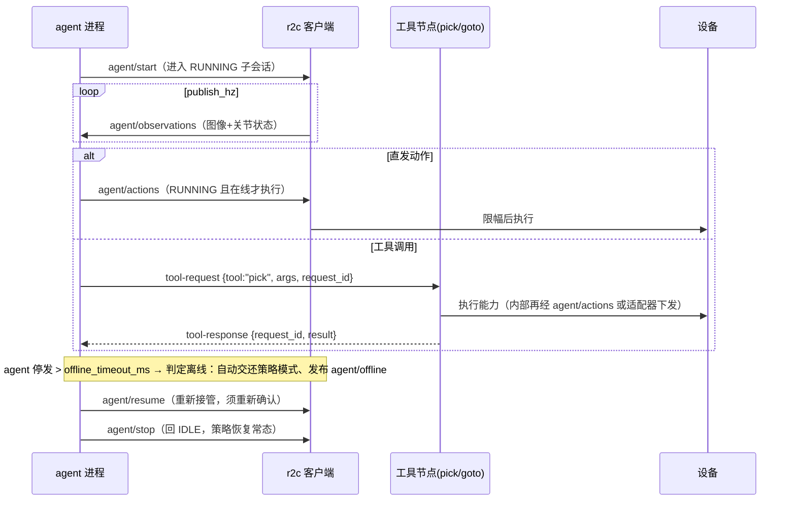

# R2C Agent 接入特性设计（DORA 对齐）

> 本文件负责"r2c 引入 DORA 式 Agent↔机器人节点连接能力"的参考特性设计——让智能体（LLM/VLM agent）作为一等公民接入 r2c 机器人链路；不属于本文件的内容：r2c 与 DORA 的中间件级对比见 `docs/research/r2c-vs-dora-middleware-comparison.md`，flow 数据流编排与零拷贝设计见 `docs/design/r2c-dora-capability-design.md`，遥操与数据采集（会话门控/离线机制/安全基座来源）见 `docs/design/r2c-teleop-data-collection-design.md`。
>
> 状态：**v1.0，待评审**。参考特性设计——只出设计，不含实现。DORA 侧事实来源：[dora-rs/dora](https://github.com/dora-rs/dora)（README `dynamic-agent-tools` 示例）、[Node Hub 指南](https://github.com/dora-rs/dora/blob/main/guide/src/hub/overview.md)、[DORA 1.0 发布说明](https://dora-rs.ai/blog/2026-09-02-dora-1.0/)、社区 [dora-skills](https://github.com/dora-rs/dora-skills)；r2c 侧事实来源：本仓库 `packages/cloudrobo-r2c` 代码。

## 1. 特性概述

**背景**：DORA 1.0 的定位是 **Agentic** Dataflow-Oriented Robotic Architecture——"agent"在其中不是独立进程协议，而是**数据流图中的一类节点**：LLM/VLM/策略 agent 节点与机器人节点（相机、执行器、ROS2/MAVLink bridge）通过 YAML 声明的 `inputs/outputs` 连接，由 daemon 经 Zenoh 搬运 Arrow 消息（同机 SHM 零拷贝/跨机 pub/sub）。配套三件套：**Node Hub**（`hub: dora-yolo@^0.5` 一行接入可复用节点，manifest 携带输入输出类型契约，build/validate 期校验接线）、**动态工具**（官方 `dynamic-agent-tools` 示例：agent 经共享 `tool-request` JSON 话题调用工具节点，工具可运行期动态加入）、**agent 编排技能**（社区 dora-skills 把 dora CLI 包装成 LLM agent 的技能）。r2c 现状：动作通路只有云端策略（`inference/actions`）与遥操（设计中的 `teleop/actions`），没有 agent 的标准接入面。

**核心思路**：
1. **Agent 是一个带契约的节点**：agent 输入 = 机器人观测/状态（复用 `Observations` 与 `state/*` 消息），输出 = 动作（`Actions`）与事件；连接即订阅/发布 zenoh topic，与 DORA 的"数据流边"同构。
2. **三路动作分话题**：新增 `{p}/{d}/agent/actions`，与 `inference/actions`（云端策略）、`teleop/actions`（遥操）分话题互不覆盖——沿用遥操设计已定案的分话题与门控模式。
3. **会话门控 + 离线即停**：复用遥操设计的安全基座——`agent/start|stop` 生命周期、RUNNING 态才执行 agent 动作、超 `offline_timeout_ms` 无动作自动交还策略模式并发 `agent/offline`、重新接管须显式 resume。
4. **工具协议（对齐 dynamic-agent-tools）**：agent 与能力节点（抓取、移动、查询状态等）经共享 `tool-request/tool-response` 话题松耦合通信，JSON 载荷按 `"tool"` 字段过滤；r2c 侧提供把既有能力封装为工具节点的模板，并可选 MCP 映射。
5. **类型契约（对齐 Node Hub manifest）**：agent 声明输入/输出/工具的 schema（r2c proto 名 + 事件 schema），`flow validate`（见 flow 设计）或独立 `agent validate` 在运行前校验接线；不引入包管理器（遗留）。
6. **两种部署形态**：独立进程直连 zenoh（最小接入，不依赖 flow 编排层）；或作为 flow 内 `kind: agent` 节点（复用 flow 设计的节点模型）。

**目标**：
- Agent 接入契约：`agent/observations`（或复用推理观测）、`agent/actions`、`agent/start|stop|resume|offline` 话题与消息定义；
- 执行门控与三路动作仲裁（策略/agent/遥操优先级与超时语义）；
- 工具节点协议（`tool-request/tool-response`）与 r2c 能力工具化模板（含 MCP server 可选实现）；
- agent 节点 schema 校验（接线错误在运行前暴露）；
- 参考实现：mock agent（无 LLM 依赖，回放/VLM 占位）；
- 配置最小化（≤5 项，均有默认值）。

**非目标**（本版本不做）：内置 LLM/VLM 推理运行时（模型 serving 由云端 `cloudrobo-infer` 或第三方承担，r2c 只定义接入面）；Node Hub 式包管理器与公共目录；多 agent 协同；语音链路；动态增删节点（见 flow 设计遗留）。

## 2. 需求分析

### 2.1 需求背景

| 维度 | 现状 | 差距 |
|------|------|------|
| agent 动作通路 | 无；动作来源仅云端策略与（设计中的）遥操 | 需要与策略/遥操分话题的 `agent/actions` 及门控 |
| agent 感知输入 | `inference/observations` 0.5Hz（给云端模型） | agent 需要本地可订阅的观测/状态（高频可选） |
| 能力工具化 | 能力埋在硬件适配器/云服务内部 | 需要工具节点协议把能力暴露给 agent（含 MCP 可选） |
| 接线校验 | 无（话题名靠约定） | 需要 schema 契约与运行前校验（对齐 DORA hub contracts） |
| agent 生命周期/安全 | 无 | 会话门控、离线即停、动作仲裁（复用遥操基座） |

### 2.2 场景分析

**场景 1：VLM 感知 agent 本地闭环（主力）。** agent 进程订阅机器人观测（图像+关节状态），VLM/LLM 生成动作或调用工具，动作经 `agent/actions` 下发执行；策略模式作为兜底持续发布，agent 离线自动交还。

**场景 2：agent + 工具节点。** agent 不直接发关节动作，而是调用工具节点（`pick(obj)`/`goto(x,y)`/`get_status()`）：经 `tool-request` 共享话题下发 JSON 请求，工具节点过滤执行并 `tool-response` 回执；工具节点可在运行期追加（对齐 dynamic-agent-tools）。

**场景 3：MCP 接入外部 agent。** r2c 以 MCP server 形式把机器人能力（订阅观测、下发动作、查询状态）暴露为标准 tools，外部 LLM agent（Claude 等）经 MCP 调用——agent 在 r2c 进程之外（业界主流接法，DORA 生态 dora-skills 同思路）。

**场景 4：flow 内组合。** agent 作为 flow 节点嵌入感知-推理-控制数据流（见 flow 设计），与相机/检测节点经 flow topic 直连。

**能力矩阵**：

| 需求点 | 现状 | 本特性 |
|--------|------|--------|
| agent 动作分话题 | ✗ | ✔ `agent/actions`（与 inference/teleop 分离） |
| agent 感知输入 | 仅 0.5Hz 云端观测 | ✔ `agent/observations`（`publish_hz` 可配，仅本地）或复用现有话题 |
| 会话门控 + 离线自动交还 | 遥操设计已有同款 | ✔ 复用状态机与超时语义，`agent/offline` 事件 |
| 三路动作仲裁 | 无 | ✔ 策略 < agent < 遥操 的优先级 + 超时即停 |
| 工具节点协议 | ✗ | ✔ `tool-request/tool-response` 共享话题 + 能力工具化模板 |
| MCP server | ✗ | ✔ 可选实现：r2c 能力 → MCP tools |
| 接线 schema 校验 | ✗ | ✔ agent manifest + validate（对齐 DORA hub contracts） |
| flow 内 agent 节点 | ✗（flow 为独立设计） | ✔ `kind: agent`（复用 flow 节点模型） |

### 2.3 友商分析（DORA 的 agent↔机器人节点连接方式，本设计对齐对象）

| DORA 机制 | 连接方式 | r2c 启示 |
|-----------|----------|----------|
| 数据流边（核心） | agent = 图中节点：YAML `inputs/outputs` 声明连线，daemon 经 Zenoh 搬 Arrow（同机 SHM/跨机 pub/sub）；机器人硬件经 ROS2 bridge（实验性）/MAVLink bridge/vendor 节点接入 | agent 与机器人的连接即 pub/sub 话题；r2c 已有 zenoh 栈，缺的是**话题契约与门控** |
| Node Hub 类型契约 | 可复用节点（相机/YOLO/LLM/TTS）`hub: name@ver` 一行接入；`dora-node.yml` manifest（apiVersion: 1，stable）携带输入输出契约，`dora build/validate` 运行前校验接线 | r2c 用 proto 名 + agent manifest 实现同等校验，不做包管理器 |
| 动态工具（dynamic-agent-tools 官方示例） | agent 与工具节点经**共享 `tool-request` 话题**通信，JSON 请求按 `"tool"` 字段过滤；工具节点运行期动态加入拓扑 | r2c 工具协议照搬此模式；MCP 作为对外标准映射 |
| record/replay | 录制 agent 会话可回放复现 | 录制沿用 R2CR（flow 设计已含） |
| agent 编排技能（社区 dora-skills） | LLM agent 经 skills 包装 dora CLI 部署/控制 dataflow | 对应本特性场景 3：r2c 能力经 MCP/skills 暴露给外部 agent |

### 2.4 名词解释

| 术语 | 定义 |
|------|------|
| agent 节点 | 订阅机器人观测/状态、生成动作或工具调用的智能体进程（LLM/VLM/规则皆可；本特性只定义接入面） |
| agent/actions | agent 动作话题；与 `inference/actions`、`teleop/actions` 分话题；仅 RUNNING 且 agent 在线时被执行 |
| agent/observations | 面向 agent 的观测话题：按 `publish_hz` 本地发布，格式与 `inference/observations` 一致（同 `Observations` 消息） |
| 工具节点 | 把机器人能力封装为可调用单元的节点：订阅 `tool-request`、按 `"tool"` 字段过滤、执行后 `tool-response` 回执 |
| tool-request / tool-response | agent↔工具节点的共享话题对；JSON 载荷 `{tool, args, request_id, timestamp_us}`；对齐 DORA dynamic-agent-tools 语义 |
| MCP server | 可选组件：把 r2c 能力（订阅观测/下发动作/工具调用）映射为 Model Context Protocol tools，供外部 LLM agent 调用 |
| agent manifest | agent 的 schema 声明文件：输入/输出消息 proto 名、工具清单、频率与 QoS 需求；validate 依据 |
| 三路仲裁 | 客户端对 `inference/actions`（策略）、`agent/actions`（智能体）、`teleop/actions`（遥操）的执行来源判定：会话状态 + 在线/离线 + 优先级 |
| 会话门控 | 复用遥操设计状态机：IDLE/RUNNING/PAUSED/FINISHING；仅 RUNNING 且对应来源在线时执行其动作 |

## 3. 功能方案

### 3.1 功能约束与依赖

**约束**：
- C1 agent 接入为**可选增量**：不配置 agent 即原有行为；云端 `inference/*` 协议零改动；
- C2 动作**分话题**：`agent/actions` 与 `inference/actions`、`teleop/actions` 互不覆盖，各自独立录制与鉴权（沿用遥操设计 C1）；
- C3 agent 的动作执行**复用现有执行路径**（`sync_client` 动作执行、限幅/安全检查、chunk 对齐），不另起执行栈；
- C4 会话门控/离线机制**复用遥操设计状态机**（同一状态机增加 agent 在线/离线子态），不新造安全语义；
- C5 消息 schema 唯一源 = r2c proto；工具协议 JSON 仅限 `tool-request/tool-response` 两话题（对齐 DORA 示例的轻量做法）；
- C6 agent manifest 声明契约，validate 在运行前校验；
- C7 配置最小化（≤5 项，均有默认值）。

**依赖**：
- `client/session.py`（topic 命名、`subscribe_actions`/`publish_observations`）与 `transport/zenoh.py`（QoS、TLS）；
- `sync_client.py` 动作执行路径与 `SafetyMonitor` 语义（限幅/限速兜底）；
- 遥操设计（`docs/design/r2c-teleop-data-collection-design.md`）的状态机/离线机制/R2CR 录制；
- flow 设计（`docs/design/r2c-dora-capability-design.md`）的 FlowNode 模型与 `kind:` 机制（场景 4）；
- 可选：`mcp` Python SDK（MCP server 实现，optional extra）。

### 3.2 整体方案设计

**技术选型**：

| 选型点 | 决策 | 依据 |
|--------|------|------|
| agent 连接形态 | **zenoh pub/sub 话题契约**（独立进程直连，或 flow 内 `kind: agent` 节点） | 与 DORA"数据流边"同构；最小接入不依赖编排层 |
| 动作通路 | 新增 `agent/actions`，客户端三路仲裁执行 | 沿用遥操分话题定案；策略持续发布作兜底 |
| agent 感知输入 | 新增 `agent/observations`（`publish_hz` 默认 10Hz，仅本地）+ 允许直接订阅现有 `inference/observations`/`state/*` | 高频本地反馈与低频上云解耦（对齐遥操 observations 模式） |
| 工具协议 | 共享 `tool-request/tool-response` JSON 话题 + `"tool"` 字段过滤 | 照搬 DORA dynamic-agent-tools；MCP 作为对外可选标准 |
| 契约校验 | agent manifest（YAML）+ `agent validate` / `flow validate` | 对齐 DORA hub typed contracts；不做包管理器 |
| 生命周期 | `agent/start\|stop\|resume` + `agent/offline`；复用遥操状态机 | 安全语义不新造（C4） |
| MCP | 可选 optional extra（`hw-cloudrobo-r2c[agent]`） | 场景 3 主流接法；不强制依赖 |

**整体架构**：

```text
                        ┌────────────────────────── 客户端（r2c client 进程） ─────────────────────────┐
  云端策略 ──► inference/actions ──►│                                                              │
  agent进程 ──► agent/actions ─────►│ 三路仲裁（会话状态 + 在线/离线 + 优先级：策略 < agent < 遥操） │──► 限幅/安全 ──► 设备
  遥操台   ──► teleop/actions ─────►│                                                              │
                        │  ▲                                                        │
                        │  │ agent/observations（publish_hz，本地）                   │
                        └──┼────────────────────────────────────────────────────────┘
                           │
  agent 进程内部：  观测订阅 → VLM/LLM 规划 → 动作输出 / 工具调用
                           │                    │
             tool-request ─┘                    └─► 工具节点A（pick）  工具节点B（goto）  …（可运行期追加）
             tool-response ◄─────────────────────────┘
  可选：MCP server（r2c 能力 → MCP tools）◄── 外部 LLM agent（Claude 等）
```

**关键时序（agent 会话 + 工具调用）**：



### 3.3 详细功能设计

> 3.3 按功能拆分：3.3.1 agent 话题与消息契约、3.3.2 三路仲裁与门控、3.3.3 工具节点协议、3.3.4 MCP server（可选）、3.3.5 agent manifest 与校验、3.3.6 接口设计、3.3.7 数据结构设计。

#### 3.3.1 agent 话题与消息契约

| 话题 | 方向 | 频率 | 消息 | 说明 |
|------|------|------|------|------|
| `{p}/{d}/agent/observations` | 客户端 → agent | `publish_hz`（默认 10Hz） | `Observations`（与 inference 同格式） | **新增**；仅本地流转；不配 agent 则不发布 |
| `{p}/{d}/agent/actions` | agent → 客户端 | agent 驱动（建议 ≤20Hz） | `Actions`（沿用 chunk 语义） | **新增**；仅 RUNNING 且 agent 在线被执行 |
| `{p}/{d}/agent/start\|stop\|resume` | 控制端 → 客户端 | 事件 | `AgentControl`（复用遥操 `TeleopControl` 骨架） | **新增**；会话生命周期 |
| `{p}/{d}/agent/offline` | 客户端 → agent/控制端 | 事件 | `AgentOffline{at, last_action_ts}` | **新增**；离线自动交还提示 |
| `{p}/{d}/agent/tool-request` / `tool-response` | agent ↔ 工具节点 | 调用驱动 | JSON（§3.3.3） | **新增**；共享话题，按 `"tool"` 过滤 |
| `{p}/{d}/inference/*`、`{p}/{d}/state/*`、`{p}/{d}/teleop/*` | 不变 | — | — | 现有协议零改动（C1） |

**AgentControl proto**（复用遥操 `TeleopControl` 骨架，只增不改）：

```protobuf
message AgentControl {
  string session_id = 1;
  string source = 2;            // local / cloud / orchestrator
  int64  timestamp_us = 3;
  oneof payload {
    Start  start  = 10;         // mode: vlm_closed_loop | tool_only
    Stop   stop   = 11;         // 回 IDLE，策略恢复
    Resume resume = 12;         // 离线自动交还后重新接管
  }
}
```

**QoS**：`agent/actions` BEST_EFFORT + DROP（可丢旧帧，对齐遥操）；生命周期/事件 RELIABLE；`agent/observations` BEST_EFFORT。分层沿用 `default_zenoh_perf.yaml` 机制。

#### 3.3.2 三路仲裁与门控（客户端执行侧）

- **状态机**：在遥操设计状态机上增加 agent 在线/离线子态——`agent_online`/`agent_offline` 与 `teleop_online`/`teleop_offline` 平行；`start` 声明接管来源（agent 或 teleop），同源子态内才执行对应动作。
- **仲裁规则**（RUNNING 内）：
  1. 遥操在线 → 执行 `teleop/actions`（最高优先级，人上）；
  2. 否则 agent 在线 → 执行 `agent/actions`；
  3. 否则执行 `inference/actions`（策略常态）；
  4. 各来源离线判定独立：超 `offline_timeout_ms`（默认 300ms）无动作 → 该来源离线，自动交还策略模式、发 `offline` 事件；重新接管须显式 resume；
  5. 所有动作执行前经既有限幅/安全检查（C3）；策略在会话期间持续发布作为兜底。
- **安全兜底**：任一来源的动作都过 `SafetyMonitor` 语义（工作空间 clamp、速度/加速度限幅）；agent 无"急停"特权——急停走遥操 `pause`（RELIABLE）或硬件通道。
- **客户端不判断 agent 的"智能"**：客户端只按会话状态+新鲜度执行，agent 内部是 VLM 闭环还是工具调用透传（对齐遥操设计"客户端不判断接管权限"的分层）。

#### 3.3.3 工具节点协议（对齐 dynamic-agent-tools）

- **共享话题**：`{p}/{d}/agent/tool-request`（agent → 全部工具节点）与 `tool-response`（工具节点 → agent）；JSON 载荷：

```json
// tool-request
{"tool": "pick", "args": {"object": "cup", "place": [0.4, 0.1, 0.2]},
 "request_id": "r-17", "timestamp_us": 1773020000000000, "timeout_ms": 8000}
// tool-response
{"request_id": "r-17", "ok": true, "result": {"grasped": true}, "elapsed_ms": 3120}
```

- **过滤规则**：每个工具节点声明 `tools: [pick, goto]`（manifest + env 注入），仅处理匹配 `"tool"` 字段的请求，其余忽略（DORA 示例同款，天然支持运行期新增工具节点——新节点订阅即接入）。
- **长耗时与取消**：`timeout_ms` 内未回执 agent 侧判失败可重试；取消经 `{"tool": "__cancel", "args": {"request_id": ...}}`（保留字段，工具节点自行实现）。
- **能力工具化模板**：`cloudrobo r2c agent tool --from <adapter>`——把硬件适配器既有能力（move/pick/get_status 等命令）生成为工具节点骨架（复用 `robots/commands/` 命令层），工具内部经既有下发路径驱动设备；云端能力（查询资产/任务）走 cloudrobo-* SDK 封装为工具。
- **录制**：两话题为 JSON 帧，R2CR 原样落盘（flow/遥操录制设施复用），回放可复现 agent 会话。

#### 3.3.4 MCP server（可选实现）

- 形态：`cloudrobo r2c agent mcp [--transport stdio|sse]`——把 r2c 能力映射为 MCP tools：`subscribe_observations`（返回快照/流式句柄）、`send_actions`（受限：经与 `agent/actions` 相同的门控与限幅）、`call_tool`（转发 §3.3.3）、`get_status`；
- 安全：MCP 入口等价于一个 agent 来源——需 `agent/start` 会话才可 `send_actions`，同样受离线即停约束；观测读取只读无门控；
- 定位：场景 3 的对外标准接法（外部 agent 无需理解 zenoh/proto）；与 DORA 生态 dora-skills"把 CLI 包装成 agent 技能"同思路，但以 MCP 标准协议承载。

#### 3.3.5 agent manifest 与校验

```yaml
# agent.yml —— agent 节点契约声明（对齐 DORA dora-node.yml 的 typed contracts 思路）
name: pick-agent
version: 0.1.0
runtime: process            # process | flow_node（复用 flow 设计 FlowNode）
inputs:
  observations: Observations      # proto 消息名；频率需求
  states: [joint_states]          # 可选：state/* 子话题
outputs:
  actions: Actions
tools: [pick, goto]               # 依赖的工具能力（validate 时核对存在性）
qos: {actions_hz: 10, publish_hz: 10}
safety: {max_cartesian_speed: 0.25, workspace: config/safety.yaml}
```

- `cloudrobo r2c agent validate [agent.yml]`：核对 proto 消息名存在、工具声明与已注册工具节点匹配、QoS/频率合法、flow 模式下输入连线正确（复用 flow validate）；
- 不做包管理器/公共目录（对齐 DORA hub 的"类型契约"价值而不引入其分发面，遗留 §9）。

#### 3.3.6 接口设计

**配置（`client_config.yaml` 增量，均有默认值）**：

```yaml
agent:
  observations_topic: "{project_id}/{device_id}/agent/observations"
  actions_topic: "{project_id}/{device_id}/agent/actions"
  publish_hz: 10              # agent/observations 发布频率
  offline_timeout_ms: 300     # agent 动作超时 → 离线自动交还
  arbitration: ["teleop", "agent", "inference"]   # 仲裁优先级（默认固定）
```

**CLI（`cloudrobo r2c agent` 命令组）**：

| 命令 | 说明 |
|------|------|
| `agent validate [agent.yml]` | manifest/契约校验 |
| `agent tool --from <adapter>` | 生成能力工具节点骨架 |
| `agent mcp [--transport stdio\|sse]` | 启动 MCP server（optional extra） |
| `agent mock` | mock agent（回放观测、循环输出动作/工具调用，无 LLM 依赖） |

**操作台/编排职责**：`agent/start` 由操作台或上层编排发布（权限 Zenoh ACL，沿用遥操约定：控制类话题单独凭证）。

#### 3.3.7 数据结构设计

- agent 会话录制沿用 R2CR：`recordings/agent_<name>/agent_actions|observations|tool_request|tool_response/*.r2cr + meta.json`（含 manifest 哈希、会话记录）；
- `meta.json` 增加来源标注（`source: agent`）与仲裁区间（何时由 agent 驱动），供回放与数据集导出区分来源（与遥操设计的接管分段语义一致）。

## 4. 可靠性与异常设计

| 异常 | 行为 |
|------|------|
| agent 离线（RUNNING，>300ms 无动作/心跳） | 判定离线 → 自动交还策略模式、发布 `agent/offline`、录制继续；重新接管须显式 resume |
| agent 与策略同时发布 | 仲裁按 §3.3.2 优先级；非当前来源动作不执行但计数 |
| 遥操与 agent 同时在线 | 遥操优先（人上）；agent 动作暂不执行，`agent/observations` 继续发布 |
| 工具节点崩溃 | agent 侧 `request_id` 超时判失败；工具节点按 flow/supervisor 策略重启；不阻塞动作直发路径 |
| 工具调用超时/取消 | `timeout_ms` 判失败可重试；`__cancel` 保留字段 |
| MCP server 崩溃 | 仅影响外部 agent 接入；机器人端无状态，重启即可 |
| 观测发布失败 | 仅影响 agent 输入新鲜度；agent 侧应自行实现 stale 判定 |
| 非法生命周期事件 | 状态机合法性检查忽略并告警（对齐遥操设计） |

## 5. 安全设计

- 谁可发布 `agent/actions`、`agent/start` 由 **Zenoh ACL** 控制；agent 凭证与策略/遥操凭证分离（沿用遥操设计约定）；
- 会话门控 + 离线即停：非 RUNNING 或 agent 离线时 agent 动作一律不执行；
- 所有动作过既有限幅/限速/工作空间检查（C3）；agent 无急停特权；
- MCP `send_actions` 与 `agent/actions` 同门控同限幅；观测读取只读；
- 工具协议 JSON 不承载凭证；`tool-request` 校验 `timestamp_us` 防重放（超窗丢弃）；
- TLS/凭证沿用现有 bundle；录制内容不含凭证。

## 6. 性能规格

- `agent/observations` 默认 10Hz、仅本地流转：小数据 KB/s 级（图像大字段建议走 flow 设计的 SHM 零拷贝/旁路，或仅传低频关键帧）；
- `agent/actions` ≤20Hz：每帧数十 KB，约百 KB/s 级；
- 工具调用 RTT 由工具实现决定；协议开销（JSON 单跳 pub/sub）可忽略；
- 客户端仲裁开销：时间戳比较 + 计数，可忽略；
- 端到端时延目标与遥操一致：动作链路 ≤50ms 量级（局域网），由 zenoh peer 直连保障。

## 7. 兼容性与升级

- 不配 `agent:` 段 = 原有行为；`inference/*`、`teleop/*`、云端协议零改动（C1）；
- 状态机在遥操设计之上**只增不改**：AgentControl 复用 TeleopControl 骨架（只增字段/事件）；
- R2CR v1 兼容；meta.json 增量字段向后兼容（旧回放忽略未知字段）；
- MCP 为 optional extra，不装不影响其他功能。

## 8. 测试与验收

| 层级 | 内容 |
|------|------|
| 单测 | 三路仲裁规则（优先级/超时/交还/resume）、AgentControl 状态机合法转移、工具请求过滤与 request_id 匹配、manifest 校验（proto 名/工具存在性/QoS）、时间戳防重放 |
| 集成（agent 闭环） | mock agent：start→observations 订阅→actions 下发被执行→stop 后策略恢复；离线自动交还与 `agent/offline`；resume 重新接管 |
| 集成（三路仲裁） | 遥操抢占 agent、agent 抢占策略、各来源独立离线判定、动作均过限幅 |
| 集成（工具协议） | 工具节点按 `"tool"` 过滤、request_id 回执匹配、超时判失败、运行期新增工具节点即接入、录制回放复现会话 |
| 集成（MCP） | MCP server 经 stdio 被外部客户端调用：get_status/subscribe_observations 只读可用；send_actions 受会话门控与限幅 |
| 验收标准 | 不配 agent 零行为变化；三路动作分话题且仲裁正确；离线自动交还 + 显式 resume；工具节点动态接入；manifest 校验拦截接线错误；云端协议零改动 |

## 9. 遗留问题与后续规划

1. agent 内置运行时形态（VLM 闭环参考实现选型：云端 infer vs 本地推理）——本特性只定接入面；
2. Node Hub 式 agent/工具分发（包管理器 + 公共目录）——等 agent 数量与复用诉求明确后评估；
3. 动态输出（对齐 DORA dynamic outputs 的 agent 运行期新话题声明）——依赖 flow 动态节点（遗留）；
4. agent 会话数据 → LeRobot 数据集导出的来源标注细则（与遥操 §3.3.2 转换管线合并设计）；
5. MCP 传输的远程安全（sse 模式的鉴权与 TLS 终结）；
6. 多 agent 协同与仲裁扩展（>3 来源时的优先级策略）。

## 10. 决策点汇总

| # | 决策点 | 状态 / 建议 |
|---|--------|-------------|
| U1 | agent 连接形态 | **已定案（建议）**：zenoh 话题契约（独立进程或 flow 内 `kind: agent`），与 DORA 数据流边同构 |
| U2 | agent 动作话题 | **已定案（建议）**：独立 `agent/actions`，与 inference/teleop 分话题 |
| U3 | agent 观测话题 | 建议：新增 `agent/observations`（默认 10Hz 本地）+ 允许复用现有话题；待评审 |
| U4 | 三路仲裁优先级 | 建议：遥操 > agent > 策略，超时即停 + 显式 resume；待评审 |
| U5 | 工具协议 | **已定案（建议）**：共享 `tool-request/tool-response` JSON 话题（照搬 DORA dynamic-agent-tools） |
| U6 | MCP 接入 | 建议：optional extra 实现 MCP server；待评审 |
| U7 | 契约校验 | **已定案（建议）**：agent manifest + validate；不做包管理器 |
| U8 | 生命周期复用 | **已定案**：复用遥操状态机（只增不改），AgentControl 骨架同 TeleopControl |
| U9 | 包归属 | 建议：协议契约与 MCP/工具模板放 `hw-cloudrobo-agent` 新包（对齐遥操设计 §11 分包思路），客户端门控留在 r2c；待评审 |
| U10 | 分阶段 | 建议：一期话题契约+门控+mock agent（无 LLM 依赖即可联调），二期工具协议+MCP |

## 11. 方案对比：r2c agent 接入的三种路线

**方案**：

| 维度 | A. MCP server 优先（agent 在外部） | B. r2c 内置 agent 节点（in-process LLM 闭环） | C. 话题契约 + 工具协议为基座（本设计），MCP/内置模板为其上实现 |
|------|-------------------------------------|---------------------------------------------|----------------------------------------------------------------|
| agent 归属 | 外部 LLM agent（Claude/自研框架）经 MCP 调 r2c | LLM 运行时跑在 r2c 侧进程 | 任意：外部经 MCP、内置模板、或纯规则 agent |
| 与 DORA 对齐度 | 对齐 dora-skills"agent 编排面" | 对齐 DORA 数据流内 agent 节点 | 同时覆盖两者（数据流边 + 编排面） |
| 耦合与风险 | 最低（r2c 只暴露标准协议）；MCP 语义受限（无实时流） | LLM 依赖/时延进机器人关键路径；发版耦合 | 中（新增话题面，但执行/安全路径零改动） |
| 实时性 | MCP 往返不适合高频闭环，适合慢速任务编排 | 可做高频闭环 | 直发 `agent/actions` 支持高频闭环 |
| 安全审计面 | MCP 入口单一，易审计 | agent 进程即动作源，需完整门控 | 门控集中客户端三路仲裁（复用遥操基座） |

**建议（C，分两期）**：先落"话题契约 + 三路仲裁 + 工具协议 + mock agent"（一期，无 LLM 依赖即可全链路联调与验收）；再按场景补 MCP server（外部 agent 接入）与 VLM 闭环参考实现（二期）。选 A 还是 B 不必二选一——C 的基座让两者都成为薄实现；若团队只认可一种，优先 A（外部 agent + MCP，实时闭环需求出现后再补 B）。

**待评审决策**：接受 C 路线与两期划分；`hw-cloudrobo-agent` 新包命名与时点（对齐遥操设计 U11 的分包节奏，避免双包同时立项的迁移冲突）。
