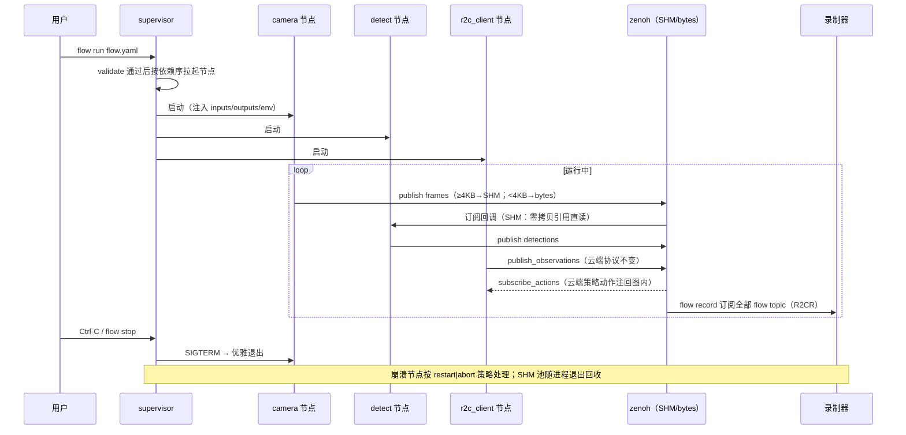

# R2C 数据流编排与零拷贝特性设计（DORA 对齐）

> 本文件负责"r2c 引入 DORA 式能力（本机数据流编排、零拷贝传输、全图录制回放）"的参考特性设计；不属于本文件的内容：r2c 与 DORA 的中间件级对比与选型见 [docs/research/r2c-vs-dora-middleware-comparison.md](https://github.com/vincentguiling/cloudrobo-sdk-client/blob/agent/compare-r2c-dora-6211d72130da/docs/research/r2c-vs-dora-middleware-comparison.md)，遥操与数据采集特性设计见 `docs/design/r2c-teleop-data-collection-design.md`，多设备设计见 `docs/design/r2c-multi-device-tree-design.md`，r2c 自身架构见 `packages/cloudrobo-r2c/docs/index.md`。
>
> 状态：**v1.0，待评审**。参考特性设计——只出设计，不含实现。DORA 侧事实来源：[dora-rs/dora](https://github.com/dora-rs/dora)、[DORA 1.0 发布说明](https://dora-rs.ai/blog/2026-09-02-dora-1.0/)、[Zenoh SHM 手册](https://zenoh.io/docs/manual/shmem/)、zenoh-python issue [#488](https://github.com/eclipse-zenoh/zenoh-python/issues/488)；r2c 侧事实来源：本仓库 `packages/cloudrobo-r2c` 代码。

## 1. 特性概述

**背景**：对比结论（见对比文档）——r2c 是"机器人↔云"数据通道 SDK，DORA 是数据流应用框架；r2c 相对 DORA 缺三块能力：**本机多节点 pipeline 编排**、**本机零拷贝传输**、**全图录制/变速回放**。r2c 现状：单客户端进程固定拓扑（`cloudroboclient.py` 拉起 SyncRobotClient），payload 全量走 Protobuf 序列化 + zenoh bytes（`client/session.py` `publish_observations` 内 `SerializeToString()` → `transport/zenoh.py` `ZenohTransport.publish(topic, payload: bytes)`），录制只有整机观测 `--record`（pkl）。本特性把这三块 DORA 式能力以**可选增量**引入 r2c，复用既有传输栈与消息 schema。

**核心思路**：
1. **可选数据流编排层（flow）**：flow YAML 声明节点与连线（inputs/outputs），节点 = 独立 Python 进程；运行时是**单机轻量 supervisor**（对齐 DORA `dora run` 本地模式），不引入 coordinator/daemon 双进程架构。
2. **节点 API（FlowNode）**：`for event in node` 事件循环，输入输出即 zenoh topic；复用 `client/session.py` 的 topic 命名与 `transport/zenoh.py` 的 pub/sub，消息默认仍为 r2c proto。
3. **r2c 能力节点化**：`R2CClient`（观测上报/动作下发）、硬件适配器、推理 adapter、录制器均可实例化为节点；上云链路 = flow 中的一个 `r2c_client` 节点。
4. **本机零拷贝（方案 A）**：payload ≥ 阈值（默认 4KB，对齐 DORA 的 4KiB 页成本交叉点）走 Zenoh SHM（peer 同机直连）；小消息维持现有 bytes 路径；跨机/SHM 不可用自动回退。
5. **大字段旁路（方案 B，可选二期）**：本地场景图像等大字段经 SHM 环形缓冲传原始块，protobuf 仅传元数据句柄；云端路径不变。
6. **全图录制/回放**：`flow record` 订阅全部输出 topic 落 R2CR（复用 `common/utils/recorder.py`）；`flow replay` 变速回放并可替换数据源节点（对齐 DORA record/replay 语义）。
7. **工具链**：`cloudrobo r2c flow validate|graph|run|record|replay|ps|logs`，对齐 DORA CLI 能力面。

**目标**：
- flow YAML schema + `flow validate`（结构/连线/类型校验）+ `flow graph`（拓扑输出）；
- 单机 supervisor 拉起/监控/回收节点进程；
- FlowNode Python API 与 `r2c_client`/`camera`/`policy`/`recorder` 参考节点；
- 本机零拷贝：SHM 发布/订阅路径 + 阈值分流 + 自动回退；
- 全图录制（R2CR）与变速回放、数据源节点替换；
- 配置最小化（flow 文件 + ≤6 项新配置，均有默认值）。

**非目标**（本版本不做）：Rust/C++ 节点 API（DORA 为多语言，r2c 本版仅 Python，见 §10 U10）；跨机编排/集群（DORA `deploy: machine:`/`dora cluster`，r2c 本机单机即可，跨机场景仍走云链路）；动态增删节点（`dora node add/remove`，风险大，遗留）；dora-rerun 式可视化集成（遗留 §9）；改动 `inference/*` 云端协议与 13+ 硬件适配器。

## 2. 需求分析

### 2.1 需求背景

| 维度 | 现状 | 差距 |
|------|------|------|
| 本机多节点编排 | 无；单 client 进程固定拓扑 | 需 flow YAML + supervisor 拉起/监控节点进程 |
| 本机零拷贝 | 无；序列化后 bytes 过 zenoh（含收端 `_sample_payload_to_bytes` 再拷贝一次） | 需 ≥阈值 SHM 路径 + 收端免拷贝 |
| 大字段免序列化 | 无；图像编码 + 全量 Protobuf | 可选旁路：原始块 + 元数据句柄 |
| 全图录制 | `--record` 整机观测 pkl（`ObservationRecorder`） | 需按 topic 全图录制（R2CR） |
| 变速回放/节点替换 | playback 整机帧回放 | 需 flow 级回放、替换数据源节点做离线回归 |
| 拓扑校验/图可视化 | 无 | `flow validate` / `flow graph` |
| 动态节点管理 | 无 | 本版不做（遗留） |

### 2.2 场景分析

**场景 1：本机感知-推理-控制 pipeline（主力）。** 相机节点 → 检测/融合节点 → 策略节点 → `r2c_client` 节点：策略动作经现有 `publish_actions`/设备执行路径驱动机器人；观测经 `subscribe_observations` 进图。全流程在本机 flow 内闭环，也可只取其中一段。

**场景 2：高频采集与离线回归。** `flow record` 全图落 R2CR；回归时 `flow replay --speed 0.5` 回放录制数据并**替换相机节点**，检测/策略节点在真实代码路径上重跑，比对输出。

**场景 3：性能敏感图像链路。** 本机 camera→检测的大帧（序列化后 ≥4KB）走 SHM 零拷贝；心跳/控制等小消息照旧 bytes。目标：消除"序列化→socket→收端再拷贝"的开销，且不引入跨机行为变化。

**场景 4：上云组合。** flow 内 `r2c_client` 节点把图中观测按现有 topic 语义上报云端、把云端策略动作注回图内——DORA 管本机编排，r2c 管机器人-云通道（对比文档 §4 的组合用法）。

**能力矩阵**：

| 需求点 | 现状 | 本特性 |
|--------|------|--------|
| flow YAML 声明节点图 | ✗ | ✔ `flow` 文件 + `flow validate` |
| 单机节点编排（拉起/健康/回收） | ✗ | ✔ supervisor（对齐 `dora run`） |
| 节点间通信复用 zenoh | 部分（单 client 内部） | ✔ flow topic = zenoh key |
| ≥4KB 本机零拷贝 | ✗ | ✔ Zenoh SHM + 阈值分流 + 回退 |
| 收端免拷贝 | ✗（`_sample_payload_to_bytes` 拷贝） | ✔ memoryview 直传解析 |
| 大字段旁路（免编码/免序列化） | ✗ | ✔ 二期可选（§3.3.3 B 案） |
| 全图录制 | ✗（仅整机 pkl） | ✔ R2CR 按 topic |
| 变速回放 + 节点替换 | ✗ | ✔ `flow replay` |
| 拓扑图输出 | ✗ | ✔ `flow graph`（文本/mermaid） |
| r2c 能力节点化（上云节点） | ✗ | ✔ `r2c_client` 节点 |

### 2.3 友商分析

| 友商 / 业界实现 | 关键机制 | 启示 |
|----------------|----------|------|
| DORA | YAML 数据流图、`dora run` 本地模式免 coordinator、SHM ≥4KB 零拷贝 + `DORA_ZERO_COPY_THRESHOLD`、record/replay 节点替换、validate/graph | 本特性的对齐对象；阈值与回退语义直接借鉴 |
| ROS 2 launch | 编排成熟但生态重（DDS/rmw），Python 节点开销大 | 编排层保持薄；不引入新传输栈 |
| LeRobot | record/replay 很薄、数据集格式为重 | 录制沿用 R2CR，格式转换已有专门设计（遥操文档 §3.3.2） |
| Viam | 失联即停、按资源×方法采集 | 节点崩溃策略默认安全侧 |

### 2.4 名词解释

| 术语 | 定义 |
|------|------|
| flow | 数据流定义文件（YAML）：节点清单、每节点 path/inputs/outputs、可选环境与资源配置 |
| FlowNode | r2c 节点基类/装饰器：`for event in node` 事件循环，`node.send_output(id, payload)` 发输出；entry-point 注册 |
| supervisor | flow 运行时：拉起节点进程、健康监控、崩溃策略、优雅退出（单机，无 coordinator/daemon） |
| SHM 池 | zenoh shared-memory feature 的进程内 ShmProvider 缓冲池（默认 8MB/节点），≥阈值 payload 从池内分配发布 |
| 零拷贝阈值 | payload 尺寸分流点（默认 4096 字节）：≥阈值走 SHM，<阈值走现有 bytes 路径；依据：SHM 按整页（4KiB）工作，小消息建页成本高于拷贝 |
| 旁路通道 | 大字段（图像等）的本地原始块传输：SHM 环形缓冲承载像素，protobuf 只传元数据句柄（shape/dtype/frame_id/槽位） |
| 回放替换 | `flow replay` 时禁用指定数据源节点、由回放器按录制时序注入同 topic 数据，下游节点代码不变 |
| 上云节点 | 封装 `R2CClient` 的 flow 节点：图中观测 → `publish_observations`，`subscribe_actions` → 图内动作输入 |
| R2CR | r2c 现有录制格式 v1（`recorder.py`/`safe_serialization.py`），帧 = 消息字节 + 时间戳 |

## 3. 功能方案

### 3.1 功能约束与依赖

**约束**：
- C1 编排层为**可选增量**：不配置 flow 即原有行为；不修改 `R2CClient`/`SyncRobotClient` 既有公开路径；
- C2 **单一传输实现**：flow 节点间通信复用 `transport/zenoh.py`（不另起 IPC 栈）；SHM 只是 zenoh peer 同机直连下的一种传输形态，不是新协议；
- C3 零拷贝**仅承诺同机 peer 场景**；跨机/SHM 不可用自动回退现有 bytes 路径，行为等价；
- C4 消息 schema 唯一源 = r2c proto；旁路通道只承载"原始字节块 + 元数据句柄"，不新增业务 schema；
- C5 录制沿用 R2CR v1，回放产物与 playback 兼容；
- C6 配置最小化：flow 文件 + `flow:` 段 ≤6 项（均有默认值）；
- C7 本版仅 Python 节点 API。

**依赖**：
- `transport/zenoh.py`（pub/sub、QoS、`_build_zenoh_config`/`_open_session`）与 `client/session.py`（topic 命名、发布/订阅方法）；
- `common/models/wrappers/`（Observations/Actions 序列化）与 `common/protos/`（11 个 .proto）；
- `common/utils/recorder.py` + `safe_serialization.py`（R2CR）、`robots/playback_adapter.py`（回放语义参照）；
- `core/transformers.py` 与 `r2c_sdk.transformers` entry-point 机制（FlowNode 注册复用）；
- eclipse-zenoh 1.9.0（SHM 需源码编译开启 `shared-memory` feature，见 §3.3.3 前提）。

### 3.2 整体方案设计

**技术选型**：

| 选型点 | 决策 | 依据 |
|--------|------|------|
| 编排运行时 | **单机轻量 supervisor**（asyncio，`flow run` 前台 / `--detach` 后台） | 对齐 DORA `dora run` 本地模式；r2c 无跨机编排诉求，不引入 coordinator/daemon 双进程 |
| 节点间传输 | **复用 zenoh pub/sub**（peer 同机直连） | 单一传输栈（C2）；QoS/重连/TLS 全部沿用 |
| 序列化 | 默认 **Protobuf**；大字段**可选旁路**（二期） | 兼容云端 schema（C4）；旁路仅本地生效 |
| 零拷贝 | ≥4KB 走 Zenoh SHM，阈值可配；收端 memoryview 免拷贝 | DORA 1.0 同款机制与阈值依据（4KiB 页成本交叉） |
| 录制 | **R2CR v1 按 topic**，`meta.json` 记 flow 快照 | 复用 recorder.py（C5） |
| 回放 | **变速 + 节点替换**（源节点禁用，回放器注入） | 对齐 DORA record/replay 语义 |
| 校验/可视化 | `flow validate`（结构/连线/类型）+ `flow graph`（mermaid/文本） | 对齐 `dora validate --strict-types` / `dora graph` |
| 动态节点 | 本版不做 | `dora node add/remove` 为 1.x 新能力，与 r2c 安全模型冲突待评估 |

**整体架构**：

```text
flow.yaml ──► flow validate ──► flow run
                                  │
                    supervisor（单机 asyncio）
                    ├── 拉起 node 进程（python path）
                    ├── 健康/崩溃策略（restart|abort）
                    └── flow ps / flow logs
                                  │
   node A (camera) ──► {p}/{d}/flow/camera/frames ──► node B (detect)
   node B ──► {p}/{d}/flow/detect/detections ──► node C (policy) ──► ...
   node C ──► {p}/{d}/flow/policy/actions ──► node D (r2c_client)
   node D ──► publish_observations / subscribe_actions ──► 云端（现有协议不变）

   零拷贝：payload ≥ 4KB 且同机 peer → Zenoh SHM（发送端写一次，接收端直读）
   录制：  flow record ──► 订阅全部 flow topic ──► recordings/*.r2cr + meta.json
   回放：  flow replay --speed 0.5 --replace camera ──► 回放器注入 camera/frames
```

**关键时序**：



### 3.3 详细功能设计

> 3.3 按功能拆分：3.3.1 Flow YAML 与节点模型、3.3.2 编排运行时、3.3.3 本机零拷贝、3.3.4 全图录制与回放、3.3.5 工具链与 CLI、3.3.6 接口设计、3.3.7 数据结构设计。

#### 3.3.1 Flow YAML 与节点模型

**flow 文件示例**：

```yaml
# flow.yaml —— 单机数据流
name: camera-detect-policy
nodes:
  - id: camera
    path: my_app/camera_node.py          # 可执行脚本或模块路径
    outputs: [frames]                     # → {p}/{d}/flow/camera/frames
    env: {CAMERA_ID: front}
  - id: detect
    path: my_app/detect_node.py
    inputs:
      frames: camera/frames              # <node-id>/<output>，长格式可带 queue 配置
    outputs: [detections]
  - id: policy
    path: my_app/policy_node.py
    inputs:
      detections: {from: detect/detections, queue_size: 4, queue_policy: drop_oldest}
    outputs: [actions]
  - id: r2c_client                        # r2c 内置节点：封装 R2CClient
    kind: r2c_client                      # 内置 kind 免 path
    inputs:
      actions: policy/actions
      observations: camera/frames        # 转发观测上报云端（现有 topic 语义）
    config: {client_config: config/client_config.yaml}
```

**字段**：

| 字段 | 必填 | 说明 |
|------|------|------|
| `name` | ✔ | flow 名称；用于录制目录与日志前缀 |
| `nodes[].id` | ✔ | 节点唯一 id；进入 topic 命名 |
| `nodes[].path` | 节点 ✔ | 可执行脚本/模块；`kind` 内置节点可省 |
| `nodes[].kind` | 否 | 内置节点类型：`r2c_client` / `recorder`（首批） |
| `nodes[].inputs` | 否 | `{input_name: node/output}` 或长格式（`from`+`queue_size`+`queue_policy: drop_oldest\|backpressure`，对齐 DORA 输入队列语义） |
| `nodes[].outputs` | 节点 ✔ | 输出名清单 |
| `nodes[].env` | 否 | 注入节点进程的环境变量 |

**FlowNode API**：

```python
from cloudrobo_r2c.flow import FlowNode, flow_node

@flow_node(outputs=["frames"])
class CameraNode(FlowNode):
    def setup(self, env): ...            # 进程启动后一次
    def on_event(self, event):           # for event in node 循环体
        if event.is_input("tick"):
            frame = self.camera.read()
            self.send_output("frames", frame.tobytes(), metadata={"shape": ..., "dtype": ...})
    def teardown(self): ...              # SIGTERM 后清理
```

- **topic 映射**：节点输出 → `{p}/{d}/flow/{node_id}/{output}`（`{p}/{d}` 沿用 `client/session.py` 既有命名）；输入订阅同一 key。QoS 分层沿用 `default_zenoh_perf.yaml` 机制，flow topic 默认 BEST_EFFORT + DROP（数据流语义），可在 flow 内按 topic 覆盖。
- **注册**：`@flow_node` 产物经 `r2c_sdk.flow.nodes` entry-point 注册，供 `flow validate` 做输入/输出名与类型核对（对齐 DORA strict-types 思路，类型本版只核对"已声明的 metadata schema 名"）。

#### 3.3.2 编排运行时（supervisor）

- **拉起**：validate 通过后按输入依赖拓扑序启动节点进程（`python -m cloudrobo_r2c.flow.run_node <id>`），注入 flow 名/id/inputs/outputs/env；无依赖环（validate 拦截）。
- **健康与崩溃策略**：每节点 `restart`（指数退避，默认）或 `abort`（安全侧：任一核心节点退出则整体关停，对齐 Viam"失联即停"启示）；节点输出心跳进 supervisor 本地状态。
- **观测命令**：`flow ps`（节点表：pid/状态/重启计数）、`flow logs [node]`（stdout/stderr 落 `.flow/logs/`）。
- **退出**：SIGTERM → 节点 `teardown()` → SHM 池随进程释放；超时强杀并告警。

#### 3.3.3 本机零拷贝

**方案 A（本版）：Zenoh SHM 传输零拷贝**。改动 confined 在 `transport/zenoh.py` + `client/session.py` + flow 发布路径：

1. **会话层**：`_build_zenoh_config/_open_session` 增加 SHM 配置；同机 peer 自动协商共享内存传输。**前提**：eclipse-zenoh 需源码编译开启 shared-memory feature——默认 wheel 不带（zenoh-python issue #488）：`pip install eclipse-zenoh --no-binary :all: --config-settings build-args="--features=zenoh/shared-memory"`；**Python 侧发布端 SHM buffer 分配能力需先验证**（本特性最大不确定性，见 §9）。
2. **发布路径**：`SerializeToString()` 之后 payload ≥ `zero_copy_threshold_bytes`（默认 4096）改走 SHM buffer 发布；小消息维持 bytes。阈值依据与 DORA 相同：SHM 按整页（4KiB）工作，小于阈值建页成本高于拷贝。
3. **订阅路径**：`_sample_payload_to_bytes` 的"sample→bytes→ParseFromString"改为 memoryview 直传 protobuf 解析，先省一次收端拷贝（SHM 样本本身就是零拷贝引用）。
4. **回退**：SHM 初始化失败/对端不 Support/跨机 → 自动回退现有 bytes 路径，行为等价；云端 adapter 与 ingestion 复用链路零改动。
5. **上限**：A 案只省传输与收端拷贝，不省 Protobuf 序列化与图像编码。

**方案 B（二期可选）：大字段旁路**。对齐 DORA"全链路同布局免序列化"：proto 的 `images` 字段降为旁路句柄（shape/dtype/frame_id/槽位），像素经 SHM 环形缓冲传原始块；本地连接时跳过 jpeg/h264 编码（`observations.py` wrapper 加本地旁路）。涉及 `--record` pkl、13+ 云端 adapter、ingestion 的适配面大，只做本地 peer 特性开关（粗略思路已在对比讨论中确认，此处为落地设计占位）。

**部署条件**：memlock（`ulimit -l unlimited` 或 `CAP_IPC_LOCK`）；首帧因 session 初始化有一次性延迟尖峰（节点启动时预热缓解，DORA 同款问题）。

#### 3.3.4 全图录制与回放

- **录制**：`flow record [flow.yaml] --out recordings/`——supervisor 内置 recorder 节点订阅全部 flow topic，按 topic 分文件落 R2CR v1（复用 `recorder.py`，轮转沿用大小/时长策略）；`meta.json` 记 flow 文件哈希、节点清单、topic→文件映射、起止时间（数据结构 §3.3.7）。
- **回放**：`flow replay <record_dir> --speed 0.5 --replace camera`——回放器以录制帧相对时间轴变速注入；`--replace <node_id>` 禁用该源节点（supervisor 不拉起），下游订阅不变；`--speed 0` 为逐帧步进（调试）。时钟漂移 > 容差时按 drop_oldest 丢弃并计数（对齐 DORA replay 节点替换语义）。
- **与遥操数采的关系**：遥操设计的录制器（操作台侧、两话题）与本特性 recorder 为同一 R2CR 设施的两个使用者，互不重叠。

#### 3.3.5 工具链与 CLI

| 命令 | 说明 | 对齐 DORA |
|------|------|-----------|
| `cloudrobo r2c flow validate <flow.yaml>` | 结构/连线/类型/依赖环校验 | `dora validate` |
| `cloudrobo r2c flow graph <flow.yaml>` | 输出 mermaid/文本拓扑 | `dora graph` |
| `cloudrobo r2c flow run <flow.yaml> [--detach]` | 拉起全图（本地模式，免 daemon） | `dora run` |
| `cloudrobo r2c flow record <flow.yaml> --out DIR` | 全图录制（R2CR） | `dora record` |
| `cloudrobo r2c flow replay <DIR> [--speed S] [--replace N]` | 变速回放 + 节点替换 | `dora replay` |
| `cloudrobo r2c flow ps` / `flow logs [node]` | 节点状态 / 日志 | `dora list` / `dora logs` |
| `cloudrobo r2c flow stop` | 优雅关停 | `dora stop` |

#### 3.3.6 接口设计

**配置（`client_config.yaml` 增量，全部有默认值）**：

```yaml
flow:
  zero_copy_threshold_bytes: 4096     # ≥该值走 SHM（0=禁用 SHM，纯 bytes）
  shm_pool_bytes: 8388608             # 每节点 SHM 池（8MB，对齐 DORA 默认）
  node_restart: restart               # restart | abort
  logs_dir: ./.flow/logs
```

不配 `flow:` 段即为原有行为（无 SHM、无编排）。flow 文件自身 schema 见 §3.3.1。

**话题清单**：

| 话题 | 方向 | 说明 |
|------|------|------|
| `{p}/{d}/flow/{node_id}/{output}` | 节点 → 订阅者 | **新增**；flow 内部数据流（BEST_EFFORT+DROP 默认） |
| 现有 `{p}/{d}/inference/*`、`{p}/{d}/state/*` | 不变 | `r2c_client` 节点沿用既有语义上云/下发 |

#### 3.3.7 数据结构设计

```text
recordings/
├── flow_camera-detect-policy/
│   ├── camera_frames/2026-11-06T10-00-00.r2cr
│   ├── detect_detections/2026-11-06T10-00-00.r2cr
│   ├── policy_actions/2026-11-06T10-00-00.r2cr
│   └── meta.json        # flow 文件哈希、节点清单、topic→文件映射、起止、speed
└── ...
```

- 帧格式沿用 R2CR v1（消息字节 + 时间戳）；不引入新格式（C5）。
- `meta.json` 参与回放校验（flow 哈希不一致时告警，允许 `--force` 覆盖）。

## 4. 可靠性与异常设计

| 异常 | 行为 |
|------|------|
| 节点崩溃 | 按 `node_restart` 策略：restart（指数退避，上限后转 abort）或 abort（整体关停）；录制文件保留已写部分并标记 `.partial` |
| SHM 初始化失败（feature 未编译/memlock 不足） | 启动时告警并**回退 bytes 路径**，行为等价；`flow validate` 提示 |
| 跨机/对端不支持 SHM | zenoh 自动走网络路径；无行为差异 |
| SHM 池耗尽/泄漏 | 引用计数 + 池 GC（对齐 zenoh SHM 语义）；耗尽时新消息降级 bytes 并计数告警 |
| 回放时钟漂移 | 超容差按 drop_oldest 丢帧并计数；`--speed 0` 步进模式不受影响 |
| 录制磁盘满 | 停止录制并告警，保留已写文件（沿用遥操录制语义） |
| 节点输出类型不匹配 | validate 阶段拦截已注册节点的 schema 名不匹配；运行时未声明 schema 仅告警不阻断 |
| 节点 hang | supervisor 心跳超时 → 按 abort 处理 |

## 5. 安全设计

- flow topic 与云端 topic 同受 Zenoh ACL 约束；`r2c_client` 节点凭证沿用现有 bundle，flow 内部 topic 建议使用本地最低权限凭证；
- SHM 段为同用户进程间共享（POSIX 语义），不跨权限边界；旁路通道（二期）**仅限同机**，不提供跨机明文通道；
- memlock 提升需部署方显式配置；文档给出最小 `ulimit` 建议；
- 录制文件路径限制在配置目录内；录制内容不含凭证（沿用遥操录制约定）；
- `flow run --detach` 的后台实例记录 pid 文件，`flow stop` 仅停本用户实例。

## 6. 性能规格

- **参考值（非本特性承诺）**：DORA 项目自测同机 SHM 路径 p50 约 500µs、较经 daemon 中转延迟低 35%、大 payload 吞吐高 3–10 倍（4KB→4MB 延迟平坦）。r2c 复用同一 zenoh SHM 机制，量级可参照，但**本特性以自建基准验收**：
- **目标**：同机图像链路（≥4KB payload）端到端 p50 较现有 bytes 路径降低 ≥30%（基准脚本对标 DORA `examples/benchmark`，随特性交付）；
- **阈值**：默认 4096 字节；<阈值消息不受影响；
- **资源**：每节点 SHM 池默认 8MB；节点进程开销与普通 zenoh session 相当；
- 录制：磁盘吞吐为瓶颈，按 topic 独立文件。

## 7. 兼容性与升级

- 不配 `flow:` 段 / 不使用 `cloudrobo r2c flow` = 完全原有行为（C1）；
- `eclipse-zenoh` 保持 1.9.0 pinned：SHM 通过 optional extra（`hw-cloudrobo-r2c[flow]`）+ 安装文档提供源码编译说明；**不带 feature 时全部功能可用（仅无零拷贝）**；
- R2CR v1 与 playback 兼容；`--record` pkl 保留；
- 云端协议、13+ 硬件适配器、ingestion 零改动。

## 8. 测试与验收

| 层级 | 内容 |
|------|------|
| 单测 | flow yaml 解析与字段校验、依赖环检测、topic 映射、阈值分流（≥/<4096）、回退触发、录制轮转与 meta 生成、回放变速与替换语义 |
| 集成（编排） | 4 节点示例 flow：validate→run→ps/logs→stop 全流程；节点崩溃 restart/abort 两策略；hang 超时关停 |
| 集成（零拷贝） | 同机 peer：SHM 开/关两条路径**行为等价**（字节级一致）；跨机回退；SHM 池耗尽降级告警 |
| 集成（录制回放） | 全图录制文件完整可回放；`--replace camera` 后 detect/policy 收到注入帧且代码路径不变；flow 哈希不匹配告警 |
| 集成（上云组合） | `r2c_client` 节点上报/下发与现有直连行为一致（对照 mock policy server） |
| 性能 | benchmark：bytes vs SHM p50/p99（1KB/4KB/64KB/1MB/4MB）、fan-out 多订阅者；达成 §6 目标 |
| 验收标准 | 不配 flow 零行为变化；flow 全命令可用；SHM 开关行为等价且回退自动；录制可回放、替换生效；零拷贝路径通过性能目标；云端协议零改动 |

## 9. 遗留问题与后续规划

1. **zenoh-python SHM 成熟度**（§3.3.3 最大风险）：默认 wheel 无 shared-memory feature（issue #488），Python API 分配 SHM buffer 的能力需在 1.9.0 上实测；若不可用则 A 案推迟至绑定升级；
2. Rust/C++ 节点 API 与 Arrow 采纳决策（维持 Protobuf vs 引入 Arrow 免序列化）——影响 B 案最终形态；
3. 跨机编排/集群（DORA `deploy: machine:`/`dora cluster`）——等待多机场景需求；
4. dora-rerun 式可视化（rerun 已有 Python SDK，r2c 侧做订阅节点即可，优先级待定）；
5. 动态节点管理（`dora node add/remove`）与安全模型评估；
6. 旁路通道与录制的兼容（录制器需在旁路层抓原始帧）；
7. flow 类型系统深度（对齐 `dora validate --strict-types` 的完整类型核对）。

## 10. 决策点汇总

| # | 决策点 | 状态 / 建议 |
|---|--------|-------------|
| U1 | 编排架构 | **已定案（建议）**：单机轻量 supervisor，不引入 coordinator/daemon |
| U2 | 节点间传输 | **已定案（建议）**：复用 zenoh transport，flow topic = zenoh key |
| U3 | 消息 schema | **已定案**：r2c proto 唯一业务 schema；旁路仅承载字节块+句柄 |
| U4 | 零拷贝阈值 | 建议 4096 字节、可配（依据 4KiB 页成本交叉，对齐 DORA）；待评审 |
| U5 | 大字段旁路（B 案） | 建议二期可选、仅本地 peer 特性开关；待评审 |
| U6 | 录制格式 | **已定案（建议）**：R2CR v1 按 topic + meta.json |
| U7 | 回放语义 | 建议：变速 + 节点替换（`--replace`）；待评审 |
| U8 | 命令面 | 建议：`flow validate/graph/run/record/replay/ps/logs/stop`；待评审 |
| U9 | 依赖策略 | **已定案（建议）**：eclipse-zenoh 保持 1.9.0，SHM 走 optional extra + 源码编译说明 |
| U10 | 多语言节点 | 本版不做；遗留 §9 |
| U11 | 动态节点管理 | 本版不做；遗留 §9 |
| U12 | 总路线 | 建议：先零拷贝（A 案）+ 录制回放，编排层随需求落地；与"直接用 DORA"的取舍见 §11 |

## 11. 方案对比：r2c 自建 flow 层 vs 直接采用 DORA vs 只做零拷贝

**方案**：

| 维度 | A. 直接采用 DORA（组合架构） | B. r2c 自建 flow 层（本设计） | C. 只做零拷贝 + 录制回放，不做编排 |
|------|------------------------------|-------------------------------|------------------------------------|
| 功能覆盖 | 全部（编排/SHM/录制回放/多语言/可视化生态） | 本设计范围（编排+SHM+录制回放） | 仅 SHM + 录制回放 |
| 技术栈 | Rust 运行时依赖；节点可 Python（≥3.11） | 纯 Python 栈，复用现有依赖 | 纯 Python，改动最小 |
| 云端集成 | 需自写 r2c 上云节点桥接 proto/凭证/策略路由 | `r2c_client` 节点复用全部现有能力（session/QoS/TLS/adapter） | 零改动（r2c 现有路径） |
| 消息 schema | 图内 Arrow；与 r2c proto 需桥接转换 | 全程 r2c proto（C4） | r2c proto |
| 部署面 | 引入 dora-cli/coordinator/daemon | 无新进程模型（supervisor 内置） | 无 |
| 维护与风险 | 依赖外部项目节奏（1.x API 已冻结，活跃）；ROS2 bridge 仍实验性 | 自研编排层长期维护成本；SHM 依赖 zenoh-python 成熟度（§9.1） | 最低 |
| 生态复用 | DORA 生态（rerun、示例、benchmark） | 复用 r2c 的 QoS/录制/适配器/transformers | 同 B 的子集 |

**建议（判据）**：
- 编排需求是**通用平台能力**、团队接受 Rust 运行时引入、且愿做 proto↔Arrow 桥接 → 优先评估 **A**（DORA 1.x API 已冻结、生态成熟，r2c 以"上云节点"接入）；
- 只需要**本机高频零拷贝与录制回归**、无编排诉求 → **C**（改动最小，先兑现对比文档 §3.4 的性能差异）；
- 需要平台内闭环（复用 proto/适配器/QoS/录制设施、纯 Python 交付）→ **B**（本设计），且内部按"先 A 案零拷贝与录制回放（一期）、再编排层（二期）"分步，编排层可后置到 A/C 验证后决策。

**待评审决策**：接受哪条路线作为特性立项范围；若接受 B，是否将 §3.3.3 A 案拆为独立先行 PR（不依赖编排层，可单独交付零拷贝与录制回放）。
