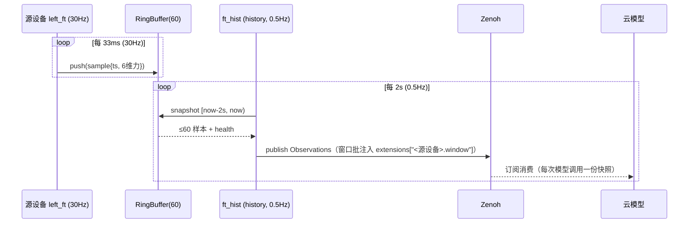

# R2C 多设备管理（设备树）特性设计 — 方案 B

> 本文件负责"基于 r2c 的多设备管理（多本体 / 多末端 / 多传感器）"方案 B（设备树 + 派生节点）的特性设计；不属于本文件的内容：业界调研依据见 [docs/research/r2c-multi-device-industry-survey.md](../research/r2c-multi-device-industry-survey.md)，R2C 现有单设备实现见 `packages/cloudrobo-r2c/`。
>
> 状态：**v0.2——组合层级已按 ROS+OpenCV 场景验证定案为路线 1.5（声明式子设备清单，见第 13 节），领域模型对齐 `packages/cloudrobo-r2c` 代码现状（完全调研见 [docs/research/cloudrobo-r2c-codebase-survey.md](../research/cloudrobo-r2c-codebase-survey.md)）**。已确认修正：常规 Observations 上行对齐 0.5Hz（D3）；窗口批经 extensions 随唯一观测入口 `{p}/{d}/inference/observations` 上行、不新起 topic（D7 已定案）；30Hz 采样与 0.5Hz 上行拆双节拍。章节按华为特性设计模板（特性概述 / 术语 / 需求分析 / 总体方案 / 详细设计 / 可靠性 / 安全 / 性能规格 / 兼容性 / 测试 / 遗留问题）组织；如团队有官方模板表单，本文各节内容可按编号 1:1 迁入。

## 1. 特性概述

**背景**：本版本要实现基于 r2c 的多设备管理。业界调研（PR #1 文档）结论：多设备组合应采用"设备树（浅层级 + 引用）+ 树上派生节点"形态；驱动场景为"云上模型需要当前六维力 + 2 秒内六维力历史"，采样 30Hz、模型调用 0.5Hz，且高频原始流不上云。

**定案范围**（2026-11-04 确认）：仅实现方案 B —— 设备树 + `history` 派生节点；方案 A（Zenoh 缓存按需查询）不做；方案 C（云端入湖窗口查询）暂不实现。

**特性价值**：
1. 多本体 / 多末端 / 多传感器在配置与消息层获得统一身份，不再是"命名约定扁平化"；
2. 历史等派生能力是树上的通用节点：**每个传感器只适配一次**，不出现"带历史 / 不带历史"两种驱动变体；
3. 采样频率（30Hz）与云端调用频率（0.5Hz）在树上解耦，高频数据不出端侧。

**目标**：
- `robot_config` 支持设备树定义（源设备 + 派生节点，引用式组合）；
- SDK 内置通用环形缓冲与 `history` 派生节点：按 `window_s × sample_hz` 维护滚动窗口，按 `publish_hz` 发布窗口批；
- 窗口批消息携带"当前值快照 + 窗口样本 + 起止时间戳 + 健康位"；
- 设备级生命周期与心跳扩展。

**非目标**（本版本不做）：云端多本体实时协同；`filter` / `tf` 派生节点实现（仅预留注册位）；入湖数据的云端窗口查询；Zenoh 高频原始流上云。

## 2. 术语

| 术语 | 定义 |
|------|------|
| 设备树 | `robot_config` 中 `devices` 列表构成的设备关系图：源设备 + 派生节点，靠引用（input / depends_on）组合，不做深层级内嵌 |
| 源设备（source） | 直接对接硬件/厂商 SDK 的设备节点（本体、末端、传感器），由现有 adapter 体系实现 |
| 适配器节点（adapter） | 传输/厂商实现层节点：一个 adapter = 一个上下文（ROS 上下文、串口、相机采集），走现有 `r2c_sdk.adapters` 注册表；**设备树的第一层分组**（如场景中 `ros:` 下挂机械臂与夹爪） |
| 子设备声明（devices） | adapter 对其键空间内逻辑设备的声明（name / type / channels），由 `describe_devices()` 自动推导、配置可覆盖 |
| 派生节点（derived） | 以一个或多个源设备的输出为输入、产出派生信号的节点；本版本实现 `history`，预留 `filter` / `tf` |
| 环形缓冲（ring buffer） | SDK 通用组件：按 `(设备, 通道)` 维度缓存最近 `ceil(window_s × sample_hz)` 个样本，溢出覆盖最旧 |
| 窗口批（window batch） | `history` 节点按 `publish_hz` 注入 `Observations.extensions` 的一组扩展字段（键 `<源设备>.window`）：当前值快照 + 窗口内全部样本 + 起止时间戳 + 健康位 |
| 样本（sample） | 一个时刻的设备读数：`timestamp` + 数据载荷（复用 `ExtensionValue` 自描述结构） |

## 3. 需求分析

**场景 1（驱动场景）**：六维力传感器 30Hz 采样；云上模型 0.5Hz 调用，每次需要"当前六维力 + 2 秒内历史（60 样本）"。约束：60 样本不在云端组窗（高频原始流不上云），必须端侧组装。

**场景 2**：多末端（双臂 + 各自夹爪）、多传感器（多相机 / IMU / 力）在同一台本体上共存，设备可独立启停、独立故障，互不拖垮。

**硬约束**：
- C1 六维力等高频原始采样流不出端侧（缓存于环形缓冲）；窗口批 0.5Hz 上行；常规 Observations 上行维持现状（见 5.3 / 决策点 D3）；
- C2 传感器适配只写一次，历史能力不进入任何传感器 adapter；
- C3 采样 / 历史频率（30Hz×2s）与模型调用频率（0.5Hz）解耦，各自可配置；
- C4 现有 v2.1 单设备配置与 Protobuf 消息保持兼容（只增不改）。

## 4. 总体方案

```text
robot_config (v3.0: adapters 树 = 传输分组 + 子设备声明 + 派生节点)
  │
  ▼
DeviceManager（每 R2CClient 一个，按 adapter 组织）
  ├── adapter: left_ft_dev (type ft300)            # 一个厂商/传输上下文 = 一个 adapter
  │     └── 源设备: left_ft ──30Hz──► RingBuffer(left_ft, cap=60)
  ├── adapter: cam0 (type opencv_camera)           # 同型多实例：cam0 / cam1 ...
  │     └── 源设备: camera0 ──30Hz──► RingBuffer(camera0, cap=60)
  ├── 派生: ft_hist (derived/history, input=left_ft)
  │        └─ 每 2s: 截窗 [now-2s, now) → 窗口批注入 extensions
  └── 派生: ...(filter/tf 预留)
  ▼
Zenoh: {project_id}/{device_id}/inference/observations（观测唯一入口，不新起 topic）
  │  窗口批经 extensions 扩展字段随观测上行：extensions["<源设备>.window"]
  ▼
云模型（0.5Hz 订阅消费；云端不感知派生节点，只按约定键读 extensions）
```

设计原则（对应调研结论）：
1. **本体在 key、设备在消息、信号在字段**：topic 首段仍为 `{project_id}/{device_id}`；设备身份用名称 + 类型进入配置与消息；窗口批 topic 增加派生节点名一段。
2. **树管"是谁、挂在哪"，引用管"用谁"**（devicetree phandle / Viam depends_on 同构）：浅层级 + 引用，不做深内嵌。
3. **派生能力是节点不是变体**（YARP remapper / ros2_control chaining 同构）：`history` 节点通用实现一次，所有源设备复用。

关键时序：



## 5. 详细设计

### 5.1 配置模型（robot_config schema v3.0）

```yaml
schema_version: "v3.0"

runtime:            # 沿用 v2.1 字段；观测上行对齐模型调用频率（D3）

adapters:                          # 传输/厂商实现层：一个 adapter = 一个上下文（ROS 上下文、串口、相机）
  - name: left_ft_dev
    type: ft300                    # 走现有 r2c_sdk.adapters entry-point 注册表
    params:
      port: /dev/ttyUSB0
      sample_hz: 30.0              # 采样率，历史窗口容量按此折算
    devices:                       # adapter 键空间内的子设备声明（describe_devices 自动推导，配置可覆盖 channels）
      - name: left_ft
        type: force_torque
        channels: ["wrench_*"]
    translator: ...                # 映射按设备分组：devices.left_ft.mappings（沿用 device_to_r2c / r2c_to_device 语义）
  - name: cam0
    type: opencv_camera            # 新增独立相机适配器（见 13 节增量 1）
    params: {index_or_path: "/dev/video0", width: 640, height: 480, fps: 30}
    devices:
      - {name: camera0, type: camera, channels: ["camera0*"]}

derived:                           # 派生节点（input 引用设备名，可跨 adapter）
  - name: left_ft_hist
    type: history
    input: left_ft
    params:
      window_s: 2.0                # 窗口批随观测上行（频率 = 模型调用频率，见 5.3 / D3）
```

字段与校验规则：

| 规则 | 说明 |
|------|------|
| `adapters.<name>.type` | 走现有 `r2c_sdk.adapters` entry-point 注册表；一个 adapter = 一个传输/厂商上下文（ROS 上下文、串口、相机采集） |
| `adapters.<name>.devices` | adapter 键空间内的子设备声明：`name` 全局唯一（对齐 Viam name / ros2_control 块名）；`channels` 声明该设备占用的键前缀；优先由 `describe_devices()` 自动推导、配置可覆盖 |
| `derived` 节点必须有 `input` | 引用子设备名（可跨 adapter）；允许链式引用派生节点，配置加载时做无环检测 |
| 容量上限 | `window_s × sample_hz ≤ 4096`（防误配），超出拒绝加载并报错——需在 `robot_config_schema` 显式新增校验（现状 pydantic `extra="allow"`，调研偏差 #6） |
| `derived/history` 参数默认值 | `window_s: 2.0`（窗口批随观测上行，观测频率即模型调用频率，节点无独立发布频率） |
| 兼容 | 配置无 `adapters` 块时，完全沿用 v2.1 单 `hardware` 块行为，不加载 DeviceManager |

**决策点 D1**：`devices` 列表是否需要显式层级字段（如 `parent`）？当前设计为"扁平列表 + 引用"，树形仅是引用关系图（业界证据：devicetree 单亲树 + phandle；Viam depends_on）。建议保持扁平，评审确认。

### 5.2 设备与派生节点运行时

- 新增 `DeviceManager`：按 `adapters` 列表实例化适配器（复用现有 AdapterRegistry），在每个 adapter 键空间内登记子设备（`describe_devices()` 声明 + 配置覆盖），实例化派生节点（新增 `r2c_sdk.derived_nodes` entry-point 组，镜像现有 adapter 注册表机制）。
- 生命周期（借鉴 ros2_control 组件状态机，调研已核验）：`UNCONFIGURED → INACTIVE → ACTIVE`；派生节点在其全部 `input` 均 ACTIVE 后才进入 ACTIVE。
- 错误隔离：单源设备 ERROR 只停用该设备与其下游派生节点（派生节点转 `DEGRADED`，见 5.4 健康位），不拖垮设备树其他分支——对齐 Viam "远端 unreachable 不消失" 语义。
- 心跳扩展（决策点 D2）：`Heartbeat` 新增 `repeated DeviceHealth devices`（name、state、error_code），整机字段保留；proto 只增不改。

### 5.3 数据面与 topic

| 数据 | 频率 | 去向 |
|------|------|------|
| 源设备原始采样（如 30Hz 六维力） | 30Hz | **仅端侧** RingBuffer，不出端（约束 C1） |
| 窗口批（history 派生节点输出） | 0.5Hz | **不新起 topic**：随 `Observations` 在唯一观测入口 `{project_id}/{device_id}/inference/observations` 上行，经 `extensions` 扩展字段承载（2026-11-04 定案）；键按源设备命名，云端不感知派生节点 |
| 常规 Observations（joint_states 等） | 维持现有 `runtime.publish_hz` | 沿用现有 topic（**决策点 D3**：是否为配合 0.5Hz 模型调用引入"快照模式"，本版本不强制） |
| Actions 下行 | 模型调用驱动 | 沿用现有 topic 与结构（多末端按设备键路由沿用 `end_effector_poses` map 模式） |

QoS / 可靠性：窗口批使用可靠传输（丢一批代价是模型拿到 4 秒旧窗口，宁可阻塞重传）；现有 Zenoh client 模式与 TLS 配置沿用，不新增传输配置面。

### 5.4 消息设计（Protobuf，只增不改）

窗口批**不新起 topic、不新增顶层消息**：随现有 `Observations.extensions`（`map<string, ExtensionValue>`）在唯一观测入口上行。新增 `observation_window.proto`（包 `r2c_sdk`）仅作为扩展字段的载荷结构：

```text
extensions["<源设备名>.window"] = ExtensionValue{
  dtype: BYTES,
  data:  ObservationWindow 序列化字节   # 见下
}
```

键名按**源设备**命名（如 `left_ft.window`），云端按约定键读取，**不感知派生节点**（node 名只在端侧存在）。载荷 proto：

```protobuf
message WindowSample {
  int64 timestamp_us = 1;        // 样本时间戳（端侧单调时钟换算的 UNIX 微秒）
  ExtensionValue data = 2;       // 复用现有自描述载荷（六维力 = FLOAT64[6]）
}

message WindowHeader {
  string node_name = 1;          // 派生节点名（ft_hist）
  string source_device = 2;      // 输入设备名（left_ft）
  int64  seq = 3;                // 窗口批序号，递增，供丢批检测
  int64  window_start_us = 4;    // 窗口起止 [start, end)
  int64  window_end_us = 5;
  double sample_hz = 6;          // 源设备标称采样率
  int32  expected_samples = 7;   // 满窗样本数（60）；实际 samples 数可小于它
  HealthState health = 8;        // HEALTHY / WARMUP（未满窗）/ DEGRADED（输入故障/断流）
}

message ObservationWindow {
  WindowHeader header = 1;
  WindowSample current = 2;      // 最新样本（当前值快照）
  repeated WindowSample samples = 3;  // 窗口内样本，时间升序
}
```

**决策点 D4**：`data` 直接用 `ExtensionValue`（自描述、免扩 proto）还是为六维力定义强类型字段？建议 V1 用 `ExtensionValue`（零侵入、与 `extensions` 机制一致），评审确认。

**决策点 D5**：`Heartbeat.devices`（5.2）与窗口批 `health` 的关系：窗口批健康位只描述本派生链路；整机/全设备健康以 Heartbeat 为准。

### 5.5 环形缓冲与截窗实现

- `RingBuffer`：单写单读无锁环形队列；`push` O(1)、`snapshot` 一次批量拷贝；容量 `ceil(window_s × sample_hz)`，满后覆盖最旧。
- 截窗规则：以**样本时间戳**为准取 `[now − window_s, now)`（不按条数取——频率抖动时保证时间窗正确）；`expected_samples` 告知消费方满窗应为多少条。
- 时间基准：端侧写入双时间戳（单调时钟差值 + UNIX 时间），窗口起止用 UNIX 时间；端云时钟差由部署运维（NTP）保证在容差内，协议不做时钟补偿（**决策点 D6**：是否需要端云时钟差上报字段，V1 不做）。
- 断流检测：距上次 push 超过 `2 / sample_hz` 判定断流 → 窗口批 `health = DEGRADED`，并在头部保留 `expected_samples` 与实际样本数差异供定位。

### 5.6 配置、加载与热更新

- 配置校验在现有 `cloudrobo-r2c` CLI 加载链完成（引用不存在、成环、容量超限 → 拒绝启动并报具体节点名）。
- 本版本不支持运行中热改树（改配置需重启客户端）；与 Viam 热加载的差距记入遗留问题。

## 6. 可靠性与异常

| 异常 | 行为 |
|------|------|
| 源设备离线 | 该设备及其下游派生节点 DEGRADED，窗口批继续以低频发布（health 位标故障，样本为最后已知窗口）；设备树其他分支不受影响 |
| 缓冲未满窗（冷启动 / 断流恢复中） | `health = WARMUP`，samples 为实际条数，`expected_samples` 恒定提供满窗基准 |
| 发布失败 / Zenoh 断连 | 窗口批按可靠传输重传；**不做历史补发**（快照语义：恢复后从当前窗口继续，seq 供云侧检测丢批） |
| 时间倒退 | 丢弃早于窗口起点的新样本并计数告警（心跳 error_code） |
| 客户端重启 | 冷启动重新走 WARMUP → HEALTHY |

## 7. 安全

沿用现有 Zenoh TLS / 凭证 bundle 体系，无新增认证面；窗口批不携带新增敏感信息（仅设备名与传感数据）；topic 命名不引入可预测的越权路径（与现有同规则）。

## 8. 性能规格

- 上行带宽：每派生节点每批 ≈ 60 × (8B 时间戳 + 48B 六维力) + 头部 ≈ **4KB**，0.5Hz ≈ **2KB/s**；N 台设备线性叠加，远低于 30Hz 原始流式上行（消息数 1/60）。
- 端侧内存：每缓冲 60 × 56B ≈ **3.4KB**/设备（double 型信号；ExtensionValue 按实际 dtype）。
- CPU：push O(1)，每 2s 一次 O(窗口) 拷贝与 protobuf 编码，可忽略。

## 9. 兼容性与升级

- 配置：无 `devices` 块 = v2.1 原行为，存量配置零改动；`history_window` 相关字段不配置 = 不加载派生节点。
- Protobuf：只增不改（proto3 兼容规则）；旧云侧忽略新 topic 即可，无破坏。
- 回退：two-way door——回退客户端版本即回到单设备行为；无数据迁移。

## 10. 测试与验收

| 层级 | 内容 |
|------|------|
| 单测 | RingBuffer 边界（空/未满/满/覆盖）、截窗时间语义（频率抖动）、无环检测、配置校验报错 |
| 集成 | dummy 源设备（现有 `dummy` adapter + `robot_dummy_config.yaml` 扩展）+ `history` 节点 e2e：本地 Zenoh 起 router，校验 0.5Hz±10%、满窗 60 样本、seq 递增、health 状态迁移（WARMUP→HEALTHY→DEGRADED→HEALTHY） |
| 验收标准 | 云侧 0.5Hz 收到窗口批；每次模型调用样本时间跨度覆盖 2s；单设备故障不影响其他设备窗口批；v2.1 存量配置回归通过 |

## 11. 遗留问题与后续规划

1. `filter` / `tf` 派生节点实现（本版本仅注册位）；
2. 方案 C（入湖后云端窗口查询）作为训练 / 回放场景的后续特性；
3. 常规 Observations 上行频率与 0.5Hz 模型调用的对齐策略（决策点 D3）；
4. 运行中热更新设备树（对标 Viam 热加载）；
5. 多设备 `joint_states` 分组消息（Actions `end_effector_poses` map 模式推广到关节面）；
6. 存量 16 个 adapter 分批补 `describe_devices()`（ros2/lerobot 优先，其余先回退配置声明 channels）；新增独立 `opencv_camera` 适配器（第 13 节场景增量 1）。

## 13. 场景覆盖验证：ROS 机械臂/夹爪 + OpenCV 相机（2026-11-04 增）

场景：机械臂与夹爪走 ROS 通信，两个相机走 OpenCV。目标设备树：

```text
ros:
  - 机械臂 (arm)
  - 夹爪 (gripper)
opencv 相机 1
opencv 相机 2
```

**结论：本特性可覆盖；组合层级据此定案为路线 1.5（声明式子设备清单），本稿 v0.2 已按此修订**（三路线对比见代码调研第 10 节）——"ros:" 这一层是**传输/适配器分组**（臂与夹爪共享同一 ROS 上下文），不是两个独立适配器。这与代码现状一致：`Ros2HardwareAdapter` 持有 ROS 上下文、一个 adapter 服务多设备（同 lerobot `bi_so_follower` 双臂形态）。若按"每设备独立 adapter"（路线 2），臂与夹爪需两个 adapter 共享一个 rcl 上下文——现有代码不支持，需新机制。

配置映射（路线 1.5 形态）：

```yaml
schema_version: "v3.0"
adapters:
  - name: ros                      # 一个 ROS 上下文
    type: ros2
    config:
      subscriptions:               # 现有 SubscriptionConfig 已支持 store_as 键前缀
        - {topic: /arm/joint_states, msg_type: sensor_msgs/msg/JointState, store_as: arm_joint_states}
        - {topic: /gripper/state, msg_type: ..., store_as: gripper_state}
      publishers: ...
    devices:                       # adapter describe_devices() 声明 + 配置引用
      - {name: arm,     type: arm,     channels: ["arm_*"]}
      - {name: gripper, type: gripper, channels: ["gripper_*"]}
  - name: cam1                     # 同一 adapter 类型的两个实例
    type: opencv_camera
    config: {index_or_path: "/dev/video0", width: 640, height: 480, fps: 30}
    devices: [{name: camera1, type: camera, channels: ["camera1*"]}]
  - name: cam2
    type: opencv_camera
    config: {index_or_path: "/dev/video2", width: 640, height: 480, fps: 30}
    devices: [{name: camera2, type: camera, channels: ["camera2*"]}]
```

对应 R2C 消息（**现有结构即可承载**）：
- arm → `joint_states`（names + position）；gripper → `end_effector_states` / 夹爪字段；
- camera1 / camera2 → `images.color.camera1`、`images.color.camera2`（`ImageGroups` 本就按相机名为键分组，`image_raw.proto:13-15`）；
- 各设备历史窗口批 → `extensions["arm.window"]`、`extensions["camera1.window"]`（按源设备命名，云端不感知 node，D7 定案）。

需要相对现状代码的增量：
1. **新增独立 `opencv_camera` 适配器**（小）：现状相机都是 adapter 内部子对象（ur5e `_cameras`、dummy `image_specs`），无独立相机适配器；OpenCV 采集可复用 LeRobot 的 OpenCV camera 实现；
2. ros2 适配器补 `describe_devices()` 元数据 API（从 `SubscriptionConfig.store_as` 前缀推导子设备清单）；
3. 映射表按设备分组（路线 1 机制）：`devices.arm.mappings` / `devices.gripper.mappings` / `devices.camera1.mappings` 替代全局单表。

覆盖检查：设备身份 ✔（adapter + devices 声明）；同型多实例 ✔（cam1/cam2）；传输共享 ✔（ros adapter 内两设备）；异构传输并存 ✔（ros 与 opencv 互不影响）；独立故障 ✔（ros 断 → arm/gripper DEGRADED，相机不受影响，per-adapter 隔离）；历史/窗口批 ✔（extensions 按设备键）。

## 12. 决策点汇总（待评审）

| # | 决策点 | 本文建议 |
|---|--------|----------|
| D1 | **已定案（2026-11-04，场景 13 驱动）**：组合层级 = adapters（传输分组）+ 组内子设备声明（describe_devices + channels）+ 派生节点引用（路线 1.5）；不采用显式 parent 深层级 | 采纳，v0.2 已按此修订 |
| D2 | Heartbeat 增加逐设备健康列表 | 采纳（proto 只增） |
| D3 | 常规 Observations 上行频率 | **修订（调研偏差 #4）**：对齐 0.5Hz（用户约束"所有观测 0.5Hz 上传"）；需把 sync_client 单节拍循环拆为"采样写缓冲 / 上行"双节拍 |
| D4 | 窗口批扩展字段载荷格式 | BYTES 承载 `ObservationWindow` proto 序列化（键 `<源设备>.window`）；备选：拆 `data`/`ts` 两个张量字段 |
| D5 | 窗口批 health 与 Heartbeat 的分工 | 窗口批只描述本链路，整机以 Heartbeat 为准 |
| D6 | 是否上报端云时钟差 | V1 不做，依赖 NTP 运维前提 |
| D7 | **已定案（2026-11-04）**：不新起 topic；观测唯一入口 `{p}/{d}/inference/observations`；窗口批经 extensions 上行，云端不感知 node | 采纳；扩展键按源设备命名（如 `left_ft.window`），node 名仅端侧内部使用 |
