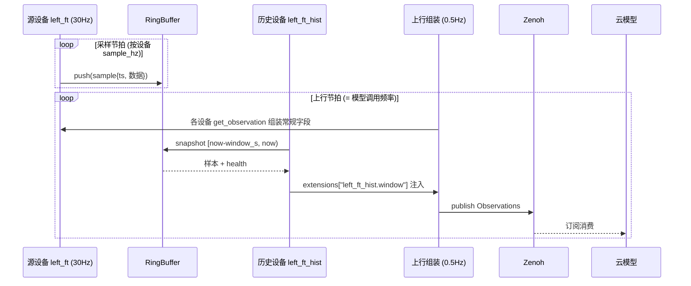

# R2C 多设备管理（设备树）特性设计

> 本文件负责"基于 r2c 的多设备管理（多本体 / 多末端 / 多传感器）"特性的功能设计；不属于本文件的内容：业界调研与代码完全调研见 `docs/research/`（`r2c-multi-device-industry-survey.md`、`cloudrobo-r2c-codebase-survey.md`），R2C 现有单设备实现见 `packages/cloudrobo-r2c/`。
>
> 状态：**v0.5，待评审**。本版修订：ROS 等传输适配器**只管上下文**（节点、连接、QoS 默认值），**设备自己声明并实现要订阅/发布什么**；场景 2 示例按此调整。前版修订：①补充场景 2 完整配置示例；②支持设备级独立配置文件 + 相对路径引用；③移除派生节点概念——历史/滤波等能力改为 entry-point 注册的普通设备类型。按特性设计模板组织（特性概述 / 需求分析〔需求背景、场景分析、友商分析、名词解释〕/ 功能方案〔功能约束与依赖、整体方案设计、详细功能设计〕/ 可靠性 / 安全 / 性能规格 / 兼容性 / 测试 / 遗留问题）。

## 1. 特性概述

**背景**：本版本要实现基于 r2c 的多设备管理（多本体、多末端、多传感器等）。现状的多设备形态是"整机扁平化"——设备没有独立身份、独立生命周期与独立故障隔离，映射表为全局单表（详见 2.1）。

**特性价值**：
1. 多本体 / 多末端 / 多传感器在配置与消息层获得统一身份与设备树结构；
2. 设备级生命周期、健康与故障隔离；
3. 历史、滤波、坐标变换等能力作为**普通设备类型**（entry-point 注册）提供，**每个设备只适配一次**，不随能力数量膨胀出驱动变体；
4. 采样频率与云端模型调用频率解耦，高频原始流不出端侧。

**目标**：
- `robot_config` 支持设备树定义：`hardware` 从单块扩展为列表（项可嵌套 `devices` 体现层级），设备按 `type` 经 entry-point 解析实现，配置从配置文件夹按文件导入；
- 设备级生命周期状态机与逐设备心跳健康；
- 首批设备类型：本体/机械臂、末端/夹爪、OpenCV 相机、历史（history，预留 filter/tf）；
- 历史等设备输出经 `Observations.extensions` 随唯一观测入口上行，云端不感知端侧实现细节。

**非目标**（本版本不做）：云端多本体实时协同；`filter` / `tf` 设备类型的实现（仅预留注册位）；入湖数据的云端窗口查询；高频原始流上云；图形化运维界面。

## 2. 需求分析

### 2.1 需求背景

版本需求来自本版本规划："实现基于 r2c 的多设备管理（如多本体、多末端、多传感器等）"。对照代码完全调研（`docs/research/cloudrobo-r2c-codebase-survey.md`，结论均带 file:line），现状与差距：

| 维度 | 现状 | 差距 |
|------|------|------|
| 设备身份 | 一个 client/session = 一个 `device_id`（整机，session.py:93-341） | 多设备无独立身份，跨设备仅有订阅覆盖参数 |
| 适配器 | 一个 adapter = 一台整机；多设备靠键前缀约定（`leftarm_/rightarm_`、`camera_*`）或内部子对象 | 无对外子设备声明 API；新 adapter 无法声明"我有哪些设备" |
| 映射 | `device_to_r2c/r2c_to_device` 全局单表，无 device 字段（config_mapper.py:136-154） | 无法按设备分组映射与校验 |
| 消息 | Observations/Actions 扁平；仅 `images.color.<cam>` 与 `extensions` 天然分组 | 关节面无分组；设备级输出无标准承载 |
| 生命周期 | 整机 Heartbeat（默认 5s，status/mode/error_code/battery） | 无逐设备状态、健康与故障隔离 |
| 频率 | sync_client 单节拍循环：控制=采样=发布（`publish_hz` 默认 30，sync_client.py:326,922-945） | 采样率与云端模型调用率（事件驱动，无频率参数）耦合 |
| 配置 | 单一 robot_config + 内联映射表（`common/robot_config_schema.py` pydantic，`extra="allow"`） | 无设备级配置拆分与相对引用；未知字段静默 |

### 2.2 场景分析

**场景 1：多传感器设备 + 历史能力。** 多类传感器（六维力、IMU、多相机）挂在一台本体上。示例：六维力传感器 30Hz 采样，云上模型 0.5Hz 调用，每次需要"当前值 + 2 秒内历史（60 样本）"，且高频原始流不上云——历史必须在端侧组装，且不能让力传感器出现"带历史 / 不带历史"两种适配。→ 由"历史设备"（`type: history`）覆盖。

**场景 2：共享传输 + 异构传输 + 同型多实例。** 机械臂与夹爪走 ROS 通信（共享同一 ROS 上下文），两个相机走 OpenCV：

```text
ros:
  - 机械臂 (arm)
  - 夹爪 (gripper)
opencv 相机 1
opencv 相机 2
```

要点：第一层是**传输上下文**（"ros:" 只是一个 ROS 上下文/节点，臂与夹爪共享它；**上下文不含任何 topic 绑定**），每个设备在自己的配置里声明订阅/发布的 topic 与消息类型；相机自带采集、与 ROS 无关，且两个相机是同一设备类型的两个实例。→ 由 hardware 列表（列表项 = 现有结构 + name/channels/transport）覆盖，完整示例见 3.3.2。

**场景 3：多本体。** 多台整机各自一个 `device_id` 会话，云端按设备编排与汇聚（本版本不承诺云端实时协同）。

**能力矩阵**：

| 需求点 | 现状 | 本特性 |
|--------|------|--------|
| 设备身份（独立命名/类型） | ✗（键前缀约定） | ✔ devices 声明 + entry-point 类型 |
| 共享传输（多设备一个上下文） | 内部隐式 | ✔ 多设备引用同一 transport 上下文 |
| 同型多实例（两台相机） | 内部隐式 | ✔ 两个 device 实例 |
| 异构传输并存（ROS + OpenCV） | 分散在各 adapter | ✔ 设备各自绑定/自带传输 |
| 独立故障隔离 | 整机级 | ✔ 单设备 DEGRADED |
| 能力复用（历史/滤波/变换） | adapter 内私有（如 flexiv wrench_filtered） | ✔ 独立设备类型，一次实现处处可用 |
| 配置可维护（设备级拆分） | ✗（单文件内联） | ✔ 设备独立配置文件 + 相对引用 |
| 频率解耦（30Hz 采样 / 0.5Hz 上行） | ✗（单节拍） | ✔ 双节拍 |
| 设备输出上云（云端不感知端侧实现） | ✗ | ✔ extensions 约定键，唯一观测入口 |

### 2.3 友商分析

| 友商 / 业界实现 | 关键机制 | 对本特性的启示 |
|----------------|----------|----------------|
| Viam | 资源模型（API+model 三元组+全局唯一 name）、sub-part/remote part 并入统一资源图、断线"标 unreachable 不消失"、单表 readings 六级元数据 | 设备命名与重名裁决；断线不消失语义；观测按 (org,location,machine,part,component) 组织 |
| ros2_control | system/sensor/actuator 组件 + `<设备>/<信号>` 接口命名；组件生命周期状态机 + on_error；命令接口独占仲裁 | 设备生命周期状态机与 HardwareStatus 健康消息；接口独占仲裁模型 |
| LeRobot | 配置即组合（注册表 + 嵌套 dataclass）；双臂/多相机键前缀分区 | 配置驱动组合形态；entry-point 注册表思想；前缀分区规范 |
| ROS 2 + Zenoh（rmw_zenoh / bridge） | topic → key expression 映射；按接口 regex 的频率/优先级/QoS 策略面；liveliness 上下线事件 | key 命名规范（高方差段靠右）；上下线事件替代心跳轮询（后续演进） |
| 灵渠 Link-U OS | AimRT 中间件（ROS 2 兼容 Topic/RPC）；`/aima/hal/<设备类型>/<安装位>/<信号>` 一路一 topic；aimrt_health_monitor（节点心跳/急停） | 传感器命名层级 `<类型>/<安装位>/<信号>`；健康监控清单 |
| Genie Studio（智元） | "Multi-Ontology and Multi-End Effector"采集任务模型；吞吐按 device 计量；Monitor 多机运维 | 设备作为配额/状态/质量的基本计量单元；多机运维独立模块 |
| Unitree SDK2 / ABB MultiMove | 按控制层级分 topic、扁平状态消息；工业多本体协同在控制器层 | 云端不做实时协同，保持每 device_id 独立执行体 |

完整对比与来源见 `docs/research/r2c-multi-device-industry-survey.md`。

### 2.4 名词解释

| 术语 | 定义 |
|------|------|
| 设备树 | `robot_config` 中 `hardware` 列表（传输上下文与设备同为列表项）+ 引用关系（transport / input）构成的关系图；浅层级 + 引用，不做深内嵌 |
| 传输上下文（adapter） | 一个共享的通信/驱动上下文（一个 ROS 上下文与节点、一个串口总线、一路相机采集），走现有 `r2c_sdk.adapters` 注册表；**只提供上下文与连接能力（建订阅/建发布），不绑定具体 topic**；多个设备可引用同一上下文 |
| 设备通道声明（channels） | 设备在自己配置里声明所需 topic / 消息类型 / QoS（ROS）或串口帧格式等；由设备类型实现消费，传输上下文只负责按声明创建句柄 |
| 设备（device） | 设备树的功能单元（本体、末端、相机、历史…）；`type` 经 `r2c_sdk.devices` entry-point 解析为具体实现；可绑定传输上下文（`transport`）或自带采集 |
| 设备类型（device type） | entry-point 注册的设备实现名（如 `arm`、`gripper`、`opencv_camera`、`history`）；**历史/滤波/变换等都是设备类型**，不是特殊节点 |
| 文件导入 | 每个设备/传输一个文件放配置文件夹，主配置 `!include` 导入（相对当前文件解析）；文件内仍可用标准 YAML 锚点（可选，示例不使用） |
| 环形缓冲（ring buffer） | 设备通用组件：按 `(设备, 通道)` 维度缓存最近 `ceil(window_s × sample_hz)` 个样本，溢出覆盖最旧 |
| 样本（sample） | 一个时刻的设备读数：`timestamp` + 数据载荷（复用 `ExtensionValue` 自描述结构） |
| 窗口批（window batch） | 历史设备注入 `Observations.extensions` 的扩展字段（键 `<设备名>.window`）：当前值快照 + 窗口内全部样本 + 起止时间戳 + 健康位 |

## 3. 功能方案

### 3.1 功能约束与依赖

**约束**：
- C1 高频原始采样流不出端侧：按设备声明的采样率写入端侧环形缓冲，仅设备输出上行；
- C2 设备适配只写一次：历史/滤波等能力以设备类型实现，不进入任何驱动型的设备实现；
- C3 采样（及历史窗口）频率与云端模型调用频率解耦，各自可配置；
- C4 兼容：v2.1 存量配置与 Protobuf 消息只增不改；
- C5 观测唯一入口 `{project_id}/{device_id}/inference/observations`，不新起 topic（2026-11-04 定案）；设备输出经 `extensions` 扩展字段承载，云端不感知端侧实现细节。

**依赖**：
- Zenoh 传输与 QoS 体系（沿用 `client/session.py` + `transport/zenoh.py`，不新增 topic 类型）；
- `r2c_sdk.adapters` entry-point 注册表（传输实现复用现有 16 个 adapter）；
- 新增 `r2c_sdk.devices` entry-point 注册表（设备类型）；
- 现有 `_config_dir` 配置目录传递机制（robot_factory.py:235-237）作为配置引用的基础；
- `common/robot_config_schema.py` pydantic 校验链（需扩展，见 3.3.2）；
- `Observations.extensions`（`map<string, ExtensionValue>`）与 proto 兼容规则。

### 3.2 整体方案设计

**技术选型**：

| 选型点 | 决策 | 依据 |
|--------|------|------|
| 组合层级 | adapters（传输上下文：只管节点/连接）+ devices（设备，自声明通道 + 可引用 transport）+ 设备间引用（`input`） | 与"一个 adapter = 一个上下文"的代码现状同构（ros2 adapter 持有 ROS 上下文）；设备各自声明订阅/发布，避免传输层与设备语义耦合；相机自带采集不与 ROS 绑定 |
| 传输上下文边界 | 上下文只做：节点/会话建立、按声明创建订阅与发布句柄、QoS 默认值；**订阅/发布的 topic 与消息类型由设备配置决定** | 同一 ROS 上下文可服务任意设备组合；新增设备不改传输配置；与"设备自治"一致 |
| 设备身份 | 设备 `name` 全局唯一 + `type` 经 entry-point 解析 | 对齐 Viam 资源 name / ros2_control 块名惯例；树负责"是谁、挂在哪"，引用负责"用谁" |
| 设备发现 | 配置 `devices` 段显式声明（设备是一等对象）+ 设备类型 entry-point；仅对仍为"整机驱动"的存量适配器保留 `describe_devices()` 兼容兜底 | ros2 `get_transport_targets`、a1z `camera_meta` 是旧模型雏形；新模型下设备清单由配置决定，传输层不再推导 |
| 能力复用 | 新 entry-point 组 `r2c_sdk.devices`：`history`/`filter`/`tf` 与 `arm`/`gripper`/`opencv_camera` 同为一等设备类型 | ros2_control controller chaining / YARP remapper 同构：能力是设备，不是设备变体 |
| 配置组织 | 存量单 hardware 块零改动；多设备 = hardware 列表（嵌套 devices 体现树层级）；每个设备/传输一个文件，`!include` 导入 | 用户只需学习增量；树的层级由配置嵌套直观表达；现有 `_config_dir` 机制可承载 |
| 设备输出承载 | `Observations.extensions` 约定键 `<设备名>.window`，载荷 BYTES（proto 序列化） | 现有 `map<string, ExtensionValue>` 机制零侵入；观测唯一入口（C5） |
| 上行频率 | 观测上行 = 云端模型调用频率（0.5Hz）；采样按设备 `sample_hz` 独立节拍写环形缓冲 | 现状 sync_client 单节拍（控制=采样=发布）需拆为双节拍 |

**整体架构**：

```text
robot_config（hardware 列表：每项 = 现有 hardware 结构 + name/transport/input）
  │
  ▼
DeviceManager（每 R2CClient 一个）
  ├── transport: ros (ros2)                        # 仅 ROS 上下文/节点，不含 topic 绑定
  │     ├── device: arm      (type: arm)     ──30Hz──► RingBuffer(arm)
  │     │      └ 设备自声明: /arm/joint_states(订阅) /arm/joint_command(发布)
  │     └── device: gripper  (type: gripper) ──30Hz──► RingBuffer(gripper)
  │            └ 设备自声明: /gripper/gripper_state(订阅) /gripper/gripper_command(发布)
  ├── device: camera1 (type: opencv_camera, 自带采集) ──30Hz──► RingBuffer(camera1)
  ├── device: camera2 (type: opencv_camera, 自带采集) ──30Hz──► RingBuffer(camera2)
  ├── device: left_ft (type: force_torque)          ──30Hz──► RingBuffer(left_ft)
  └── device: left_ft_hist (type: history, input=left_ft)
        └─ 每上行周期: 截窗 [now-window_s, now) → 注入 extensions["left_ft_hist.window"]
  ▼
Zenoh: {project_id}/{device_id}/inference/observations（观测唯一入口）
  │  常规字段 + extensions（含设备输出）一并上行
  ▼
云模型（按调用频率订阅消费；只按约定键读 extensions，不感知端侧实现）
```

**关键时序**：



### 3.3 详细功能设计

#### 3.3.1 功能原理

- **装载**：`DeviceManager` 读取 `adapters`（实例化传输上下文：节点/会话/连接，复用现有 AdapterRegistry）与 `devices`（按 `type` 从 `r2c_sdk.devices` 解析实现并构造，注入其引用的传输上下文）；**设备实现按自身配置声明的通道创建订阅/发布**（传输上下文只提供建句柄能力）；相机等自带采集的设备不引用传输上下文。
- **双节拍**：采样节拍按设备 `sample_hz` 拉取数据写环形缓冲；上行节拍按模型调用频率组装 Observations（常规字段 + 各设备输出注入的 extensions），经现有会话发布。现状 sync_client 的单节拍循环拆分为两节拍。
- **生命周期**：借鉴 ros2_control 组件状态机——设备 `UNCONFIGURED → INACTIVE → ACTIVE`；`input` 引用设备（如历史设备依赖力传感器）在其输入设备 ACTIVE 后激活；单设备 ERROR 仅影响依赖它的设备（转 DEGRADED），其他设备不受影响。
- **故障隔离**：单设备离线不拖垮整机；断线资源"标记不可用而非消失"（对齐 Viam 语义），恢复后自动回归。

#### 3.3.2 接口设计

**配置接口（兼容优先原则，2026-11-05 修订）**：**不新增顶层 schema**——多设备是现有 `hardware` 块的自然扩展，用户只需学习增量：

| 规则 | 说明 |
|------|------|
| 存量零改动 | v2.1 配置（单 `hardware` 块）**原样可用、行为不变**——单块 = 单设备，即今天的行为 |
| 增量一：`hardware` 可为列表，且**列表项可嵌套 `devices`** | 树的层级直接由嵌套表达：传输节点下的 `devices:` 是挂在它下面的子设备（叶节点）；无 `transport`/嵌套的项是自带采集的叶节点 |
| 增量二：新设备类型 | `type: history`（及后续 `filter`/`tf`）经 `r2c_sdk.devices` entry-point 注册，列表项加 `input` 引用即可 |
| 设备复用 = 从配置文件夹导入 | 每个设备/传输一个文件放配置文件夹，主配置用 `!include` 导入（见示例）；**示例统一采用此写法**，不用锚点 |
| 映射保持全局 | `device_to_r2c`/`r2c_to_device` 缺省仍是全局（存量语义）；需要按设备分组时才在列表项内覆盖 |

**节点契约（成为 transport / 成为 input 各需提供什么）**：

| 角色 | 成为该节点必须提供 | 说明 |
|------|---------------------|------|
| **传输节点（transport，可被别的节点挂靠）** | ① 上下文建立/释放：`connect()`/`disconnect()`（如创建 ROS 节点、打开串口总线）；② 句柄工厂：`create_subscription(ChannelSpec)` / `create_publisher(ChannelSpec)`——子设备声明什么 topic 就建什么句柄；③ `context_info()`（节点名/domain 等诊断信息）；④ QoS 默认值（子设备可覆盖）；⑤ 生命周期状态与恢复（基类默认实现） | **只提供"连接能力"，不提供业务语义**——它不知道挂的是机械臂还是夹爪；`type` 走现有 `r2c_sdk.adapters` 注册表（`ros2` 即是一个传输节点实现） |
| **输入节点（input，可被历史/滤波引用）** | ① 数据输出：按声明 `sample_hz` 产出**带时间戳的样本**（进入 `Observations` 字段或 `extensions`）；② 通道声明：`channels`（它占用的 topic/键），供录制与 topic 冲突检测；③ 生命周期：ACTIVE/DEGRADED 状态与自动恢复（设备基类默认实现）；④ 元数据：`describe_devices()` 或由配置 `name/type/channels` 声明 | **提供"数据 + 健康"**：任何能持续产出带时间戳读数的设备（力传感器、关节、相机、历史设备）都可作为 `input`；`history` 设备本身也是合法的 `input`（可级联，需无环） |
| **能力节点（history / 后续 filter、tf）** | ① `input` 引用（指向某个输入节点）；② 能力参数（如 `window_s`）；③ 输出写到约定位置（history → `extensions["<name>.window"]`） | 由 SDK 通用实现承载（环形缓冲/截窗），能力设备**零驱动代码** |

**单设备（存量，零改动）**：

```yaml
schema_version: "v2.1"
runtime: {...}
hardware:                      # 单块 = 今天的行为
  type: ft300
  config: {port: /dev/ttyUSB0, sample_hz: 30}
translator: {type: configurable}
device_to_r2c: {...}
r2c_to_device: {...}
```

**多设备（增量写法）——场景 2 完整示例**（ROS 机械臂 + 夹爪共享 ROS 上下文、双 OpenCV 相机、力传感器 + 历史）。树形层级 = 配置嵌套：传输节点的 `devices:` 是它的子设备；示例统一用 `!include` 从配置文件夹导入文件：

`robot_config.yaml`（整机入口）：

```yaml
schema_version: "v2.1"                     # 版本号不变，schema 向后兼容
runtime: {...}                             # 沿用
translator: {type: configurable}           # 沿用（全局映射；按设备覆盖见下）

hardware:                                  # 从单块扩展为列表；树的根层
  - !include ./transports/ros.yaml         # 传输节点：内嵌 arm/gripper 两个子设备
  - !include ./transports/serial_ft.yaml   # 传输节点：内嵌 left_ft 子设备
  - !include ./devices/camera1.yaml        # 叶节点：自带采集
  - !include ./devices/camera2.yaml
  - !include ./devices/left_ft_hist.yaml   # 叶节点：历史（input → left_ft）
```

`transports/ros.yaml`（**传输节点 + 它的子设备树**）：

```yaml
name: ros
type: ros2                       # 传输节点实现（r2c_sdk.adapters 注册表）
config:
  node_name: r2c_ros
  qos_defaults: {reliability: reliable, depth: 10}   # 子设备可覆盖
devices:                         # ← 树的层级：挂在本传输节点下的子设备
  - name: arm                    # 机械臂
    type: arm                    # r2c_sdk.devices entry-point
    config:
      joint_names: [joint_1, joint_2, joint_3, joint_4, joint_5, joint_6]
      sample_hz: 30
      channels:                  # 子设备自声明订阅/发布（传输节点按此建句柄）
        state:   {topic: /arm/joint_states,  msg_type: sensor_msgs/msg/JointState}
        command: {topic: /arm/joint_command, msg_type: sensor_msgs/msg/JointState}
  - name: gripper                # 夹爪：与 arm 同一 ROS 上下文
    type: gripper
    config:
      sample_hz: 30
      channels:
        state:   {topic: /gripper/gripper_state,   msg_type: sensor_msgs/msg/GripperState}
        command: {topic: /gripper/gripper_command, msg_type: sensor_msgs/msg/GripperCommand}
```

`transports/serial_ft.yaml`（串口传输节点 + 力传感器子设备）：

```yaml
name: serial_ft
type: ft_serial
config: {port: /dev/ttyUSB0, baudrate: 921600}
devices:
  - name: left_ft                # 力传感器（input 节点）
    type: force_torque
    config: {channel: wrench, sample_hz: 30}
```

`devices/camera1.yaml`（相机 1：自带采集，无需 transport，直接是根层叶节点）：

```yaml
name: camera1
type: opencv_camera
config: {index_or_path: "/dev/video0", width: 640, height: 480, fps: 30, sample_hz: 30}
```

`devices/camera2.yaml`（相机 2：同类型第二个实例，独立文件）：

```yaml
name: camera2
type: opencv_camera
config: {index_or_path: "/dev/video2", width: 640, height: 480, fps: 30, sample_hz: 30}
```

`devices/left_ft_hist.yaml`（历史设备：`input` 引用另一设备的 `name`）：

```yaml
name: left_ft_hist
type: history               # r2c_sdk.devices entry-point（SDK 通用实现，零驱动代码）
input: left_ft              # 引用任意输入节点的 name（可跨 transport；需无环）
config: {window_s: 2.0}     # 窗口随观测上行，无独立发布频率
```

对应树形结构：

```text
robot_config
├── ros (transport: ros2)
│   ├── arm (device: arm)
│   └── gripper (device: gripper)
├── serial_ft (transport: ft_serial)
│   └── left_ft (device: force_torque)  ──input──►  left_ft_hist
├── camera1 (device: opencv_camera)
├── camera2 (device: opencv_camera)
└── left_ft_hist (capability: history)
```

**YAML 锚点说明**：锚点/合并键（`&x`/`*x`/`<<:`）是标准 YAML 能力，单文件内仍可使用；但**示例与推荐写法统一为文件导入**（`!include`），避免锚点跨设备误用。

**与旧设计的对比（本版修订点）**：

| 旧设计（v0.5） | 新设计（兼容优先） |
|----------------|---------------------|
| 新顶层 `adapters` + `devices` 段，schema_version 升 v3.0 | **不新增顶层段**：`hardware` 单块→列表（可嵌套 devices），schema_version 不变 |
| 用户需学习 `adapters`/`devices`/`transport`/`config_file` 一套新结构 | 用户只学两点：hardware 可为列表（项可嵌套 devices）、新增设备类型；其余全部沿用 |
| 存量配置需迁移改写 | 存量配置**原样运行**；新增设备只需在 `hardware` 列表追加项 |
| 设备复用靠 `config_file` 文件引用机制 | **每个设备一个文件放配置文件夹，`!include` 导入**；文件内仍可用 YAML 锚点（可选） |

**文件导入规则（`!include`，加载预处理，非 schema）**：相对当前文件所在目录解析；支持嵌套导入（被导入文件内可再 `!include`）；导入链出现环 → 加载失败并报出完整链路；路径限制在配置目录内（5 节）；展开后统一做 schema 校验，错误信息带文件路径。不使用 `!include` 的配置完全是标准 YAML。

**校验规则**：

| 规则 | 说明 |
|------|------|
| `hardware` 单块 | 与 v2.1 完全一致（存量路径，不加载 DeviceManager） |
| `hardware` 列表 | 每项 `type` 走 entry-point 注册表；`name` 全局唯一（含嵌套 devices）；根层项 = 树的一级节点 |
| 嵌套 `devices` | 仅传输节点（实现了句柄工厂）可有 `devices:` 子列表；子设备 `name` 同样全局唯一 |
| `channels` | 设备自声明通道；同一 transport 内 topic 冲突（同向重复）→ 加载失败报冲突双方 |
| `input` | 历史/滤波等能力设备引用其他设备 `name`；存在性与无环检测 |
| 容量上限 | `window_s × sample_hz ≤ 4096`，超出拒绝加载——需在 `robot_config_schema` 显式新增校验（现状 pydantic `extra="allow"` 静默，代码调研偏差 #6） |
| `!include` | 加载预处理；相对当前文件解析、防环、路径限制在配置目录内（5 节） |
| 映射归属 | 缺省全局（存量语义）；列表项内可写 `device_to_r2c`/`r2c_to_device` 覆盖该设备（可选增量） |

**传输上下文 API**（设备面向上下文的接口，`IRobotHardwareAdapter` 的上下文实现提供）：

| 能力 | 签名（示意） | 说明 |
|------|--------------|------|
| 建订阅 | `create_subscription(spec: ChannelSpec) -> SubscriptionHandle` | 按设备声明的 topic/消息类型/QoS 建订阅；重复 topic 复用同一句柄 |
| 建发布 | `create_publisher(spec: ChannelSpec) -> PublisherHandle` | 同上，用于命令下发 |
| 上下文信息 | `context_info() -> {node_name, domain_id, ...}` | 供设备诊断与日志 |

即：**传输层提供能力，设备层提供语义**——适配器不知道"机械臂"或"夹爪"，只按 `ChannelSpec` 建句柄；设备实现决定订阅什么、如何解析、如何发布。

**元数据 API**：`IRobotHardwareAdapter` 增加可选覆盖 `describe_devices() -> list[DeviceDeclaration]`（`name/type/channels`），默认返回空（由配置声明兜底）；ros2 适配器仅返回上下文信息，设备清单由配置声明。

**消息接口**：观测唯一入口不变；extensions 约定键见 3.3.3；proto 只增不改。

**界面设计**：本特性为 SDK/配置层特性，无新增图形界面；多机运维可视面（对标 AimStudio 式工具）列入后续规划。

#### 3.3.3 数据结构设计

**设备输出的 extensions 约定**（以历史设备为例）：

```text
extensions["<设备名>.window"] = ExtensionValue{
  dtype: BYTES,
  data:  ObservationWindow 序列化字节
}
```

键按设备名（如 `left_ft_hist.window`）——每个设备把自己的输出发布在自己的键下；云端按集成约定读取设备键，不感知端侧实现。

新增 `observation_window.proto`（包 `r2c_sdk`，与现有 proto 同目录、同编译链；只增不改）：

| 消息/字段 | 说明 |
|-----------|------|
| `WindowSample{timestamp_us, data}` | 单样本：UNIX 微秒时间戳 + `ExtensionValue` 自描述载荷（六维力 = FLOAT64[6]） |
| `WindowHeader{source_device, seq, window_start_us, window_end_us, sample_hz, expected_samples, health}` | 窗口头：`seq` 供云侧丢批检测；`expected_samples` 为满窗基准；`health ∈ {HEALTHY, WARMUP, DEGRADED}` |
| `ObservationWindow{header, current, samples}` | 载荷整体：当前值快照 + 窗口内样本（时间升序） |

**Heartbeat 扩展**（只增）：`repeated DeviceHealth devices`（name、type、state、error_code）——逐设备健康，整机字段保留。

**分组演进**：`images.color.<cam>` 与 `end_effector_poses` map 已按名分组；`joint_states` 的多设备分组列为后续特性（见遗留问题 3）。

## 4. 可靠性与异常设计

| 异常 | 行为 |
|------|------|
| 设备离线 | 该设备及依赖它的设备转 DEGRADED，其他设备不受影响；恢复后自动回归 |
| 环形缓冲未满窗（冷启动/断流恢复） | health = WARMUP，samples 为实际条数，`expected_samples` 恒定提供满窗基准 |
| 上行失败 / Zenoh 断连 | 沿用现有可靠传输重试；设备输出不做历史补发（快照语义），`seq` 供云侧检测丢批 |
| 配置文件缺失/引用成环 | 启动失败，报出引用链与文件路径 |
| 时间倒退 | 丢弃早于窗口起点的新样本并计数告警（心跳 error_code） |
| 客户端重启 | 冷启动重新走 WARMUP → HEALTHY |
| 断流检测 | 距上次样本超过 `2 / sample_hz` 判定断流 → health = DEGRADED |

## 5. 安全设计

沿用现有 Zenoh TLS / 凭证 bundle 体系，无新增认证面；extensions 扩展字段不新增敏感数据；配置文件引用仅允许读取配置目录内路径（防目录穿越），越界路径拒绝加载；不引入可预测的越权路径（与现有 topic 规则一致）。

## 6. 性能规格

- 上行带宽：以历史设备为例，每设备每批 ≈ 60 × (8B 时间戳 + 48B 六维力) + 头部 ≈ 4KB，0.5Hz ≈ 2KB/s/设备；N 台设备线性叠加；远低于原始流式上行（消息数 1/60）。
- 端侧内存：每环形缓冲 60 × 56B ≈ 3.4KB/设备（double 型信号；ExtensionValue 按实际 dtype）。
- CPU：缓冲写入 O(1)，每上行周期一次 O(窗口) 拷贝与 protobuf 编码，可忽略。
- 配置加载：多文件展开 + 校验一次性完成，启动期开销，与文件数线性。

## 7. 兼容性与升级

- 配置：无 `adapters`/`devices` 块 = v2.1 原行为，存量配置零改动；设备类型不配置 = 不加载。v2.1 单 `hardware` 块保留。
- Protobuf：只增不改（proto3 兼容规则）；旧云侧忽略 extensions 新键即可，无破坏。
- 回退：two-way door——回退客户端版本即回到单设备行为；无数据迁移。

## 8. 测试与验收

| 层级 | 内容 |
|------|------|
| 单测 | RingBuffer 边界（空/未满/满/覆盖）、截窗时间语义（频率抖动）、设备引用无环检测、配置引用（相对路径/嵌套/成环/越界）、配置校验报错（含未知字段显式校验） |
| 集成（场景 1） | 力设备 + 历史设备 e2e：本地 Zenoh 起 router，校验上行频率 ±10%、满窗样本数、seq 递增、health 状态迁移（WARMUP→HEALTHY→DEGRADED→HEALTHY） |
| 集成（场景 2） | ros2（arm+gripper 共享上下文）+ 两个 opencv_camera 实例（各自配置文件引用）：设备独立加载、异构传输并存、单设备故障不影响其他设备 |
| 验收标准 | 云侧按模型调用频率收到 Observations，extensions 含约定设备键；v2.1 存量配置回归通过；单设备故障不影响其他设备；设备配置可独立成文件并被相对引用 |

## 9. 遗留问题与后续规划

1. `filter` / `tf` 设备类型实现（本版本仅注册位）；
2. 入湖数据的云端窗口查询（训练 / 回放场景）；
3. 常规 Observations 内多设备 `joint_states` 分组消息（`end_effector_poses` map 模式推广到关节面）；
4. 运行中热更新设备树与配置文件重载（对标 Viam 热加载）；
5. 多机运维可视面（多机连接、批量部署、告警）；
6. 存量 16 个 adapter 中，非 ROS 类（lerobot/ur5e/flexiv 等）仍是"整机驱动"，需按本设计拆成"上下文 + 设备类型"两段（ros2 适配器改为纯上下文，先做）；新增 `opencv_camera`、`history` 设备类型实现；
7. 设备侧 topic 声明与 ros2 `SubscriptionConfig` 现有字段（含 `transforms`/`max_update_hz`）的对齐细则；
8. rmw_zenoh liveliness 上下线事件替代心跳轮询（长期演进）。

## 10. 决策点汇总

| # | 决策点 | 状态 / 建议 |
|---|--------|-------------|
| D1 | 组合层级 | **已定案**：adapters（传输上下文：只管节点/连接）+ devices（设备类型 + 自声明 channels + transport/input 引用）；不采用显式 parent 深层级 |
| D2 | Heartbeat 增加逐设备健康列表 | 采纳（proto 只增） |
| D3 | 观测上行频率 | **修订**：对齐云端模型调用频率（0.5Hz）；sync_client 拆采样/上行双节拍 |
| D4 | extensions 载荷格式 | BYTES 承载 `ObservationWindow` proto 序列化；备选：拆 data/ts 两个张量字段（待评审） |
| D5 | 设备输出 health 与 Heartbeat 的分工 | 设备输出只描述本设备，整机以 Heartbeat 为准 |
| D6 | 是否上报端云时钟差 | V1 不做，依赖 NTP 运维前提 |
| D7 | 设备输出承载方式 | **已定案**：不新起 topic，观测唯一入口，extensions 承载，云端不感知端侧实现 |
| D8 | 配置引用机制 | **修订（2026-11-05 二次）**：兼容优先——不新增顶层段，`hardware` 单块→列表（项可嵌套 devices 体现树层级）；示例统一为配置文件夹 + `!include` 文件导入（锚点仅单文件内可选）；路径沙箱：配置目录内 |
| D9 | 传输上下文与设备的职责边界 | **已定案（2026-11-05）**：上下文只提供节点/连接与建订阅/发布句柄（`create_subscription`/`create_publisher`），**topic 与消息类型由设备配置声明**；适配器不感知设备语义 |


