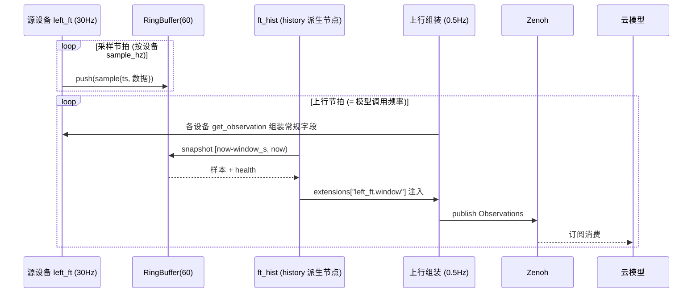

# R2C 多设备管理（设备树）特性设计

> 本文件负责"基于 r2c 的多设备管理（多本体 / 多末端 / 多传感器）"特性的功能设计；不属于本文件的内容：业界调研与代码完全调研见 `docs/research/`（`r2c-multi-device-industry-survey.md`、`cloudrobo-r2c-codebase-survey.md`），R2C 现有单设备实现见 `packages/cloudrobo-r2c/`。
>
> 状态：**v0.3，待评审**。按特性设计模板组织（特性概述 / 需求分析〔需求背景、场景分析、友商分析、名词解释〕/ 功能方案〔功能约束与依赖、整体方案设计、详细功能设计〕/ 可靠性 / 安全 / 性能规格 / 兼容性 / 测试 / 遗留问题）。

## 1. 特性概述

**背景**：本版本要实现基于 r2c 的多设备管理（多本体、多末端、多传感器等）。现状的多设备形态是"整机扁平化"——设备没有独立身份、独立生命周期与独立故障隔离，映射表为全局单表（详见 2.1）。

**特性价值**：
1. 多本体 / 多末端 / 多传感器在配置与消息层获得统一身份与设备树结构；
2. 设备级生命周期、健康与故障隔离；
3. 派生能力（历史、滤波、坐标变换等）作为树上的通用节点，**每个设备只适配一次**，不随能力数量膨胀出变体；
4. 采样频率与云端模型调用频率解耦，高频原始流不出端侧。

**目标**：
- `robot_config` 支持设备树定义：adapters（传输分组）→ 子设备声明 → 派生节点；
- 设备级生命周期状态机与逐设备心跳健康；
- 派生节点机制：首个节点为 `history`（历史窗口），预留 `filter` / `tf`；
- 派生数据经 `Observations.extensions` 随唯一观测入口上行，云端不感知端侧节点结构。

**非目标**（本版本不做）：云端多本体实时协同；`filter` / `tf` 派生节点实现（仅预留注册位）；入湖数据的云端窗口查询；高频原始流上云；图形化运维界面。

## 2. 需求分析

### 2.1 需求背景

版本需求来自本版本规划："实现基于 r2c 的多设备管理（如多本体、多末端、多传感器等）"。对照代码完全调研（`docs/research/cloudrobo-r2c-codebase-survey.md`，结论均带 file:line），现状与差距：

| 维度 | 现状 | 差距 |
|------|------|------|
| 设备身份 | 一个 client/session = 一个 `device_id`（整机，session.py:93-341） | 多设备无独立身份，跨设备仅有订阅覆盖参数 |
| 适配器 | 一个 adapter = 一台整机；多设备靠键前缀约定（`leftarm_/rightarm_`、`camera_*`）或内部子对象 | 无对外子设备声明 API；新 adapter 无法声明"我有哪些设备" |
| 映射 | `device_to_r2c/r2c_to_device` 全局单表，无 device 字段（config_mapper.py:136-154） | 无法按设备分组映射与校验 |
| 消息 | Observations/Actions 扁平；仅 `images.color.<cam>` 与 `extensions` 天然分组 | 关节面无分组；派生数据无标准承载 |
| 生命周期 | 整机 Heartbeat（默认 5s，status/mode/error_code/battery） | 无逐设备状态、健康与故障隔离 |
| 频率 | sync_client 单节拍循环：控制=采样=发布（`publish_hz` 默认 30，sync_client.py:326,922-945） | 采样率与云端模型调用率（事件驱动，无频率参数）耦合 |

### 2.2 场景分析

**场景 1：多传感器设备 + 派生能力。** 多类传感器（六维力、IMU、多相机）挂在一台本体上。示例：六维力传感器 30Hz 采样，云上模型 0.5Hz 调用，每次需要"当前值 + 2 秒内历史（60 样本）"，且高频原始流不上云——历史必须在端侧组装，且不能让力传感器出现"带历史 / 不带历史"两种适配。→ 由设备树 + `history` 派生节点覆盖（3.3）。

**场景 2：共享传输 + 异构传输 + 同型多实例。** 机械臂与夹爪走 ROS 通信（共享同一 ROS 上下文），两个相机走 OpenCV：

```text
ros:
  - 机械臂 (arm)
  - 夹爪 (gripper)
opencv 相机 1
opencv 相机 2
```

要点：树的第一层是**传输/适配器分组**（"ros:" 是一个 ROS 上下文，臂与夹爪共享它），相机是另一传输上的独立设备、且两个相机是同一适配器类型的两个实例。→ 由 adapters 分组 + 组内子设备声明覆盖（3.2、3.3.2）。

**场景 3：多本体。** 多台整机各自一个 `device_id` 会话，云端按设备编排与汇聚（本版本不承诺云端实时协同）。

**能力矩阵**：

| 需求点 | 现状 | 本特性 |
|--------|------|--------|
| 设备身份（独立命名/类型） | ✗（键前缀约定） | ✔ adapter + 子设备声明 |
| 共享传输（多设备一个上下文） | 内部隐式 | ✔ adapter 分组内声明 |
| 同型多实例（两台相机） | 内部隐式 | ✔ 多个 adapter 实例 |
| 异构传输并存（ROS + OpenCV） | 分散在各 adapter | ✔ 各自 adapter 节点 |
| 独立故障隔离 | 整机级 | ✔ 单设备/单分支 DEGRADED |
| 派生能力（历史/滤波/变换） | adapter 内私有（如 flexiv wrench_filtered） | ✔ 通用派生节点，逐设备声明 |
| 频率解耦（30Hz 采样 / 0.5Hz 上行） | ✗（单节拍） | ✔ 双节拍 |
| 派生数据上云（云端不感知端侧结构） | ✗ | ✔ extensions 约定键，唯一观测入口 |

### 2.3 友商分析

| 友商 / 业界实现 | 关键机制 | 对本特性的启示 |
|----------------|----------|----------------|
| Viam | 资源模型（API+model 三元组+全局唯一 name）、sub-part/remote part 并入统一资源图、断线"标 unreachable 不消失"、单表 readings 六级元数据 | 设备命名与重名裁决；断线不消失语义；观测按 (org,location,machine,part,component) 组织 |
| ros2_control | system/sensor/actuator 组件 + `<设备>/<信号>` 接口命名；组件生命周期状态机 + on_error；命令接口独占仲裁 | 设备生命周期状态机与 HardwareStatus 健康消息；接口独占仲裁模型 |
| LeRobot | 配置即组合（注册表 + 嵌套 dataclass）；双臂/多相机键前缀分区 | 配置驱动组合形态；前缀分区规范 |
| ROS 2 + Zenoh（rmw_zenoh / bridge） | topic → key expression 映射；按接口 regex 的频率/优先级/QoS 策略面；liveliness 上下线事件 | key 命名规范（高方差段靠右）；上下线事件替代心跳轮询（后续演进） |
| 灵渠 Link-U OS | AimRT 中间件（ROS 2 兼容 Topic/RPC）；`/aima/hal/<设备类型>/<安装位>/<信号>` 一路一 topic；aimrt_health_monitor（节点心跳/急停） | 传感器命名层级 `<类型>/<安装位>/<信号>`；健康监控清单 |
| Genie Studio（智元） | "Multi-Ontology and Multi-End Effector"采集任务模型；吞吐按 device 计量；Monitor 多机运维 | 设备作为配额/状态/质量的基本计量单元；多机运维独立模块 |
| Unitree SDK2 / ABB MultiMove | 按控制层级分 topic、扁平状态消息；工业多本体协同在控制器层 | 云端不做实时协同，保持每 device_id 独立执行体 |

完整对比与来源见 `docs/research/r2c-multi-device-industry-survey.md`。

### 2.4 名词解释

| 术语 | 定义 |
|------|------|
| 设备树 | `robot_config` 中 adapters（传输分组）+ 子设备声明 + 派生节点构成的关系图；浅层级 + 引用，不做深内嵌 |
| 适配器节点（adapter） | 传输/厂商实现层节点：一个 adapter = 一个上下文（ROS 上下文、串口、相机采集），走现有 `r2c_sdk.adapters` 注册表；设备树的第一层分组 |
| 子设备声明（devices） | adapter 对其键空间内逻辑设备的声明（name / type / channels），由 `describe_devices()` 自动推导、配置可覆盖 |
| 源设备（source） | adapter 键空间内直接对接硬件/厂商 SDK 的设备节点（本体、末端、传感器），由现有 adapter 体系实现 |
| 派生节点（derived） | 以一个或多个子设备的输出为输入、产出派生信号的节点；本版本实现 `history`，预留 `filter` / `tf` |
| 环形缓冲（ring buffer） | SDK 通用组件：按 `(设备, 通道)` 维度缓存最近 `ceil(window_s × sample_hz)` 个样本，溢出覆盖最旧 |
| 样本（sample） | 一个时刻的设备读数：`timestamp` + 数据载荷（复用 `ExtensionValue` 自描述结构） |
| 窗口批（window batch） | `history` 节点注入 `Observations.extensions` 的一组扩展字段（键 `<源设备>.window`）：当前值快照 + 窗口内全部样本 + 起止时间戳 + 健康位 |

## 3. 功能方案

### 3.1 功能约束与依赖

**约束**：
- C1 高频原始采样流不出端侧：按设备声明的采样率写入端侧环形缓冲，仅派生/常规结果上行；
- C2 传感器/设备适配只写一次：派生能力不进入任何设备 adapter；
- C3 采样（及历史窗口）频率与云端模型调用频率解耦，各自可配置；
- C4 兼容：v2.1 存量配置与 Protobuf 消息只增不改；
- C5 观测唯一入口 `{project_id}/{device_id}/inference/observations`，不新起 topic（2026-11-04 定案）；派生数据经 `extensions` 扩展字段承载，云端不感知端侧节点结构。

**依赖**：
- Zenoh 传输与 QoS 体系（沿用 `client/session.py` + `transport/zenoh.py`，不新增 topic 类型）；
- `r2c_sdk.adapters` entry-point 注册表（adapter 复用现有 16 个实现）；
- `common/robot_config_schema.py` pydantic 校验链（需扩展，见 3.3.2）；
- `Observations.extensions`（`map<string, ExtensionValue>`）与 proto 兼容规则。

### 3.2 整体方案设计

**技术选型**：

| 选型点 | 决策 | 依据 |
|--------|------|------|
| 组合层级 | adapters（传输分组）→ 组内子设备声明（describe_devices + channels 覆盖）→ 派生节点按设备名引用（可跨 adapter） | 与"一个 adapter = 一个上下文"的代码现状同构（ros2 adapter 持有 ROS 上下文、lerobot bi_so_follower 双臂）；天然支持共享传输与同型多实例；不引入"多 adapter 编排"新机制 |
| 设备身份 | `adapter.name + device.name`（name 全局唯一）+ `channels` 键前缀声明 | 对齐 Viam 资源 name / ros2_control 块名惯例；树负责"是谁、挂在哪"，引用负责"用谁" |
| 子设备发现 | `describe_devices()` 元数据 API 自动推导 + 配置覆盖 | ros2 `get_transport_targets`、a1z `camera_meta`、命令注册表均为现有雏形 |
| 派生节点注册 | 新增 `r2c_sdk.derived_nodes` entry-point 组（镜像现有 adapter 注册机制） | ros2_control controller chaining / YARP remapper 同构：能力是链上节点，不是设备变体 |
| 派生数据承载 | `Observations.extensions` 约定键 `<设备>.window`，载荷 BYTES（proto 序列化） | 现有 `map<string, ExtensionValue>` 机制零侵入；观测唯一入口（C5） |
| 上行频率 | 观测上行 = 云端模型调用频率（0.5Hz）；采样按设备 `sample_hz` 独立节拍写环形缓冲 | 现状 sync_client 单节拍（控制=采样=发布）需拆为双节拍 |

**整体架构**：

```text
robot_config (v3.0: adapters 树 = 传输分组 + 子设备声明 + 派生节点)
  │
  ▼
DeviceManager（每 R2CClient 一个，按 adapter 组织）
  ├── adapter: left_ft_dev (type ft300)            # 一个厂商/传输上下文 = 一个 adapter
  │     └── 源设备: left_ft ──30Hz──► RingBuffer(left_ft, cap=60)
  ├── adapter: cam0 (type opencv_camera)           # 同型多实例：cam0 / cam1 ...
  │     └── 源设备: camera0 ──30Hz──► RingBuffer(camera0, cap=60)
  ├── 派生: ft_hist (derived/history, input=left_ft)
  │        └─ 每 2s: 截窗 [now-2s, now) → 注入 extensions["left_ft.window"]
  └── 派生: ...(filter/tf 预留)
  ▼
Zenoh: {project_id}/{device_id}/inference/observations（观测唯一入口）
  │  常规字段 + extensions（含派生数据）一并上行
  ▼
云模型（按调用频率订阅消费；只按约定键读 extensions，不感知端侧节点）
```

**关键时序**：



### 3.3 详细功能设计

#### 3.3.1 功能原理

- **装载**：`DeviceManager` 按 `adapters` 列表实例化适配器（复用现有 AdapterRegistry），在每个 adapter 键空间内登记子设备（`describe_devices()` 声明 + 配置覆盖），实例化派生节点（`r2c_sdk.derived_nodes` entry-point 组）。
- **双节拍**：采样节拍按设备 `sample_hz` 拉取 `get_observation()` 写环形缓冲；上行节拍按模型调用频率组装 Observations（常规字段 + 各派生节点注入的 extensions），经现有会话发布。现状 sync_client 的单节拍循环拆分为两节拍。
- **生命周期**：借鉴 ros2_control 组件状态机——设备 `UNCONFIGURED → INACTIVE → ACTIVE`；派生节点在其全部 input 设备 ACTIVE 后激活；单设备 ERROR 仅影响其下游派生链（转 DEGRADED），设备树其他分支不受影响。
- **故障隔离**：单设备/单分支离线不拖垮整机；断线资源"标记不可用而非消失"（对齐 Viam 语义），恢复后自动回归。

#### 3.3.2 接口设计

**配置接口**（robot_config schema v3.0）：

```yaml
schema_version: "v3.0"

runtime:            # 沿用 v2.1 字段；观测上行对齐模型调用频率

adapters:                          # 传输/厂商实现层：一个 adapter = 一个上下文
  - name: left_ft_dev
    type: ft300                    # 走现有 r2c_sdk.adapters entry-point 注册表
    params:
      port: /dev/ttyUSB0
      sample_hz: 30.0              # 采样率，历史窗口容量按此折算
    devices:                       # 子设备声明（describe_devices 自动推导，配置可覆盖 channels）
      - name: left_ft
        type: force_torque
        channels: ["wrench_*"]
    translator: ...                # 映射按设备分组：devices.left_ft.mappings（沿用现有映射语义）
  - name: cam0
    type: opencv_camera            # 新增独立相机适配器（见遗留问题 6）
    params: {index_or_path: "/dev/video0", width: 640, height: 480, fps: 30}
    devices:
      - {name: camera0, type: camera, channels: ["camera0*"]}

derived:                           # 派生节点（input 引用设备名，可跨 adapter）
  - name: left_ft_hist
    type: history
    input: left_ft
    params:
      window_s: 2.0                # 随观测上行，无独立发布频率
```

校验规则：

| 规则 | 说明 |
|------|------|
| `adapters.<name>.type` | 走现有 entry-point 注册表；一个 adapter = 一个传输/厂商上下文 |
| `adapters.<name>.devices` | 子设备 `name` 全局唯一；`channels` 声明占用的键前缀；优先 `describe_devices()` 推导、配置覆盖 |
| `derived` 节点必须有 `input` | 引用子设备名（可跨 adapter）；允许链式引用派生节点，加载时做无环检测 |
| 容量上限 | `window_s × sample_hz ≤ 4096`，超出拒绝加载——需在 `robot_config_schema` 显式新增校验（现状 pydantic `extra="allow"` 对未知字段静默，代码调研偏差 #6） |
| 兼容 | 配置无 `adapters` 块时，完全沿用 v2.1 单 `hardware` 块行为，不加载 DeviceManager |

**元数据 API**：`IRobotHardwareAdapter` 增加可选覆盖 `describe_devices() -> list[DeviceDeclaration]`（`name/type/channels`），默认返回空（由配置声明兜底）；ros2 适配器从 `SubscriptionConfig.store_as` 前缀推导。

**消息接口**：观测唯一入口不变；extensions 约定键见 3.3.3；proto 只增不改。

**界面设计**：本特性为 SDK/配置层特性，无新增图形界面；多机运维可视面（对标 AimStudio 式工具）列入后续规划。

#### 3.3.3 数据结构设计

**extensions 派生数据约定**（以 `history` 节点为例）：

```text
extensions["<源设备名>.window"] = ExtensionValue{
  dtype: BYTES,
  data:  ObservationWindow 序列化字节
}
```

新增 `observation_window.proto`（包 `r2c_sdk`，与现有 proto 同目录、同编译链；只增不改）：

| 消息/字段 | 说明 |
|-----------|------|
| `WindowSample{timestamp_us, data}` | 单样本：UNIX 微秒时间戳 + `ExtensionValue` 自描述载荷（六维力 = FLOAT64[6]） |
| `WindowHeader{node_name, source_device, seq, window_start_us, window_end_us, sample_hz, expected_samples, health}` | 窗口头：派生节点名仅端侧使用；`seq` 供云侧丢批检测；`expected_samples` 为满窗基准；`health ∈ {HEALTHY, WARMUP, DEGRADED}` |
| `ObservationWindow{header, current, samples}` | 载荷整体：当前值快照 + 窗口内样本（时间升序） |

**Heartbeat 扩展**（只增）：`repeated DeviceHealth devices`（name、state、error_code）——逐设备健康，整机字段保留。

**分组演进**：`images.color.<cam>` 与 `end_effector_poses` map 已按名分组；`joint_states` 的多设备分组列为后续特性（见遗留问题 5）。

## 4. 可靠性与异常设计

| 异常 | 行为 |
|------|------|
| 源设备离线 | 该设备及其下游派生链转 DEGRADED，其余分支不受影响；恢复后自动回归 |
| 环形缓冲未满窗（冷启动/断流恢复） | health = WARMUP，samples 为实际条数，`expected_samples` 恒定提供满窗基准 |
| 上行失败 / Zenoh 断连 | 沿用现有可靠传输重试；派生数据不做历史补发（快照语义），`seq` 供云侧检测丢批 |
| 时间倒退 | 丢弃早于窗口起点的新样本并计数告警（心跳 error_code） |
| 客户端重启 | 冷启动重新走 WARMUP → HEALTHY |
| 断流检测 | 距上次样本超过 `2 / sample_hz` 判定断流 → health = DEGRADED |

## 5. 安全设计

沿用现有 Zenoh TLS / 凭证 bundle 体系，无新增认证面；extensions 扩展字段不新增敏感数据；不引入可预测的越权路径（与现有 topic 规则一致）。

## 6. 性能规格

- 上行带宽：以历史窗口为例，每派生节点每批 ≈ 60 × (8B 时间戳 + 48B 六维力) + 头部 ≈ 4KB，0.5Hz ≈ 2KB/s/设备；N 台设备线性叠加；远低于原始流式上行（消息数 1/60）。
- 端侧内存：每环形缓冲 60 × 56B ≈ 3.4KB/设备（double 型信号；ExtensionValue 按实际 dtype）。
- CPU：缓冲写入 O(1)，每上行周期一次 O(窗口) 拷贝与 protobuf 编码，可忽略。

## 7. 兼容性与升级

- 配置：无 `adapters` 块 = v2.1 原行为，存量配置零改动；派生节点不配置 = 不加载。
- Protobuf：只增不改（proto3 兼容规则）；旧云侧忽略 extensions 新键即可，无破坏。
- 回退：two-way door——回退客户端版本即回到单设备行为；无数据迁移。

## 8. 测试与验收

| 层级 | 内容 |
|------|------|
| 单测 | RingBuffer 边界（空/未满/满/覆盖）、截窗时间语义（频率抖动）、无环检测、配置校验报错（含未知字段显式校验） |
| 集成（场景 1） | dummy/FT 源设备 + history 节点 e2e：本地 Zenoh 起 router，校验上行频率 ±10%、满窗样本数、seq 递增、health 状态迁移（WARMUP→HEALTHY→DEGRADED→HEALTHY） |
| 集成（场景 2） | ros2（arm+gripper 共享上下文）+ 两个 opencv_camera 实例：子设备声明、异构传输并存、单分支故障不影响其他分支 |
| 验收标准 | 云侧按模型调用频率收到 Observations，extensions 含约定键窗口批；v2.1 存量配置回归通过；单设备故障不影响其他设备 |

## 9. 遗留问题与后续规划

1. `filter` / `tf` 派生节点实现（本版本仅注册位）；
2. 入湖数据的云端窗口查询（训练 / 回放场景）；
3. 常规 Observations 内多设备 `joint_states` 分组消息（`end_effector_poses` map 模式推广到关节面）；
4. 运行中热更新设备树（对标 Viam 热加载）；
5. 多机运维可视面（多机连接、批量部署、告警）；
6. 存量 16 个 adapter 分批补 `describe_devices()`（ros2/lerobot 优先，其余先回退配置声明 channels）；新增独立 `opencv_camera` 适配器（场景 2 增量）；
7. rmw_zenoh liveliness 上下线事件替代心跳轮询（长期演进）。

## 10. 决策点汇总

| # | 决策点 | 状态 / 建议 |
|---|--------|-------------|
| D1 | 组合层级 | **已定案（2026-11-04，场景 2 驱动）**：adapters（传输分组）+ 组内子设备声明 + 派生节点引用；不采用显式 parent 深层级 |
| D2 | Heartbeat 增加逐设备健康列表 | 采纳（proto 只增） |
| D3 | 观测上行频率 | **修订**：对齐云端模型调用频率（0.5Hz）；sync_client 拆采样/上行双节拍 |
| D4 | extensions 载荷格式 | BYTES 承载 `ObservationWindow` proto 序列化；备选：拆 data/ts 两个张量字段（待评审） |
| D5 | 派生数据 health 与 Heartbeat 的分工 | 派生数据只描述本链路，整机以 Heartbeat 为准 |
| D6 | 是否上报端云时钟差 | V1 不做，依赖 NTP 运维前提 |
| D7 | 派生数据承载方式 | **已定案（2026-11-04）**：不新起 topic，观测唯一入口，extensions 承载，云端不感知端侧节点结构 |
