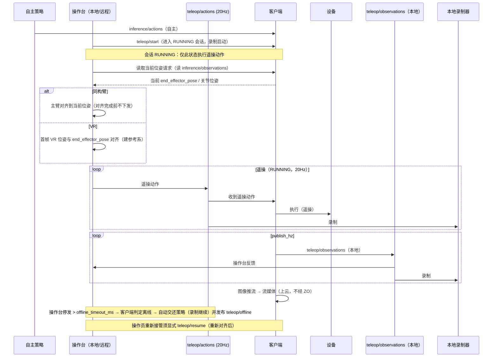

# R2C 遥操与数据采集特性设计

> 本文件负责"基于 r2c 的遥操与数据采集"特性的功能设计；不属于本文件的内容：设备树特性设计见 [PR #1 的 r2c-multi-device-tree-design.md](https://github.com/vincentguiling/cloudrobo-sdk-client/blob/agent/research-r2c-multidevice-d6cf83e2c104/docs/design/r2c-multi-device-tree-design.md)（该文档合入后改为仓库内相对路径），业界调研见 `docs/research/r2c-multi-device-industry-survey.md`，代码现状见 `docs/research/cloudrobo-r2c-codebase-survey.md`。
>
> 状态：**v1.0，待评审**。v1.0（2026-11-06 反馈）：新增 §3.3.5 **VR客户端功能实现**（参考 metaquest-dist：Unity+OpenXR 六层架构、离合相对映射、teleop.v1→r2c 协议映射、Zenoh 传输与部署、阶段化路线）。v0.9（2026-11-06 反馈）：新鲜度仲裁升级为**显式遥操离线机制**——RUNNING 内超时判定操作台离线，自动交还策略模式（录制继续）并发布 `teleop/offline` 事件，重新接管须显式 `resume`；不再使用隐式"过期回退"。v0.7：消除"生命周期门控"与"发布权交接"表述矛盾——客户端感知会话状态并据此门控，不判断接管权限；执行规则为会话状态 + 新鲜度两层判定。v0.8 增补（2026-11-05 反馈）：**新增 `teleop/observations` 录制 → LeRobot v2.1/v3 格式转换设计**（transformer 自定义转换管道；v3 从 v2.1 两段式转换，见 §3.3.2）；**§3.3 按功能重排**（3.3.1 遥操功能实现、3.3.2 数据采集与格式转换、3.3.3 接口设计、3.3.4 数据结构设计）。更早版本：teleop 动作/观测独立话题（20Hz）、观测仅本地不上云（格式同 inference）、图像推拉流上云、同构臂对位/VR 相对位姿、生命周期五话题门控、客户端不区分本地/远程。实现范围（2026-11-05 决策）：**VR 输入与云端实时遥操（远程遥操）为原始需求但仍在设计阶段——实现已从 PR #2 移除**（vr_udp 源/teleop_vr_udp 配置/VR mock 发送端），本文档按保留实现对齐：已实现 = 主从臂（lerobot_leader）+ mock_joints 源、局域网现场遥操、录制；VR/远程遥操相关章节为设计阶段内容。只出设计，不含实现。

## 1. 特性概述

**背景**：本特性主力场景是**遥操接管**——机器人按云端策略自主执行，遇异常时操作员接管，处理完交还自主；接管时段是价值最高的训练数据（回流配置中 `collect_method` 已有"遥操接管"）。现状：r2c 只有整机原始观测录制（`ObservationRecorder` + `--record`，cloudroboclient.py:188-193）与回放；遥操在 r2c 之外（LeRobot teleoperate、`--teleop.joint_sign`）。

**核心思路**：
1. **遥操动作独立话题**：`{p}/{d}/teleop/actions`，**20Hz** 下发，与策略动作 `{p}/{d}/inference/actions` 分开，互不覆盖；客户端两条来源都订阅。RUNNING 态内执行遥操，**超过 `offline_timeout_ms` 未收到遥操动作即判定操作台离线并自动交还策略模式**（见核心思路 7）；非 RUNNING 态遥操动作直接丢弃（见核心思路 6）。
2. **遥操观测独立话题**：`{p}/{d}/teleop/observations`，按 `publish_hz` 发布，**只在本地流转、不上云**（由本地操作台端录制保存）；**数据格式与内容与 `inference/observations` 一致**（同一 `Observations` 消息）。**图像通过推拉流上云**（不经 teleop/observations 承载，见 3.3.1）。
3. **本地/远程不区分**：本地操作台与远程操作员都发布到同一个 `teleop/actions`，客户端无本地/远程分支。
4. **采集=本地端录制两个话题**：`teleop/actions` 与 `teleop/observations`（本地录制器）。
5. **遥操输入两类**：同构臂——先对齐位姿再跟随；VR——相对位姿模式（首帧对齐 `end_effector_pose`）。
6. **会话生命周期门控**：`teleop/start|pause|resume|finish|quit` 五个生命周期话题控制遥操会话状态；**仅在数采进行中（RUNNING）客户端才接收&执行 `teleop/actions`**，其余状态一律忽略（防止无人值守时遥操动作驱动机器人）。
7. **遥操离线机制（自动交还策略）**：RUNNING 态内超过 `offline_timeout_ms`（默认 300ms）未收到 `teleop/actions`，客户端判定**操作台离线**，自动切回策略模式（恢复执行 `inference/actions`）、录制继续，并发布 `teleop/offline` 事件通知操作台；离线期间遥操动作不再执行，**操作员须显式 `teleop/resume` 才能重新接管**（避免误以为仍在控制）。

**目标**：
- 新增 `teleop/actions`（20Hz，客户端订阅、执行）与 `teleop/observations`（客户端按 `publish_hz` 发布，仅本地流转）；
- 会话生命周期门控：五话题驱动的客户端状态机（§3.3.2），仅 RUNNING 态执行遥操动作；
- 遥操离线机制：RUNNING 内超时判定离线 → 自动交还策略模式 + `teleop/offline` 事件 + 显式 `resume` 重新接管；
- 同构臂遥操的位姿预对齐流程；VR 遥操的相对位姿模式；
- 本地端录制 `teleop/actions` + `teleop/observations`，可轮转、可回放；
- 图像经推拉流上云（teleop/observations 不承载图像上云）；
- 配置最小化（客户端新增 ≤ 5 项，均有默认值）。

**非目标**（本版本不做）：客户端内建接管权限体系（由 Zenoh ACL/发布端承担）；推拉流服务端实现（复用现有视频通道/三方流媒体，本期只约定对接方式）；云端 episode 浏览/标注；多机器人协同遥操。

## 2. 需求分析

### 2.1 需求背景

| 维度 | 现状 | 差距 |
|------|------|------|
| 遥操动作通路 | 无；遥操在 r2c 外 | 需要与策略动作分开的遥操动作话题（20Hz） |
| 遥操观测 | 只有 `inference/observations`（给模型） | 需要本地高频的 `teleop/observations`（不上云），图像另走推拉流 |
| 遥操输入模式 | 只有外部主从臂 | 需要同构臂位姿预对齐与 VR 相对位姿两种模式 |
| 本地 vs 远程 | 概念上视为两种模式 | 客户端不应区分：同一 `teleop/actions` 话题 |
| 采集 | `--record` 录整机原始观测（cloudroboclient.py:415-425） | 需要本地端录制遥操两话题 |
| 回放 | playback 回放整机帧 | 录制产物需可回放 |

### 2.2 场景分析

**场景 1：遥操接管（主力）。** 策略在 `inference/actions` 上执行；操作员发 `teleop/start` 进入会话（RUNNING），开始向 `teleop/actions`（20Hz）发布。客户端在该状态下执行遥操；操作台若停发超过 `offline_timeout_ms`，客户端判定遥操离线并**自动交还策略模式**（策略恢复执行、录制继续、发布 `teleop/offline` 事件），操作员重新接管需显式 `resume`；`pause` 则整机保持。接管期间 `teleop/observations` 按 `publish_hz` 本地发布（操作台反馈 + 本地录制），图像另行推拉流上云供远程观看。

**场景 2：同构臂遥操（同型号臂作主臂）。** 开始遥操前，客户端/操作台先把同构臂（主臂）的位姿**对齐到当前从臂位姿**（读 `inference/observations` 的当前 `end_effector_pose`/关节位姿），对齐完成前不下发动作；对齐后主臂增量即从臂增量。

**场景 3：VR 遥操（相对位姿）。** VR 控制器为输入：首帧 VR 位姿与 `inference/observations` 的 `end_effector_pose` 对齐（建立参考系），之后按 VR 相对位姿增量驱动从臂末端；无需物理对齐主臂。

**场景 4：远程遥操。** 操作员跨网络发布到同一 `teleop/actions`、图像经推拉流观看；`teleop/observations` 仍只本地流转（本地端录制）。

**场景 5：只采集。** 本地录制器记录遥操两话题。

**能力矩阵**：

| 需求点 | 现状 | 本特性 |
|--------|------|--------|
| 遥操动作与策略动作分离 | ✗ | ✔ `teleop/actions`（20Hz）vs `inference/actions` |
| 遥操观测本地高频、不上云 | ✗ | ✔ `teleop/observations` @ `publish_hz`，仅本地流转，格式与 inference 一致 |
| 图像上云 | 现有推理观测含图像 | ✔ 图像走推拉流（teleop 观测不承载上云） |
| 同构臂位姿预对齐 | ✗ | ✔ 操作前对齐到当前位姿（读 inference/observations） |
| VR 相对位姿遥操 | ✗ | ✔ 首帧对齐 `end_effector_pose`，后续增量 |
| 本地/远程一致 | 概念上分叉 | ✔ 同一 `teleop/actions`，客户端不分 |
| 遥操离线机制 | 无 | ✔ RUNNING 内超时判定操作台离线 → 自动交还策略模式（录制继续、`teleop/offline` 事件），重新接管须显式 `resume` |
| 本地端录制两话题 | ✗ | ✔ `teleop/actions` + `teleop/observations` |
| 回放 | 整机帧回放 | ✔ 按 topic 回放 |

### 2.3 友商分析

| 友商 / 业界实现 | 关键机制 | 启示 |
|----------------|----------|------|
| LeRobot | 主从臂 teleoperate、record/replay | 遥操与录制可以很薄：主臂→从臂、录制存帧 |
| Viam | 失联即停；数据 capture 按资源×方法 | 客户端只需超时即停；采集按来源分 |
| ROS 2 + Zenoh | topic → key expression；regex 策略控频率/QoS | 话题即接口；遥操/策略各走各的话题 |
| Genie Studio / 灵渠 OS | 采集任务与校验在云侧/工具链，端侧薄 | 端侧只发动作/录话题，编排上移 |

### 2.4 名词解释

| 术语 | 定义 |
|------|------|
| teleop/actions | 遥操动作话题；20Hz 下发；本地与远程操作台均发布到这里，客户端统一订阅 |
| teleop/observations | 遥操观测话题；客户端按 `publish_hz` 发布，**仅本地流转、不上云**（本地操作台端录制），格式与内容与 `inference/observations` 一致 |
| 推拉流 | 图像上云方式：客户端把相机画面推到流媒体服务，云端/远程操作台拉流观看；teleop/observations 不承载图像上云 |
| 同构臂位姿预对齐 | 同构臂遥操开始前，把主臂位姿调整到与从臂当前位姿一致（读 `inference/observations`），对齐完成前不下发动作 |
| VR 相对位姿遥操 | VR 首帧位姿与从臂当前 `end_effector_pose` 对齐建立参考系，之后按 VR 相对位姿增量驱动 |
| 遥操离线机制 | RUNNING 内超过 `offline_timeout_ms` 未收到 `teleop/actions` → 判定操作台离线：自动交还策略模式、发布 `teleop/offline`、录制继续；重新接管须显式 `teleop/resume` |
| 会话状态门控 | 客户端维护数采会话状态（IDLE/RUNNING/PAUSED/FINISHING），仅 RUNNING 接收执行 `teleop/actions`；**客户端感知"会话状态"，但不判断"接管权限/归属"**（谁可接管由 Zenoh ACL 与操作台约定） |
| 发布权交接 | 上层编排语义：`teleop/start` 后操作台发布的 `teleop/actions` 即被执行，**策略在会话期间持续发布、作为遥操过期时的回退来源**；`finish`/`quit` 回 IDLE 后恢复纯策略执行。客户端不跟踪"谁在控制"，只按会话状态 + 动作新鲜度执行 |
| 录制器 | 订阅指定 topic、按到达时序落盘的订阅者（R2CR 格式） |

## 3. 功能方案

### 3.1 功能约束与依赖

**约束**：
- C1 遥操动作与策略动作**分话题**，互不覆盖：`teleop/actions`（20Hz）与 `inference/actions`；
- C2 客户端**不区分**本地/远程遥操，同一 `teleop/actions` 与同一执行路径；
- C3 `teleop/observations` 按 `publish_hz` 发布、**仅本地流转不上云**，格式与内容与 `inference/observations` 一致；
- C4 图像通过**推拉流**上云，`teleop/observations` 不承载图像上云；
- C5 遥操输入两类：同构臂（位姿预对齐）与 VR（相对位姿，首帧对齐 `end_effector_pose`）；
- C6 采集 = 本地端录制 `teleop/actions` + `teleop/observations`；
- C7 配置最小化（≤5 项，均有默认值）；兼容现有 `--record`、R2CR v1 与 playback。

**依赖**：
- `transport/zenoh.py`（pub/sub、QoS、TLS）与 `client/session.py`（topic 命名、发布/订阅方法）；
- `Actions`/`Observations` 消息与 `sync_client` 动作执行路径；
- `common/utils/recorder.py` + `safe_serialization.py`（R2CR）；
- Zenoh ACL（谁可发布遥操话题）。

### 3.2 整体方案设计

**技术选型**：

| 选型点 | 决策 | 依据 |
|--------|------|------|
| 遥操动作话题 | **新增** `{p}/{d}/teleop/actions`，**20Hz**，与 `inference/actions` 分离 | 策略与遥操互不覆盖、可独立录制与鉴权 |
| 遥操观测话题 | **新增** `{p}/{d}/teleop/observations`，按 `publish_hz` 发布，**仅本地流转**，格式与 `inference/observations` 一致 | 操作台反馈与本地录制；不上云降低公网带宽 |
| 图像上云 | **推拉流**：客户端推相机流到流媒体服务，云端/远程拉流 | 高频图像不走 Zenoh 观测话题；teleop/observations 保持轻量 |
| 同构臂预对齐 | 遥操开始前读 `inference/observations` 当前位姿，主臂对齐后才进入跟随 | 消除初始位姿差，避免起跳 |
| VR 相对位姿 | 首帧 VR 位姿与 `end_effector_pose` 对齐，后续按增量映射 | VR 无物理对齐手段，用参考系平移 |
| 门控与离线机制 | 会话状态门控（仅 RUNNING 执行遥操；PAUSED 两路停；IDLE/FINISHING 只执行策略）+ 离线检测（RUNNING 内超 `offline_timeout_ms` 无遥操动作 → 判定离线、自动交还策略、发 `teleop/offline`、需显式 `resume` 重新接管；策略也停 → 停止保持） | 离线是显式状态迁移而非隐式回退；操作员始终知道当前是遥操还是策略 |
| 本地/远程 | 不区分，同一话题 | 去掉客户端模式分支 |
| 采集 | 本地端录制 `teleop/actions` + `teleop/observations` | 与约定一致；R2CR 落盘；录制器在本地操作台侧 |

**整体架构**：

```text
发布端                                          客户端
  ├── 自主策略 ──► inference/actions ─────────► 会话门控 + 离线检测/自动交还
  └── 操作台(本地/远程) ──► teleop/actions(20Hz) ─┘        │
                                                       ▼
                                                限幅/安全检查 → 设备

  客户端 ──► teleop/offline（事件，离线时）──► 操作台（提示已被自动交还）
  客户端 ──► teleop/observations（publish_hz，仅本地流转）──► 本地操作台（反馈）
                                                        └──► 本地录制器 ─► recordings/*.r2cr
  客户端 ──► 相机画面 ──推流──► 流媒体服务 ──拉流──► 云端/远程观看（图像上云）
```

**关键时序（同构臂 / VR 遥操）**：



### 3.3 详细功能设计

> 3.3 按功能拆分：3.3.1 遥操功能实现（客户端执行侧）、3.3.2 数据采集与格式转换（录制与导出）、3.3.3 接口设计（共享话题/配置/CLI）、3.3.4 数据结构设计（录制目录）、3.3.5 VR客户端功能实现（Quest 操作端，参考 metaquest-dist）。

#### 3.3.1 遥操功能实现

##### 3.3.1.1 功能原理

- **动作订阅与执行规则（会话状态 + 在线/离线状态）**：客户端同时订阅 `inference/actions` 与 `teleop/actions`（20Hz 操作节拍）。
  - `IDLE` / `FINISHING`：只执行 `inference/actions`；`teleop/actions` 丢弃（计数告警）；
  - `RUNNING` + **遥操在线**（最近 `offline_timeout_ms` 内有遥操动作）：执行遥操动作；
  - `RUNNING` + **遥操离线**（超过 `offline_timeout_ms` 无遥操动作）：判定操作台离线 → **自动交还策略模式**，执行 `inference/actions`，发布 `teleop/offline` 事件；离线期间新到的遥操动作一律不执行（须 `resume` 重新接管）；
  - `RUNNING` + 遥操离线且策略动作也过期：停止并保持（安全兜底）；
  - `PAUSED`：两路都不执行（保持位姿），避免"暂停遥操但策略继续动"；PAUSED 不做离线检测（人工暂停与失联区分开）。
  在线/离线只影响"由谁驱动"，不改变既有的 stale 判定、chunk 对齐、n-skip、fusion。
- **本地/远程统一**：操作台无论本地进程还是远端节点，都向 `teleop/actions` 发布；`teleop/observations` 的消费者与录制器在本地。客户端无模式分支。
- **接管、离线自动交还与显式交还**：
  - **接管** = 控制端发 `teleop/start` 进入 RUNNING（录制启动），操作台发布 `teleop/actions` 即被执行；**策略在会话期间持续发布**，作为离线交还后的执行来源；
  - **离线自动交还** = RUNNING 内超过 `offline_timeout_ms` 无遥操动作 → 判定操作台离线 → 自动切回策略模式（执行 `inference/actions`）、录制继续（记录离线区间）、发布 `teleop/offline` 事件；**这是状态迁移，不是隐式回退**——离线期间遥操动作不被执行，操作员侧 UI 由该事件提示"已自动交还"；
  - **重新接管** = 操作员排除故障后发 `teleop/resume`（操作台侧完成重新对齐/确认）→ 回到遥操在线；
  - **显式交还** = 控制端发 `finish`/`quit` → 回 IDLE，恢复纯策略执行。
  客户端按会话状态 + 在线/离线决定执行来源，**不判断"谁有接管权限"**（权限由 Zenoh ACL 与操作台约定）。

##### 3.3.1.2 会话生命周期与数采门控

客户端维护会话状态机（事件源为五个生命周期话题 + 遥操在线/离线检测）：

```text
IDLE --start--> RUNNING --pause--> PAUSED --resume--> RUNNING
RUNNING --finish--> FINISHING（录制收尾落盘）--> IDLE
RUNNING/PAUSED --quit--> IDLE（丢弃当前会话未落盘数据）
任意态 --quit--> IDLE；start 仅在 IDLE 有效，重复 start 忽略并告警
RUNNING 内部子态：teleop_online（默认，start/resume 后）--超时无遥操动作--> teleop_offline（自动交还策略，发 offline 事件）--resume--> teleop_online
```

- **门控规则（核心安全语义）**：仅 **RUNNING 且遥操在线**时客户端执行 `teleop/actions`；IDLE/PAUSED/FINISHING/离线态收到的遥操动作一律丢弃（计数并限频告警）。PAUSED 时策略动作也不执行（整体保持），避免"暂停遥操但策略继续动"的意外。
- **与采集的耦合**：录制器在**本地操作台侧**，与客户端消费同一组生命周期事件——操作台发 `start` 时同时启动录制器（两话题），`pause/resume` 在录制文件上打分段标记，`finish` 收尾落盘并生成 `meta.json`，`quit` 丢弃未完成数据；客户端只负责执行门控与观测发布，不持有录制器。数采与遥操执行共用同一状态机，天然满足"不在数采状态下不接收&执行 teleop/actions"。
- **消息形态**：生命周期话题 payload 为轻量事件帧（`{timestamp, session_id, operator}` JSON 或复用 `CommandMessage` proto），客户端不校验内容语义，收到即按话题名转移状态；幂等：重复/乱序事件按状态机合法性检查忽略。建议用 proto 固化（只增不改）：

```protobuf
message TeleopControl {
  string session_id = 1;       // start 生成，后续控制携带；不匹配则忽略
  string source = 2;           // 触发源：local_pad / cloud / watchdog
  int64  timestamp_us = 3;     // 乱序/过期控制按此校验
  oneof payload {
    Start   start   = 10;      // input_mode: isomorphic_arm | vr
    Pause   pause   = 11;
    Resume  resume  = 12;      // 离线自动交还后重新接管（操作台侧须先完成重新对齐/确认）
    Finish  finish  = 13;      // keep_recording: bool
    Quit    quit    = 14;
  }
}
```

- **发布者**：操作台/云端控制台均可发布（权限由 Zenoh ACL 控制）；本地操作台"开始采集"按钮即发 `teleop/start`。
- **离线兜底**：`RUNNING` 且遥操在线时超过 `offline_timeout_ms`（默认 300ms）无遥操动作 → 判定操作台离线，自动交还策略模式（见 3.3.1.1），会话仍 RUNNING、录制继续；`PAUSED`/`IDLE`/`FINISHING` 不做离线检测，直接阻断遥操执行。

##### 3.3.1.3 同构臂位姿预对齐

遥操开始前，操作台读取当前位姿（`inference/observations` 的 `end_effector_pose`/关节位姿），驱动主臂运动到该位姿；对齐完成（误差 < 阈值）前操作台不下发 `teleop/actions`。对齐由操作台侧流程完成，客户端无需新状态机。

##### 3.3.1.4 VR 相对位姿遥操

VR 首帧位姿作为参考原点，与 `inference/observations` 的 `end_effector_pose` 对齐；之后按 VR 相对位姿增量（平移+旋转）叠加到参考位姿生成目标末端位姿。首帧对齐与增量映射在操作台/VR 侧实现。

##### 3.3.1.5 遥操观测发布

客户端在控制循环的每个 `publish_hz` 节拍组装 Observations，发布到 `teleop/observations`；**发布时段与会话门控一致**——RUNNING/PAUSED 态发布（PAUSED 供操作台确认现场），IDLE/FINISHING 停止发布。**格式与内容与 `inference/observations` 一致（同一 `Observations` 消息）**，区别仅在话题、频率（`publish_hz` vs 0.5Hz）与流转范围（仅本地、不上云）。图像不在此话题承载上云。

##### 3.3.1.6 图像推拉流上云

相机画面由客户端推到流媒体服务（复用现有视频通道/三方流媒体，本版只约定对接方式），云端/远程操作台拉流观看；`teleop/observations` 保持轻量（非图像字段），仅本地流转。

#### 3.3.2 数据采集与格式转换

##### 3.3.2.1 话题录制（R2CR）

- 本地录制器订阅 `teleop/actions` + `teleop/observations`，原样落盘（R2CR v1，按 topic 分文件），按大小/时长轮转；可选 `meta.json` 记设备树快照与配置哈希（数据结构见 §3.3.4）。
- 回放：按录制文件与 topic 回放；playback 设备类型注入设备树。
- 录制文件是格式转换（3.3.2.2~3.3.2.4）的唯一输入源。

##### 3.3.2.2 转换管线与 transformer 抽象

录制文件（R2CR + meta.json）→ **LeRobot 数据集**的转换采用可插拔 transformer 管道：

```text
recordings/*.r2cr + meta.json
  → EpisodeSplitter（按 meta 会话记录分段：start..finish 为一个 episode；pause/resume 打段边界标记）
  → FrameDecoder（按 topic 反序列化：teleop/observations → Observations，teleop/actions → Actions）
  → Transformer 管道（可插拔，逐帧变换）
  → LeRobotWriter（v2.1 / v3 写出）
```

**Transformer 抽象**（与 r2c 既有 `transformers/` 注册表机制一致，`r2c_sdk.transformers` entry-point 注册）：

- 每个 transformer 声明 `input_keys → output_keys` 与 `transform(frame, ctx) → frame`，可级联；
- 内置 transformer：`decode_image`（jpeg/webp bytes → ndarray，供视频编码）、`joint_rename`（R2C 关节名 → LeRobot feature 名）、`gripper_normalize`（开度区间归一）、`resample`（20Hz 动作/`publish_hz` 观测 → 数据集目标 fps 对齐）、`drop_keys`；
- 自定义转换：第三方以 entry-point 注册 transformer 并在转换配置中声明管道（`convert.yaml`），不改核心代码；
- 对齐规则：以 `teleop/observations` 帧时间戳为主时间轴，`teleop/actions` 按最近邻对齐到观测时间戳（LeRobot `action` 为观测时刻的下发动作，与"观测+动作成对"语义一致）。

##### 3.3.2.3 LeRobot v2.1 导出

- **输出结构**：LeRobotDataset v2.1 目录（`meta/info.json`、`meta/episodes.jsonl`、`meta/tasks.jsonl`、`data/chunk-*/episode_*.parquet`、`videos/chunk-*/`）；
- **字段映射**（默认，可被 transformer 覆盖）：
  - `observation.state` ← `teleop/observations.joint_states`（names+position）；
  - `observation.images.<cam>` ← `teleop/observations.images`（解码后按 fps 编码 mp4）；
  - `action` ← `teleop/actions.joint_states.position[0]`（或 ee 模式的 `end_effector_poses`，按操作模式二选一）；
  - `timestamp` ← 观测帧相对 episode 起始秒；`episode_index/task_index` ← EpisodeSplitter 与 meta 任务字段；
- **元数据**：`meta.json` 的会话记录（session_id、input_mode、接管分段）写入 episodes 元数据扩展字段（v2.1 允许额外列/字段）。

##### 3.3.2.4 LeRobot v3 导出（从 v2.1 转换）

- **两段式**：v3 导出器 = v2.1 导出 + v2.1→v3 升级转换（沿用 LeRobot 官方升级语义：数据布局与元数据结构差异由升级器处理），不重复实现逐帧转换；
- **直接模式（可选）**：transformer 管道末级挂 `LeRobotV3Writer` 直接写出 v3（省一次中间落盘）；两条路径产物等价，默认两段式（实现简单、可复用 v21 校验）；
- **校验**：导出后用 `cloudrobo-ingestion` 既有 `lerobot_v3` 校验器验证（复用回流链路，不再自建校验）。

##### 3.3.2.5 转换配置与 CLI

```yaml
convert:
  input_dir: ./recordings
  format: lerobot_v21          # lerobot_v21 | lerobot_v3 | lerobot_v3_from_v21（默认两段式）
  transformers:                # 管道声明（按序执行）
    - decode_image
    - joint_rename: {mapping_file: robots/so_follower/mapping.yaml}
    - resample: {fps: 30}
  output_dir: ./datasets
```

| 命令 | 说明 |
|------|------|
| `cloudrobo r2c convert --config convert.yaml` | 执行转换（单目录批处理） |
| `cloudrobo r2c convert --validate` | 导出后运行 lerobot_v3 校验 |

#### 3.3.3 接口设计

**话题清单**：

| 话题 | 方向 | 频率 | 说明 |
|------|------|------|------|
| `{p}/{d}/inference/actions` | 策略 → 客户端 | 策略驱动 | 现有；策略动作 |
| `{p}/{d}/teleop/actions` | 操作台 → 客户端 | **20Hz** | **新增**；本地/远程遥操动作（**仅 RUNNING 态被执行**，见 §3.3.1.2） |
| `{p}/{d}/teleop/start` | 控制端 → 客户端 | 事件 | **新增**；开始遥操会话（进入数采/RUNNING，录制启动） |
| `{p}/{d}/teleop/pause` | 控制端 → 客户端 | 事件 | **新增**；暂停（不执行 teleop/actions，录制分段） |
| `{p}/{d}/teleop/resume` | 控制端 → 客户端 | 事件 | **新增**；恢复（回到 RUNNING） |
| `{p}/{d}/teleop/finish` | 控制端 → 客户端 | 事件 | **新增**；完成本次采集会话（录制收尾落盘，回 IDLE，策略恢复） |
| `{p}/{d}/teleop/quit` | 控制端 → 客户端 | 事件 | **新增**；中止退出（丢弃当前会话未落盘数据，回 IDLE） |
| `{p}/{d}/teleop/offline` | 客户端 → 控制端 | 事件 | **新增**；操作台离线被自动交还时发布（含离线时刻与最后动作时间戳），提示操作员"已切回策略模式，重新接管须 resume" |
| `{p}/{d}/inference/observations` | 客户端 → 云模型 | 0.5Hz（D3） | 现有；推理观测（含当前位姿，供预对齐/VR 首帧读取） |
| `{p}/{d}/teleop/observations` | 客户端 → **本地**操作台 | `publish_hz` | **新增**；仅本地流转不上云，格式与 inference/observations 一致 |
| 推拉流通道 | 客户端 → 流媒体 → 云端/远程 | 视频帧率 | **图像上云**（teleop/observations 不承载图像上云） |
| `{p}/{d}/state/*` | 客户端 → 云 | 各自配置 | 现有（joint_states/heartbeats 等） |

**配置（极简，全部有默认值）**：

```yaml
teleop:
  actions_topic: "{project_id}/{device_id}/teleop/actions"              # 默认
  observations_topic: "{project_id}/{device_id}/teleop/observations"    # 默认；仅本地订阅/录制
  actions_rate_hz: 20                                                    # 遥操动作下发频率（建议值，由操作台遵守）
  offline_timeout_ms: 300                                                # 遥操动作超时 → 判定操作台离线，自动交还策略模式

collection:                                          # 本地操作台侧录制器配置
  record: ["teleop/actions", "teleop/observations"]
  output_dir: ./recordings
```

不配 `teleop`/`collection` 段即为原有行为（不发布 `teleop/observations`、不录制）。

**CLI（在 `cloudrobo r2c client` 基础上增加）**：

| 命令/参数 | 说明 |
|-----------|------|
| `--record-topics "teleop/actions,teleop/observations"` | 命令行录制（等价 collection.record） |
| `--record-dir <dir>` | 录制目录 |
| `cloudrobo r2c record status` | 录制状态：topic、文件数、大小 |
| `cloudrobo r2c replay <record_dir>` | 回放 |
| `cloudrobo r2c convert` | R2CR → LeRobot v2.1/v3 导出（§3.3.2.5） |

操作台职责：**本地操作台** = 发布 `teleop/actions`（20Hz）与生命周期话题、订阅 `teleop/observations` 并本地录制；**远程操作台** = 发布 `teleop/actions` 与生命周期话题，画面经推拉流观看，**不订阅 `teleop/observations`**（不上云）。客户端无对应命令。

**界面设计**：无图形界面；录制/转换状态用 CLI 与日志。

#### 3.3.4 数据结构设计

**录制目录**：

```text
recordings/
├── teleop_actions/2026-11-05T10-00-00.r2cr
├── teleop_observations/2026-11-05T10-00-00.r2cr
└── meta.json            # 可选：设备树快照、配置哈希、录制起止、publish_hz、会话记录（start/pause/resume/finish/quit 时刻、session_id、source、input_mode）
```

- 文件内容沿用 **R2CR v1**（magic/version/frame_count/索引），帧为消息字节 + 时间戳；不引入新格式。
- 轮转按大小（默认 512MB）或时长（默认 10min），文件名带起始时间；`meta.json` 为可选旁注，不参与回放正确性，但**参与 episode 分段**（§3.3.2.2）。


#### 3.3.5 VR客户端功能实现

> 参考材料：`docs/metaquest-dist.tar.gz`（Meta Quest 遥操客户端开发资料库：六层架构 `design/architecture.md`、teleop.v1 协议 `design/protocol.md`、技术栈 `design/tech-stack.md`、13 个开源参考项目 `teleop/`）。本节定义 VR 客户端（Quest 头显 + 双手柄）的实现方案，作为 §3.3.1.4 VR 相对位姿遥操的操作端落地。

##### 3.3.5.1 功能概述

| 项 | 说明 |
|----|------|
| 形态 | Quest 上的 **Unity + OpenXR** 应用（C#，APK，Horizon Store/侧载分发）；WebXR 浏览器版作为轻量验证补充 |
| 输入 | 双 VR 手柄 6-DoF 位姿 + trigger/grip/thumbstick/按键；手部追踪（21 关键点）作为后续扩展输入 |
| 输出 | 经离合相对位姿映射生成末端目标，按 **20Hz** 发布到 `{p}/{d}/teleop/actions`（r2c `Actions` 消息） |
| 反馈 | 订阅 `teleop/observations`（本地）+ 拉流观看相机画面；关节限位/接近奇异点经**手柄振动**反馈 |
| 会话 | 发布/消费 §3.3.1.2 生命周期话题（start/pause/resume/finish/quit/offline） |
| 归属 | Unity 工程独立仓库；协议契约与映射参考实现由 `hw-cloudrobo-teleop` 包承载（§11 方案 B） |

##### 3.3.5.2 分层架构（借鉴 metaquest 六层架构）

| 层 | 职责 | 归属 | 平台相关性 |
|----|------|------|-----------|
| ① 平台层 | 运行时/渲染/生命周期（Unity + OpenXR，`enumerateInputDevices()`/`runloop()`） | Unity 工程（C#） | **强相关** |
| ② 输入采集层 | `VRControllerAcquirer`：OpenXR 手柄 6-DoF + 按键采样；后续 `VRHandAcquirer`（手部追踪） | Unity 工程（C#） | **强相关** |
| ③ 输入抽象层 | 归一化为 `InputSample`（oneof：ControllerSample/HandSample） | 核心库（跨端复用） | 无关 |
| ④ 映射层 | `MappingStrategy.apply(input, state) → RobotCommand`（策略可插拔 + 滤波链） | 核心库（跨端复用） | 无关 |
| ⑤ 通信层 | protobuf 序列化 + Zenoh pub/sub（peer 直连 / Router 路由） | 核心库（跨端复用） | 弱相关 |
| ⑥ 机器人层 | IK/安全/驱动——**在机器人端（r2c client）实现**，操作端只发末端目标 | r2c（已有） | 无关 |

**关键约束**：③④⑤ 构成平台无关核心；①② 随平台替换（Quest/PICO/PC 同一核心，换 OpenXR 插件即可，参考 PICO 4 Ultra 同工程部署）。落到我们：**C# 侧自持平台层 + 采集层，映射后动作直接进 r2c 协议；映射层（④）放在 C# 侧**（离合映射是手感核心、与头显渲染节拍耦合），机器人端不做映射，只做 IK 与安全拦截（与 §11 分层边界一致）。

##### 3.3.5.3 输入采集与映射（功能原理）

- **采集**：OpenXR 每帧采样双手柄 → `ControllerSample{pose, trigger, grip, thumbstick, buttons, side}`（`InputProfile.CONTROLLER`）；grip 扳机兼作 **deadman**（按住才跟随）。
- **映射策略（首选）`ClutchRelativeMapping`**（借鉴 vr-teleop-kit `ClutchPoseMapper`、Quest2ROS2 相对运动控制）：
  1. **首帧对齐**：会话建立时读 `inference/observations` 当前 `end_effector_pose` 作为参考锚点（§3.3.1.4）；
  2. 按住 grip：手柄位姿**相对锚点**的增量 × `position_scale`/`rotation_scale`（默认 1.0，可配）→ 末端目标增量叠加；
  3. **reach limit**：手柄到达工作空间边界（box/圆柱）→ 停止增量并振动提示；松开 grip（离合）：目标保持，手柄可重新定位到舒适位姿再按住继续（slipping clutch）；
  4. 滤波链：EMA（α 可配）+ 死区，抑制手柄抖动。
- **双臂**：`BimanualMapping` = 单策略实例 ×2（laterality：左手柄→左臂、右手柄→右臂），各自独立锚点与离合；输出 `CartesianCommand.targets[2]`。
- **手部追踪（后续扩展）**：`HandSample`（腕 6-DoF + 21 关键点）→ `HandRetargetingMapping`（dex-retargeting）→ 灵巧手关节目标；本期不实现，`InputSample` oneof 预留。
- **触觉反馈**：机器人端在接近关节限位/奇异点时经反馈通道下发振动参数，客户端触发手柄振动（借鉴 vr-teleop-kit）。

##### 3.3.5.4 协议映射（teleop.v1 → r2c 话题）

**以 r2c `.proto`（proto3）为唯一 schema 源**；teleop.v1 `Envelope` 不整体引入，仅映射语义（§11，避免双 schema 并存）。protoc 生成 C# 供 Unity 使用（`Google.Protobuf` NuGet，按需裁剪）：

| metaquest 概念 | r2c 落地 | 说明 |
|----------------|----------|------|
| `Envelope(RobotCommand/InitialSample)` 控制流（60–120Hz BEST_EFFORT） | `{p}/{d}/teleop/actions`（`Actions` 消息，**20Hz**，BEST_EFFORT） | 映射层输出末端目标 → 填 `Actions`（chunk 对齐沿用 r2c） |
| `RobotState` 状态反馈（30–60Hz） | `{p}/{d}/teleop/observations`（`Observations`，`publish_hz`，仅本地） | 操作端读取当前位姿/关节做锚点与 UI 显示 |
| `ControlEvent`（E_STOP/PAUSE/RESUME/RESET/RECORD_TOGGLE） | `teleop/start\|pause\|resume\|finish\|quit`（`TeleopControl`） | E_STOP → 立即 `pause` + 停发动作；RECORD_TOGGLE → `finish`/`start` |
| `Heartbeat`（10Hz RELIABLE） | 离线检测（`offline_timeout_ms`，§3.3.1.2） | 客户端侧超时判定，无需显式心跳消息 |
| `teleop/{session}/video`（H.264） | **推拉流通道**（§3.3.1.6） | Quest 端拉流观看，不新增 Zenoh 视频话题 |
| `Handshake`/`protocol_version` 协商 | 不需要——两端共用同一 r2c proto，随包版本对齐 | schema 漂移由 monorepo CI 校验生成物 |

##### 3.3.5.5 传输与部署

- **局域网**：Quest 与机器人端 Zenoh **peer 直连**（最低延迟）；**远程**：两端分别接 Zenoh Router 自动路由（无需中继/TURN），凭证走 Zenoh TLS + ACL（操作台凭证才可写遥操话题，§5）；
- **QoS**：控制流 BEST_EFFORT（可丢旧帧），生命周期/事件 RELIABLE（确保送达）；
- **部署**：Unity 构建 APK（Horizon Store 或侧载）；`hw-cloudrobo-teleop` 包提供 proto 契约、映射参考实现（Python 侧仿真映射器，供无头显调试）与离线仿真回放；Unity 工程仓库不进 monorepo（构建产物不入库）。

##### 3.3.5.6 安全

- deadman（grip）+ `SafetyMeta` 随每帧动作下发；机器人端 `SafetyMonitor` 做最终拦截（工作空间 clamp、速度/加速度限幅、关节限位，§5）；
- 离线机制沿用 §3.3.1.2：操作台停发超时 → 自动交还策略 + `teleop/offline`，Quest 端 UI 显示"已切回策略模式"，重新接管须 `resume` + 重新对齐锚点；
- 急停最高优先级：Quest 侧任意时刻可发 `pause`（RELIABLE），客户端先停后处理。

##### 3.3.5.7 实现路线（阶段化，借鉴 metaquest 技术栈路线）

| 阶段 | 内容 | 验收 |
|------|------|------|
| 0：协议与骨架（2–3 周） | protoc 生成 C#；Zenoh C# 绑定集成；`Actions`/`TeleopControl` 收发与序列化 | Quest APK 发 InputSample，机器人端字节级一致 |
| 1：单手柄→单臂闭环（3–4 周） | `VRControllerAcquirer` + `ClutchRelativeMapping`（离合/缩放/EMA）+ 20Hz 发布；局域网 peer 直连 | Quest 手柄离合遥操单臂，首帧对齐正确 |
| 2：双手柄双臂 + PICO（3–4 周） | `BimanualMapping`（laterality）；同一 Unity 工程切 OpenXR 插件部署 PICO 4 Ultra | 双手柄控双臂；PICO 手柄遥操可用 |
| 3：远程与观感（3–4 周） | Zenoh Router 远程路由；推拉流观看；触觉反馈（限位/奇异点振动） | 跨互联网遥操 + 视频回传观感达标 |

**参考项目选型**（metaquest `teleop/`）：快速验证链路用 **telegrip / vr-teleop-kit**（WebXR，Quest 浏览器直跑，离合映射已验证）；正式 Unity 实现参考 **meta_quest_teleoperation**（干净的手柄数据管道）与 **beavr-bot**（双臂示范采集框架）；宇树机型直接以 **xr_teleoperate** 为基座。
## 4. 可靠性与异常设计

| 异常 | 行为 |
|------|------|
| 遥操离线（RUNNING，>300ms 无遥操动作） | 判定操作台离线 → 自动交还策略模式（执行 `inference/actions`）、发布 `teleop/offline`、录制继续；策略也停 → 停止并保持；离线期间遥操动作不执行 |
| 同构臂对齐未完成即收到动作 | 操作台不下发（对齐门禁在操作台侧）；客户端按会话门控 + 在线/离线状态执行 |
| 操作台与策略同时发布（RUNNING 且在线） | 执行遥操；策略动作不丢弃但暂不执行 |
| `teleop/observations` 发布失败 | 仅影响本地反馈/录制，不影响控制执行；记录告警 |
| 推拉流中断 | 只影响远程观看，不影响遥操控制与本地录制 |
| 远程链路抖动 | Zenoh 可靠传输/重连沿用现有；超时保护兜底 |
| 录制磁盘满 | 停止录制并告警，保留已写文件 |
| 录制丢帧 | 记录丢帧计数到 meta；不阻断控制 |
| 进程崩溃 | 已写 R2CR 文件可读；未完成文件标记 `.partial` |

## 5. 安全设计

- 谁能发布 `teleop/actions` 与 `teleop/start` 等生命周期话题由 **Zenoh ACL** 控制；建议策略与操作台使用不同凭证，操作台凭证才可写遥操话题；
- 会话门禁（仅 RUNNING 且遥操在线执行遥操动作）保证非数采状态与操作台离线时遥操动作不驱动设备；`start` 建议附加操作台侧确认（防误触发）；
- 客户端保留限幅/限速；遥操使能（deadman）由操作台实现，客户端以超时即停兜底；
- TLS/凭证沿用现有 bundle；
- 录制文件路径限制在配置目录内；录制内容不含凭证。

## 6. 性能规格

- `teleop/observations` 仅本地流转：带宽占用在本地网段；格式与 `inference/observations` 一致（不含图像上云负担），30Hz 下小数据 KB/s 级（图像走推拉流）；
- `teleop/actions` @20Hz：每帧数十 KB（chunk 大小决定），约百 KB/s 级；
- 图像推拉流带宽单独计（视分辨率/码率，不经 Zenoh 话题）；
- 录制：磁盘吞吐为瓶颈；两话题同时录制时按 topic 独立文件；
- 客户端新增开销：在线/离线检测 + 一路本地发布节拍，可忽略。

## 7. 兼容性与升级

- 新增两话题，不影响既有 `inference/*` 与 `state/*`；
- 不配 `teleop`/`collection` = 原有行为；`--record` 保留；
- R2CR v1 与 playback 兼容。

## 8. 测试与验收

| 层级 | 内容 |
|------|------|
| 单测 | 在线/离线检测（超时判定/离线态丢弃遥操/resume 恢复在线）、生命周期状态机转移与非法转移拒绝、EpisodeSplitter 分段、内置 transformer（decode_image/joint_rename/resample）、录制轮转与命名、回放解析、meta 生成 |
| 集成（离线交还） | RUNNING 内操作台停发 >offline_timeout_ms → 自动交还策略（策略恢复执行）、teleop/offline 发布、录制含离线标记；离线期间下发遥操动作被丢弃；resume 后重新执行遥操 |
| 集成（生命周期门控） | 五话题驱动状态机：IDLE 下发 teleop/actions 被丢弃不执行；start 后执行；pause 停止执行且策略保持；resume 恢复；finish 落盘后回 IDLE 再次阻断；quit 丢弃未落盘数据；非法转移（IDLE 收 resume）忽略并告警 |
| 集成（同构臂对齐） | 模拟主臂位姿 ≠ 当前位姿：对齐完成前操作台不下发；对齐后跟随 |
| 集成（VR 相对位姿） | 首帧对齐 end_effector_pose 后，增量映射正确、参考系不漂移 |
| 集成（遥操观测） | 校验 `teleop/observations` 以 `publish_hz` 发布（±10%）、仅本地订阅可见、格式与 `inference/observations` 一致 |
| 集成（推拉流） | 图像经流媒体可拉流观看；teleop/observations 无图像上云负载 |
| 集成（录制/回放） | 本地录制两话题，文件完整、可回放；磁盘满停止录制 |
| 集成（格式转换） | 录制 → lerobot_v21 导出：episode 按 start..finish 分段、字段映射正确、视频编码可读；lerobot_v3 两段式与直接模式产物等价；自定义 transformer 管道生效；导出通过 lerobot_v3 校验 |
| 验收标准 | 遥操与策略动作分话题且互不覆盖；`teleop/actions` 20Hz、`teleop/observations` 符合 `publish_hz` 且不上云；图像经推拉流可看；同构臂/VR 两模式按 3.3.1 语义工作；非 RUNNING 态或操作台离线时 `teleop/actions` 不被执行；离线自动交还策略并发布 `teleop/offline`；客户端无本地/远程分支 |

## 9. 遗留问题与后续规划

1. 推拉流服务端选型与对接（复用现有视频通道或三方流媒体；本期只约定客户端推流接口）；
2. 同构臂对齐的阈值与操作台引导 UI（对齐进度/误差显示）；
3. VR 相对位姿映射的奇异位形/工作空间边界保护；
4. 录制文件与 `cloudrobo-ingestion` 的目录/元数据对接细则（转换产物 lerobot_v21/v3 → 上传）；
5. 远程遥操时延测量与跨公网 QoS 调优（动作 20Hz + 拉流）；
6. 操作台侧工具（主臂/手柄/VR 发布端）与校准；
7. episode 分段与多轮采集（会话内 pause/resume 段合并 vs 独立 episode 的数据集语义）；
8. 视频编码依赖（LeRobot 导出需 ffmpeg/av；依赖随 teleop 包 optional extra 分发）；

## 10. 决策点汇总

| # | 决策点 | 状态 / 建议 |
|---|--------|-------------|
| U1 | 遥操动作是否独立话题 | **已定案**：独立 `teleop/actions`，与 `inference/actions` 分开 |
| U2 | 遥操观测话题与频率 | **已定案**：`teleop/observations`，按 `publish_hz` 发布 |
| U3 | 采集话题范围 | **已定案**：`teleop/actions` + `teleop/observations` |
| U4 | 遥操动作下发频率 | **已定案**：20Hz |
| U5 | teleop/observations 流转范围与格式 | **已定案**：仅本地流转不上云，格式与内容与 inference/observations 一致；图像走推拉流 |
| U6 | 遥操输入模式 | **已定案**：同构臂（位姿预对齐）与 VR（相对位姿，首帧对齐 end_effector_pose）两类 |
| U7 | 遥操离线机制 | **已定案（2026-11-06 反馈）**：RUNNING 内超 `offline_timeout_ms`（默认 300ms）无遥操动作 → 判定操作台离线，**自动交还策略模式**（策略恢复执行、录制继续）并发布 `teleop/offline`；重新接管须显式 `teleop/resume` |
| U8 | 录制粒度与轮转 | 建议：本地端按 topic 原样录制（R2CR v1），大小/时长轮转；待评审 |
| U9 | 配置项范围 | 建议：`teleop.actions_topic/observations_topic/actions_rate_hz/timeout_ms` + `collection.record/output_dir`；待评审 |
| U10 | 会话生命周期话题与门控 | **已定案（2026-11-05 反馈）**：新增 `teleop/start|pause|resume|finish|quit` 五话题；非数采（非 RUNNING）态不接收&执行 `teleop/actions`；状态机与采集耦合细节（§3.3.2）待评审 |
| U11 | client 改进方案（r2c 增量 vs 独立 teleop 包） | 建议：机器人端小增量留在 r2c + 新增独立 `hw-cloudrobo-teleop` 包承载操作端运行时与协议契约（§11）；待评审 |
| U12 | LeRobot 格式转换 | 建议：transformer 管道（复用 r2c transformers 注册表机制）+ v2.1 导出 + v3 两段式（v21→v3 升级转换），直接模式可选；ingestion 既有 lerobot_v3 校验复用（§3.3.2）；待评审 |

## 11. client 改进方案：r2c 增量开发 vs 独立 teleop 包

参考材料：`docs/metaquest-dist.tar.gz`（Meta Quest 遥操客户端开发资料库）。其与本特性的相关结论：

- **操作端形态**：Quest 上的 Unity + OpenXR 应用（C#），经 Zenoh C# 绑定发布控制流（protobuf `Envelope/InputSample/RobotCommand`，60–120Hz，BEST_EFFORT）；局域网 peer 直连、远程经 Zenoh Router 路由——与我们 §3.2/§4.3 的拓扑结论一致；
- **协议契约可对齐**：其 `ControlEvent`（E_STOP/PAUSE/RESUME/RESET/RECORD_TOGGLE）与本设计 §3.3.2 生命周期话题、`teleop/{session}/command` 与 `teleop/actions`、`RobotState` 反馈与 `teleop/observations`、心跳与超时保护——概念一一对应，差异主要在消息 schema（其自研 `teleop.v1` Envelope vs 我们的 r2c `Actions`/`Observations`/`CommandMessage`）；
- **分层边界**：其六层架构中平台层/输入采集层（OpenXR 采集器）强平台相关且在 C# 侧；输入抽象、映射、传输、机器人抽象层是平台无关核心。落到我们的分工：**C# 侧自持平台层+采集层，Python 侧自持映射后的动作消费与机器人执行**，中间只共享 Zenoh key 约定与 protobuf schema。

**方案对比**：

| 维度 | A. 全部在 r2c 包内增量 | B. 机器人端留 r2c + 新增 `hw-cloudrobo-teleop` 包（建议） |
|------|------------------------|--------------------------------------------|
| 机器人端改动 | 门控状态机 + 离线检测/自动交还 + 生命周期订阅（sync_client 小改） | 相同（这部分本来就是 client 执行路径，天然属于 r2c） |
| 操作端代码归属 | r2c 包内 `teleop/` 子包（PR #2 现状） | 迁入新包；r2c 回归"机器人端数据面 SDK"单一职责 |
| 部署面 | 操作台装 r2c 全家桶（含 16+ 机器人适配器依赖声明） | 操作台只装 `hw-cloudrobo-teleop`（zenoh+protobuf+numpy，轻量） |
| VR/C# 协作 | schema 埋在 r2c 包内 | schema 契约随 teleop 包发布；.proto 本身语言无关，Unity 侧用同一 proto 编译 C# 生成物，无需 Python 运行时 |
| 版本节奏 | 随 r2c 发版（机器人端节奏） | 操作端独立迭代（VR 对接变化频繁） |
| monorepo 惯例 | 单包持续膨胀 | 符合既有 `packages/*` 按域分包惯例（ingestion/r2c 各自独立先例） |

**建议（B）**：

1. **r2c 机器人端增量（小，留在 r2c）**：生命周期五话题订阅与状态机、`teleop/actions` 门控与离线检测/自动交还、`teleop/observations` 按 `publish_hz` 本地发布——都在 client 执行路径上，属 r2c 职责；
2. **新增 `packages/hw-cloudrobo-teleop`**：操作端运行时——输入源抽象（主臂/VR bridge/mock）、映射（同构臂透传、VR 相对位姿）、20Hz 发布、生命周期会话客户端、本地录制器（订阅两话题 R2CR 落盘）；依赖 `hw-cloudrobo-r2c[client]`（复用 session/序列化/R2CR）；
3. **协议契约共享**：以 r2c `.proto`（proto3）为唯一 schema 源，C# 生成物由 Unity 工程自行编译或由 teleop 包以构建产物分发；metaquest `teleop.v1` 不整体引入，仅将其 `ControlEvent`/`SafetyMeta`/心跳语义映射到我们的生命周期话题与超时保护（避免双 schema 并存）；
4. **迁移路径**：PR #2 的 r2c 内 `teleop/` 子包即操作端雏形，评审通过后按 B 平移到新包（模块整体移动，无重写）；机器人端增量（生命周期+门控）在 r2c 内实现。

**待评审决策**：是否接受 B；若接受，新包命名 `hw-cloudrobo-teleop` 与迁移时点（本特性实现前迁移，或先在 r2c 内完成功能、下个版本拆包）。


