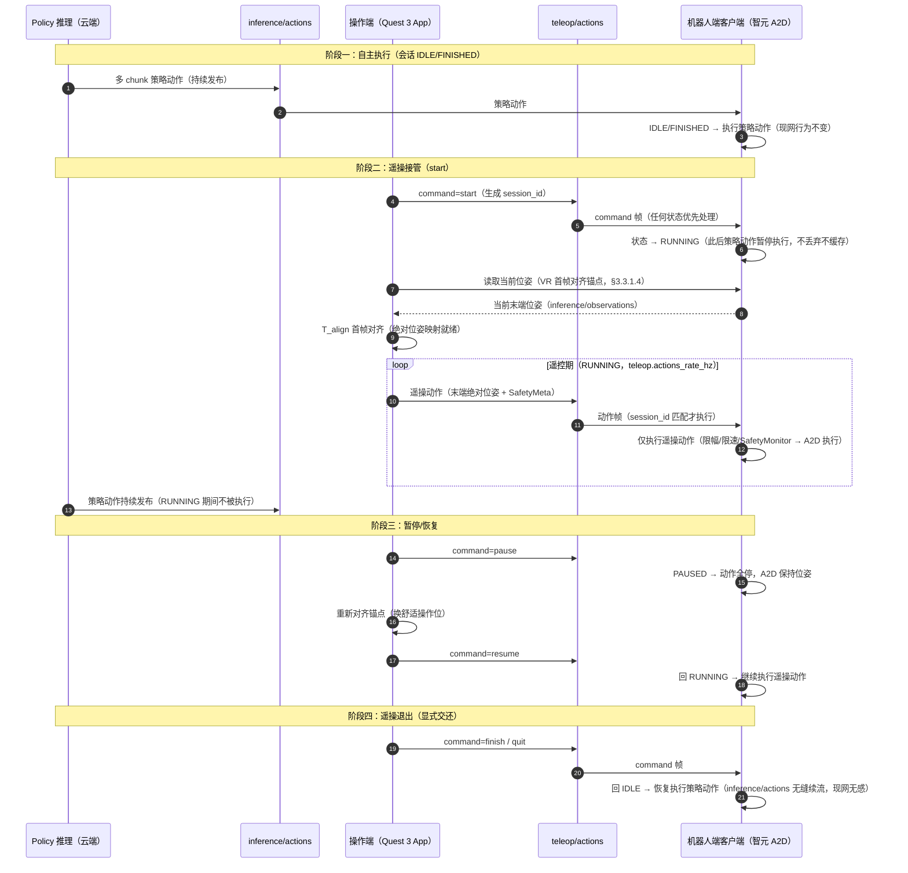
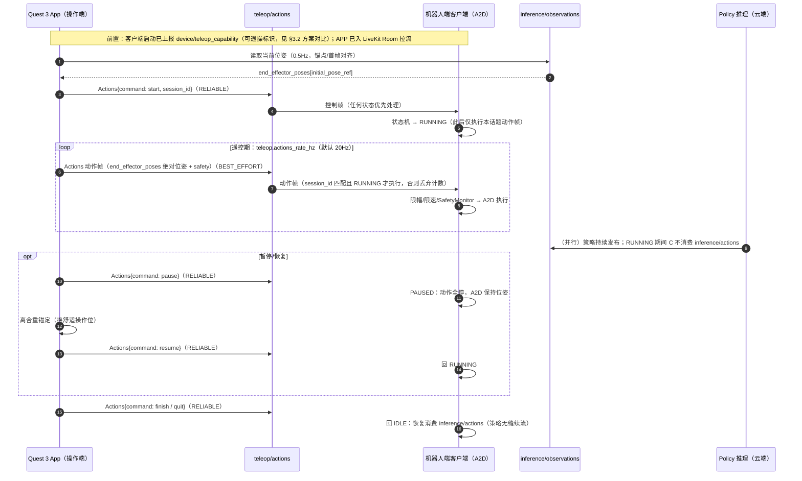

# R2C 遥操特性设计

> 本文件负责"基于 r2c 的遥操"特性的功能设计（数据采集已裁撤，见非目标）；不属于本文件的内容：设备树特性设计见 [PR #1 的 r2c-multi-device-tree-design.md](https://github.com/vincentguiling/cloudrobo-sdk-client/blob/agent/research-r2c-multidevice-d6cf83e2c104/docs/design/r2c-multi-device-tree-design.md)（该文档合入后改为仓库内相对路径），业界调研见 `docs/research/r2c-multi-device-industry-survey.md`，代码现状见 `docs/research/cloudrobo-r2c-codebase-survey.md`。
>
> 状态：**v2.7，待评审**。v2.7（2026-11-10 反馈更正）：**重写接口形态方案对比**——两方案均经 `teleop/actions` 下发遥操，差异在**机器人适配器承接遥操命令的接口**：方案 A 适配器新增专用接口 `teleop_cmd`（接口存在即客观标识可遥操），方案 B 复用适配器现有 `send_command`（零新增，但需清单显式声明可遥操）；U15 改为分阶段建议（验证期 B、规模化后 A）。v2.6（2026-11-10 反馈）：①§3.3.1.5 补充**遥操协议时序**（mermaid：控制帧 RELIABLE / 动作帧 BEST_EFFORT / session_id 校验全流程）；②§3.2 新增**接口形态方案对比**（独立 `teleop/actions` vs 并入 send_command，U15 复核维持独立）与**可遥操能力标识**（`device/teleop_capability` 上报）。v2.5（2026-11-09 反馈）：①移除本地（现场）遥操；②设备圈定——操作端 = **Meta Quest 3**、目标机器人 = **智元 A2D**；③新增**遥操接管/退出与 policy 推理交互 mermaid 时序图**；④新增**面向机器人的接入接口**（§3.3.3，以 A2D 为例）；⑤新增**遥操协议设计（protobuf）**（§3.3.1.5）；⑥新增**遥操 App 方案**（§3.3.2.8）。v2.4：本次不考虑本地推流机制，视频回传仅复用现有云端命令驱动的推流路径。v2.3（2026-11-07 反馈）：**`teleop/actions` 语义收窄**——只承载遥操（频率由配置指定），包含遥操生命周期控制 + 单 chunk 遥操动作；**job 与单 chunk 推理动作不再上该话题**（job/action 保留不动、单 chunk 推理动作仍走 `inference/actions`），`source` 字段随之取消。v2.1（2026-11-07 反馈）：友商分析补充 **Dora**（数据流框架，操作端节点化形态参考）与 **PhyAgentOS**（Session 模型与分层安全链参考）的分析对比。v2.0（2026-11-07 反馈）：①**同构臂发送关节绝对位置、VR 发送绝对位姿**（非相对/增量映射）；②**VR 位姿初始值 = `inference/observations` 的指定位姿**（按名字指定，如 `end_effector_poses.<name>`）——VR 首帧把头显/手柄坐标系对到该绝对位姿，之后绝对位姿直接驱动。v1.9（2026-11-07 反馈）：①**去掉 `source=teleop` 标记**——`teleop/actions` 上遥操动作不再带来源标记（仅 job/单 chunk 推理动作保留 `source=job`/`source=policy`，遥操动作即该话题上无 `source` 标注的动作）；②**遥操下发频率改为配置指定**（`teleop.actions_rate_hz`，不再固定 配置频率）。v1.8：v1.8（2026-11-07 反馈）：**`teleop/observations` 不发布**（话题与全部相关设计移除，U2/U5 撤销）；概念对齐——**本地操作台暂不存在，不写出**；**监控大屏概念改为"监控大屏"**（观看端=监控大屏/云端控制台/VR 客户端，均经 LiveKit 拉流）。v1.7（2026-11-07 反馈）：**离线相关机制暂不实现，移入遗留待讨论**（§9）——执行规则收敛为单层会话门控（IDLE/FINISHED 只执行策略动作；PAUSED 都不执行；RUNNING 只执行遥操动作），移除 teleop/offline 事件、offline_timeout_ms 配置与 teleop_online/offline 子态。v1.6（2026-11-07 反馈）：**执行来源规则修订**——IDLE/FINISHED 只执行策略动作（`inference/actions`）；PAUSED 都不执行；**其余状态（含遥操离线）只执行遥操动作**——遥操离线时机器人**保持位姿并告警/提示重新接管，不再自动切回策略模式**（取消"离线自动交还策略"，改为"离线保持 + 事件提示"，交还由显式 `finish`/`quit` command 帧驱动）。v1.5：v1.5（2026-11-07 反馈）：§3.3.1.6 视频回传刷新——遥操推流**已在官方最新代码实现**（r2c `camera` 模块：LiveKit WebRTC 推流 + `job/command` CAMERA_START/STOP/RTC_TOKEN_RENEW 命令 + JWT 自动续签 + 相机能力上报），特性设计直接复用。v1.4（2026-11-07 定案）：动作话题布局修订——**`inference/actions` 保持不变**（策略流式通路零迁移）；**移除 `job/action`**；**新增 `teleop/actions`** 承载遥操动作（频率由配置 teleop.actions_rate_hz 指定）+ job 任务动作 + 单 chunk 推理动作，生命周期经话题内 `command` 帧承载。此前 v1.3：砍掉数据采集功能（详见 git 历史）；v1.2 曾讨论三话题合并为一（本版修订其合并范围）。v1.3（2026-11-06 反馈）：**砍掉数据采集功能**——移除本地录制（R2CR）与 LeRobot v2.1/v3 格式转换、采集配置与录制相关测试/决策点；生命周期不再与录制耦合；`teleop/observations` 保留本地发布供操作台反馈；数据采集列为非目标（后续如需另行立项）。v1.2（2026-11-06，管理面/console 研讨结论）：①**动作话题合并**——遥操动作、策略动作、任务（job）动作统一到**统一动作话题** `{p}/{d}/teleop/actions`，消息携带 `source`（policy/job/teleop）与 `command`（start/pause/resume/finish/quit）字段，生命周期由 command 帧承载；②**遥操相关功能在 r2c 包内实现**（不同入口/不同配置文件），独立 teleop 包方案否决（§11 定案）。实现范围（2026-11-05 决策）：**VR 输入与云端实时遥操（远程遥操）为原始需求但仍在设计阶段——实现已从 PR #2 移除**，本文档按保留实现对齐（已实现 = 主从臂 + mock_joints 源、局域网现场遥操）。只出设计，不含实现。

## 1. 特性概述

**背景**：本特性主力场景是**遥操接管**——机器人按云端策略自主执行，遇异常时操作员接管，处理完交还自主。现状：遥操在 r2c 之外（LeRobot teleoperate、`--teleop.joint_sign`），r2c 仅有整机原始观测录制（`ObservationRecorder` + `--record`，与本期无关）。

**核心思路**：
1. **动作话题布局（2026-11-07 定案，v2.3 收窄）**：`inference/actions` **保持不变**（策略多 chunk 流式动作，现网无感）；**新增 `teleop/actions`**——只承载**遥操**：遥操动作（频率由配置指定）+ 生命周期控制（`command` 帧）+ 单 chunk 遥操动作。**执行来源由会话状态决定**：IDLE/FINISHED 只执行策略动作（`inference/actions`）；PAUSED 都不执行；其余状态只执行遥操动作（`teleop/actions`）。
2. **生命周期 command 帧**：遥操生命周期（start/pause/resume/finish/quit）不再使用独立话题，以 `teleop/actions` 内消息的 **`command` 字段**（`TeleopControl`）承载，任何状态先处理命令帧再做动作仲裁。
3. **范围与设备（2026-11-09 圈定）**：本期仅**远程遥操**（本地/现场遥操移出范围）；操作端设备 = **Meta Quest 3**，目标机器人 = **智元 A2D**；监控大屏与 Quest 3 App 都发布到 `teleop/actions`，客户端无分支。

4. **遥操输入两类（绝对量）**：同构臂——发送**关节绝对位置**（先对齐位姿再跟随）；VR——发送**绝对位姿**（初始值 = `inference/observations` 的指定位姿，首帧对齐后绝对驱动）。
5. **实现归属**：遥操相关功能**全部在 r2c 包内实现**——机器人端增量在 client 执行路径（sync_client），操作端运行时以独立入口（`cloudrobo r2c teleop`）与独立配置文件（teleop YAML）承载，不新建包（§11 定案）。

**目标**：
- 新增 `teleop/actions`：只承载遥操——遥操动作（频率由配置指定）+ 生命周期控制（`command` 帧）+ 单 chunk 遥操动作；`inference/actions` 保持不变；
- 会话生命周期门控：command 帧驱动的客户端状态机（§3.3.1.2），仅 RUNNING 态执行遥操动作；
- VR 遥操的绝对位姿模式（Meta Quest 3，App 方案见 §3.3.2.8）；同构臂预对齐流程设计保留为后续扩展；
- 面向机器人的接入接口清单（§3.3.3，以智元 A2D 为例）；
- 遥操 protobuf 协议设计（§3.3.1.5）；
- 遥操 App 方案（§3.3.2.8）；
- 图像经推拉流上云（LiveKit，官方 camera 模块）；
- 配置最小化（客户端新增 ≤ 5 项，均有默认值）。

**非目标**（本版本不做）：本地推流机制；**本地（现场）遥操**；**同构臂输入模式**（后续扩展，设计保留，见 §3.3.1.3）；**遥操离线机制**（离线判定/停止保持/自动交还策略——待讨论，见 §9）；**数据采集**（本地端录制 R2CR、LeRobot v2.1/v3 导出、回放——2026-11-06 裁撤，后续如需另行立项）；客户端内建接管权限体系（由 Zenoh ACL/发布端承担）；推拉流云侧服务（LiveKit SFU）运维——端侧推流已实现（camera 模块，§3.3.1.6），本特性直接复用；云端 episode 浏览/标注；多机器人协同遥操。

**设备圈定（2026-11-09 定案）**：操作端设备 = **Meta Quest 3**（双手柄，Unity + OpenXR App，§3.3.2）；目标机器人 = **智元 A2D**（AgiBot 远征 A2 系列：轮式底盘 + 双臂 + 头部/腕部相机；接入接口见 §3.3.3）。

## 2. 需求分析

### 2.1 需求背景

| 维度 | 现状 | 差距 |
|------|------|------|
| 动作通路 | 策略动作 `inference/actions` 与任务动作 `job/action` 分话题；遥操在 r2c 外 | **`inference/actions` 不变**；新增 `teleop/actions`（只承载遥操：动作 + 生命周期 command 帧 + 单 chunk 遥操动作） |
| 遥操输入模式 | 只有外部主从臂 | 本期：VR 绝对位姿（Meta Quest 3，§3.3.2）；同构臂预对齐为后续扩展（§3.3.1.3 保留） |
| 范围 | 本地/远程两种模式概念并存 | 本期仅**远程遥操**；客户端单通路 `teleop/actions`，不因接入形态分叉 |

### 2.2 场景分析

**场景 1：遥操接管（主力）。** 策略继续在 `inference/actions` 上发布（不变）；操作员发 `start` command 帧（`teleop/actions`）进入会话（RUNNING），随后以 配置频率 发布 遥操动作。客户端在 RUNNING 内只执行 遥操动作；`pause` 则整机保持。

**场景 2（后续扩展，本期设备范围外）：同构臂遥操（同型号臂作主臂）。** 开始遥操前，客户端/操作端先把同构臂（主臂）的位姿**对齐到当前从臂位姿**（读 `inference/observations` 的当前 `end_effector_pose`/关节位姿），对齐完成前不下发动作；对齐后主臂增量即从臂增量。

**场景 3（本期主操作方式）：VR 遥操（绝对位姿，设备 = Meta Quest 3）。** VR 客户端（§3.3.2）发送**绝对位姿**：初始值 = `inference/observations` 的指定位姿（按名字指定），首帧把手柄坐标系对齐到该位姿，之后绝对位姿直接驱动从臂末端。

**场景 4：远程遥操（本期主场景）。** 操作员跨公网向 `teleop/actions` 发布遥操动作、图像经推拉流观看（设备圈定：Quest 3 → 智元 A2D，见 §1）；本地（现场）遥操移出本期范围。

**能力矩阵**：

| 需求点 | 现状 | 本特性 |
|--------|------|--------|
| 动作话题布局（遥操独立话题） | ✗（遥操缺失） | ✔ `inference/actions` 不变 + `teleop/actions`（只承载遥操） |
| 图像上云 | 现有推理观测含图像 | ✔ 图像走推拉流（teleop 观测不承载上云） |
| 同构臂位姿预对齐（后续扩展） | ✗ | ✔ 设计保留（§3.3.1.3），本期设备范围外 |
| VR 绝对位姿遥操（Quest 3） | ✗ | ✔ 初始位姿 = `inference/observations` 指定位姿，首帧对齐后绝对驱动（§3.3.2） |
| 远程遥操（Quest 3 → A2D） | ✗ | ✔ `teleop/actions` 单通路 + Zenoh Router 跨公网接入 |

### 2.3 友商分析

| 友商 / 业界实现 | 关键机制 | 启示 |
|----------------|----------|------|
| LeRobot | 主从臂 teleoperate | 遥操操作端可以很薄：输入→映射→发动作 |
| Viam | 失联即停 | 客户端只需超时即停 |
| ROS 2 + Zenoh | topic → key expression；regex 策略控频率/QoS | 话题即接口；来源可用消息字段承载 |
| Genie Studio / 灵渠 OS | 采集任务与校验在云侧/工具链，端侧薄 | 端侧只发动作，编排上移 |
| Dora（dora-rs/dora） | **它是什么**：一个本地机器人程序框架——把"手柄采集、动作换算、安全检查、下发执行"各自做成独立小程序（节点），再用一份 YAML 文件声明谁连谁，框架按图拉起进程并用共享内存传数据（延迟比 ROS 低 10–17 倍）。**和本设计的关系**：它管的是机器人本机/局域网内的程序编排，不管机器人↔云的连接（鉴权/多租户/跨公网），因此与 r2c 不冲突也不互替。**借鉴点**：操作端运行时按"输入采集→映射→安全检查→发布"拆成独立模块的分层方式（详见 `docs/research/r2c-vs-dora-middleware-comparison.md`） |
| PhyAgentOS（PhyAgentOS-core） | **它是什么**：一个具身智能"运行时底座"（开源，MIT）——管 Agent 规划怎么变成机器人动作；特色是把一次任务当作"会话（Session）"来调度与验收，动作执行前过一道道安全检查（预检 → 动作桥 → SafetyGuard → 心跳 → 目标侧限位）。**和本设计的关系**：与我们同样做"人/Agent 驱动机器人"这件事，但它是通用 Agent 底座，我们是面向遥操场景的专用设计。**对我们设计的印证**：本设计有三处做法与它相同——①按"会话"组织一次遥操任务（§3.3.1.2）；②动作执行前逐层安全检查（§3.3.2.6 操作端 deadman + §5 机器人端 SafetyMonitor）；③高频动作走 Zenoh 总线、慢变的会话状态走轻量 command 帧（§3.3.1.2）。这说明这些做法是业界共识（详见 `docs/research/phyagentos-team-projects-survey.md`） |

### 2.4 名词解释

| 术语 | 定义 |
|------|------|
| `teleop/actions` | **新增副话题**：只承载遥操——遥操动作（频率由配置指定）+ 生命周期 `command` 控制帧 + 单 chunk 遥操动作；`inference/actions` 保持不变 |chunk_size=1）的动作与 `command` 生命周期控制帧；`inference/actions` 保持不变 |
| `command` 帧 | 携带 `TeleopControl`（start/pause/resume/finish/quit）的遥操生命周期命令消息，在 `teleop/actions` 上随动作流传输；无动作步 |
| 推拉流 | 图像上云方式：客户端把相机画面经 LiveKit 推流，监控大屏/云端控制台/VR 客户端拉流观看 |
| 同构臂位姿预对齐 | 同构臂遥操开始前，把主臂位姿调整到与从臂当前位姿一致（读 `inference/observations`），对齐完成前不下发动作 |
| VR 绝对位姿遥操 | VR 发送绝对位姿；初始值 = 从臂当前指定位姿（`inference/observations`），首帧对齐后按绝对位姿驱动 |
| 会话状态门控 | 客户端维护数采会话状态（IDLE/RUNNING/PAUSED/FINISHING 语义见 §3.3.1.2），按状态决定执行来源；**客户端感知"会话状态"，但不判断"接管权限/归属"**（谁可接管由 Zenoh ACL 与操作台约定） |

## 3. 功能方案

### 3.1 功能约束与依赖

**约束**：
- C1 动作话题布局：`inference/actions` 保持不变；`teleop/actions` 只承载遥操（频率由配置指定）：动作 + 生命周期 `command` 帧 + 单 chunk 遥操动作；生命周期以 `command` 帧（`TeleopControl`）承载，不再使用独立生命周期话题；
- C2 本期范围 = **远程遥操**：操作端（Quest 3 App）跨公网经 Zenoh Router 接入同一 `teleop/actions`；本地（现场）遥操移出范围，客户端执行路径不因接入形态分叉；
- C3 图像通过**推拉流**上云（复用官方 `camera` 模块 LiveKit 实现，§3.3.1.6）；本地推流与本地（现场）遥操均不在本期范围；
- C5 遥操输入两类（绝对量）：同构臂（关节绝对位置，位姿预对齐）与 VR（绝对位姿，初始值 = `inference/observations` 指定位姿）；
- C6 数据采集为非目标（2026-11-06 裁撤）：本地录制、格式转换、回放均不在本期范围；
- C7 遥操功能**全部在 r2c 包内实现**（机器人端增量在 client 执行路径；操作端走独立入口 `cloudrobo r2c teleop` 与独立配置文件），不新建包；
- C8 配置最小化（均有默认值）；`inference/actions` 发布端零改动；`job/action` 保留不动。

**依赖**：
- `transport/zenoh.py`（pub/sub、QoS、TLS）与 `client/session.py`（topic 命名、发布/订阅方法）；
- `Actions` 消息扩展（`command` 字段，proto3 只增不改）与 `sync_client` 动作执行路径；
- （数据采集依赖已随功能裁撤移除）
- Zenoh ACL（谁可发布 `teleop/actions` 与 `inference/actions`）。

### 3.2 整体方案设计

**技术选型**：

| 选型点 | 决策 | 依据 |
| 动作话题 | **定案（2026-11-07，v2.3 收窄）**：`inference/actions` 保持不变（策略多 chunk）；`job/action` 保留不动；新增 `teleop/actions` 只承载遥操（动作 + 生命周期 `command` 帧 + 单 chunk 遥操动作，频率由 `actions_rate_hz` 指定） | 策略流式通路零迁移；job 通路零迁移；遥操收敛到专用话题 |
| 图像上云 | **推拉流（已实现，直接复用）**：官方 `camera` 模块经 LiveKit WebRTC 推流（`job/command` 的 CAMERA_START/STOP + JWT 续签），云端/远程拉流 | 高频图像不走 Zenoh 观测话题；teleop/observations 保持轻量 |
| 同构臂预对齐 | 遥操开始前读 `inference/observations` 当前位姿，主臂对齐后才进入跟随 | 消除初始位姿差，避免起跳 |
| VR 绝对位姿 | 发送绝对位姿；初始值 = `inference/observations` 指定位姿（按名字），首帧对齐后直接驱动 | 避免增量漂移；坐标基准随观测更新 |
| 执行来源 | 单层规则：IDLE/FINISHED 只执行策略；PAUSED 全停；RUNNING 只执行遥操 | 离线机制待讨论（§9 遗留），不在本期实现；规则唯一，以 §3.3.1.1/§3.3.1.2 为准 |
| 范围 | 本期仅远程遥操（Quest 3 → Router → A2D） | 本地（现场）遥操移出；客户端单通路 |
| 采集 | 本期不做（非目标，2026-11-06 裁撤） | — |
| 实现归属 | **全部在 r2c 包内**：机器人端增量在 client 执行路径；操作端走独立入口与配置文件（§11 定案） | 管理面/console 研讨结论：不新建包 |

**接口形态方案对比（2026-11-10 更正）：适配器承接遥操命令——专用 teleop_cmd vs 复用 send_command**：

> 前提：两方案的**传输与协议完全相同**——遥操动作都经 `teleop/actions` 下发（§3.3.1.5 时序不变）；差异仅在**机器人适配器侧由哪个接口承接**遥操命令（§3.3.3 落到适配器实现）。

| 维度 | 方案 A：适配器新增专用接口 `teleop_cmd` | 方案 B：复用适配器现有 `send_command` |
|------|--------------------------------------|--------------------------------------|
| 适配器接入成本 | 每款机型需额外实现一个接口（teleop_cmd：接收遥操动作/控制并驱动执行） | **零新增**——已实现 send_command（推理动作下发）的机型即可承接遥操命令 |
| **可遥操判定（如何知道该机器人可遥操）** | **客观探测**：适配器实现了 `teleop_cmd` 即支持遥操（接口/entry-point 存在性判断，不会失真） | 接口本身人人都有，无法从存在性判断——需在适配器清单/配置中**显式声明** `teleop_supported`（人工维护，存在声明与实现不一致的风险） |
| 语义清晰度 | 遥操语义（末端位姿→IK、SafetyMeta、离合保持）独立成契约，实现内聚 | `send_command` 内需为遥操加分支，推理与遥操语义耦合 |
| 演进 | 遥操契约可独立演进（新增能力字段不动推理通路） | 遥操每次演进都改 `send_command` 共享契约，波及推理链路 |
| 权限控制 | 相同：都在话题层（`teleop/actions` 的 Zenoh ACL，操作端专用凭证），非适配器层差异 | 相同 |
| 适用阶段 | 多机型规模化、正式版 | 单机型快速打通 / 验证期 |

**建议（U15，分阶段）**：验证期（本期圈定智元 A2D 一款）先用**方案 B** 复用 `send_command` 快速打通（`teleop_capability` 由适配器清单显式声明）；多机型规模化后引入**方案 A** 的 `teleop_cmd` 专用接口（`teleop_capability` 改为接口探测，判定客观化）。

**可遥操能力上报（两方案共同出口）**：判定来源随方案不同（A=接口探测，B=清单声明），但对外的上报形态一致——客户端启动时经 **`device/teleop_capability`** 上报：

`{teleop_supported: true, input_modes: [VR], end_effectors: [<initial_pose_ref 可用名列表>], suggested_rate_hz, protocol_version, capability_source: adapter_interface | adapter_manifest}`

云端 console / 操作端机器人列表按此过滤：未上报或 `teleop_supported=false` = 不可遥操（不展示接管入口）；协议演进经 `protocol_version` 协商。
**整体架构**：

```text
发布端                                                客户端
  ├── 自主策略 ──► inference/actions（保持不变，多 chunk 流式）──► 会话门控（IDLE/FINISHED 执行）
  ├── 任务(job) ──► job/action（不变）──► 会话门控（job 语义不变）
  └── 操作端(单chunk遥操动作) ─► {p}/{d}/teleop/actions ──► 会话门控
  └── 操作端(VR客户端/主臂工具) ─► 遥操动作（频率由配置指定）+ command 帧 ─┘
                                                                    ▼
                                                          限幅/安全检查 → 设备

  客户端 ──► 相机画面 ──推流──► 流媒体服务 ──拉流──► 云端/远程观看（图像上云）
```

**关键时序（同构臂 / VR 遥操）**：



### 3.3 详细功能设计

> 3.3 按功能拆分（功能实现在前、共享接口在底部）：3.3.1 遥操功能实现（客户端执行侧）、3.3.2 VR客户端功能实现（Quest 3 遥操 App，参考 metaquest-dist）、3.3.3 面向机器人的接入接口（以智元 A2D 为例）、3.3.4 接口设计（共享话题/配置/CLI）。数据采集（录制/格式转换）已裁撤；本地（现场）遥操与同构臂输入移出本期范围。

#### 3.3.1 遥操功能实现

##### 3.3.1.1 功能原理

- **动作订阅与执行规则（会话状态单层门控）**：客户端订阅 `inference/actions`（不变）与 `teleop/actions`（遥操专用，遥操节拍由配置 teleop.actions_rate_hz 指定），按话题与消息 `command` 字段分流。
  - `IDLE` / `FINISHING`：执行 `inference/actions`（不变）；`teleop/actions` 上遥操动作丢弃（计数告警）；
  - `RUNNING`：只执行 `teleop/actions` 内遥操动作；`inference/actions` 动作不消费（不丢弃、不缓存）；
  - `RUNNING`：策略动作一律不执行；
  - `PAUSED`：两路都不执行（保持位姿），避免"暂停遥操但策略继续动"。
  会话状态只影响"由谁驱动"，不改变既有的 stale 判定、chunk 对齐、n-skip、fusion。
- **command 帧优先**：任何状态下，携带 `command`（TeleopControl）的消息先按状态机处理（§3.3.1.2），再做动作仲裁；command 帧无动作步，不进入执行路径。
- **操作端统一**：操作端（本期 = Quest 3 App）以配置频率向 `teleop/actions` 发布动作与 command 帧；客户端无模式分支。
- **接管与显式交还**：
  - **接管** = 控制端发 `command=start`进入 RUNNING，操作台发布 遥操动作即被执行；**策略在会话期间持续发布**（会话期间不执行，RUNNING 只执行遥操）；
  - **保持语义** = 会话内动作流中断时保持当前位姿（无隐式回退策略）；
  - **重新接管** = 操作员排除故障后发 `command=resume`（操作端侧完成重新对齐/确认）→ 回到遥操在线；
  - **显式交还** = 控制端发 `command=finish`/`quit` → 回 IDLE，恢复纯策略执行。
  客户端按会话状态决定执行来源，**不判断"谁有接管权限"**（权限由 Zenoh ACL 与操作端约定）。

##### 3.3.1.2 会话生命周期与数采门控

客户端维护会话状态机（事件源为 `teleop/actions` 上的 `command` 帧）：

```text
IDLE --command:start--> RUNNING --command:pause--> PAUSED --command:resume--> RUNNING
RUNNING --command:finish--> FINISHING（会话收尾）--> IDLE
RUNNING/PAUSED --command:quit--> IDLE
任意态 --command:quit--> IDLE；start 仅在 IDLE 有效，重复 start 忽略并告警
```

- **门控规则（核心安全语义）**：仅 **RUNNING** 时客户端执行 遥操动作；IDLE/PAUSED/FINISHING/离线态收到的遥操动作一律丢弃（计数并限频告警）。PAUSED 时策略动作也不执行（整体保持），避免"暂停遥操但策略继续动"的意外。**command 帧任何状态都先处理**（状态机合法性校验后转移）。
- **生命周期语义**：`start/finish/quit/pause/resume` 仅驱动会话状态与门控——`finish` 会话收尾（回 IDLE，恢复纯策略执行）、`quit` 中止回 IDLE；录制相关语义随数据采集裁撤（非目标）。
- **消息形态**：`Actions` 消息扩展（proto3 只增不改，兼容旧发布端）：

```protobuf
message Actions {
  // …… 现有字段（timestamp/id/chunk_size/joint_states/end_effector_poses/…）……
  TeleopControl command = 20;   // 有值 = 本帧为遥操生命周期命令（无动作步）；缺省 = 动作帧
}
```

完整遥操协议定义见 §3.3.1.5。

- **发布者**：操作端（VR 客户端/主臂工具）/云端控制台均可发布 command 帧（权限由 Zenoh ACL 控制）；操作端"开始遥操"即发 `command=start`。**兼容性**：`inference/actions` 与 `job/action` 现有发布端**零改动**（各自话题与 schema 均不变）。

##### 3.3.1.3 同构臂位姿预对齐

遥操开始前，操作端读取当前位姿（`inference/observations` 的 `end_effector_pose`/关节位姿），驱动主臂运动到该位姿；对齐完成（误差 < 阈值）前操作台不下发 遥操动作。对齐由操作台侧流程完成，客户端无需新状态机。

##### 3.3.1.4 VR 绝对位姿遥操

VR 客户端发送**绝对位姿**（非相对/增量）：①**初始值** = `inference/observations` 的指定位姿（按名字指定，如 `end_effector_poses.<name>`，名字在遥操配置中配置）；②首帧 VR 把手柄坐标系对齐到该初始位姿；③之后 VR 直接发送绝对位姿驱动从臂末端（每帧即完整目标位姿，无参考系漂移）。首帧对齐在操作端/VR 侧实现（VR 客户端实现见 §3.3.3）。

##### 3.3.1.5 遥操协议设计（protobuf）

**设计原则**：r2c `.proto`（proto3）为唯一 schema 源（两端共享，§3.3.2.4）；**只增不改**（旧端忽略未知字段）；动作与生命周期控制同话题承载、以 `command` 字段判别帧型。

**话题 → 消息映射**：

| 话题 | 消息 | 方向 | 频率 | QoS |
|------|------|------|------|-----|
| `{p}/{d}/teleop/actions` | `Actions` 动作帧（`end_effector_poses` 末端绝对位姿，chunk_size=1） | 操作端（Quest 3 App）→ 客户端 | `teleop.actions_rate_hz`（默认 20） | BEST_EFFORT |
| `{p}/{d}/teleop/actions` | `Actions{command: TeleopControl}` 控制帧 | 操作端/云端控制台 → 客户端 | 事件 | RELIABLE |
| `{p}/{d}/inference/observations` | `Observations`（现有，0.5Hz） | 客户端 → 操作端（锚点/状态显示） | 0.5Hz | 现有 |

**消息定义（新增部分，均为对既有 proto 的增量扩展）**：

```protobuf
// Actions：既有消息，新增两个扩展字段（proto3 只增不改）
message Actions {
  // …… 现有字段（timestamp/id/chunk_size/joint_states/end_effector_poses/…）……
  TeleopControl command = 20;  // 生命周期控制帧（§3.3.1.2）；缺省 = 动作帧
  SafetyMeta    safety  = 21;  // 随动作帧下发的安全元数据（可选）
}

message TeleopControl {
  string session_id   = 1;   // start 时生成（UUID）；后续控制帧必须携带，不匹配则忽略
  string operator_id  = 2;   // 操作端标识（Quest 3 App 实例 / 操作员账号）
  int64  timestamp_us = 3;   // 乱序/过期控制帧按此校验
  oneof payload {
    TeleopStart  start  = 10;  // 进入 RUNNING
    TeleopPause  pause  = 11;  // 动作全停、保持位姿
    TeleopResume resume = 12;  // 恢复 RUNNING（操作端须先完成重新对齐）
    TeleopFinish finish = 13;  // 会话收尾 → IDLE（策略恢复执行）
    TeleopQuit   quit   = 14;  // 中止 → IDLE
  }
}

message TeleopStart {
  InputMode input_mode       = 1;  // 本期固定 VR（Quest 3）；ISOMORPHIC 为后续扩展
  string    initial_pose_ref = 2;  // VR 初始位姿在 inference/observations 中的名字（§3.3.1.4）
}

enum InputMode {
  INPUT_MODE_UNSPECIFIED = 0;
  INPUT_MODE_VR          = 1;   // Meta Quest 3（本期）
  INPUT_MODE_ISOMORPHIC  = 2;   // 同构臂（后续扩展，设计保留）
}

// 安全元数据（随每帧遥操动作下发；机器人端 SafetyMonitor 做最终拦截，§5）
message SafetyMeta {
  bool  deadman_active = 1;  // grip 按住=true（false = 离合保持，目标不变）
  bool  estop          = 2;  // 急停请求（最高优先级，先停后处理）
  float speed_scale    = 3;  // 速度缩放 0~1
}
```

**帧语义规则**：①`command` 非空 = 控制帧，不进入动作执行路径，任何状态先处理；②动作帧必须落在 RUNNING 且 `session_id` 匹配才被执行，否则丢弃计数限频告警；③动作帧负载复用既有 `end_effector_poses`（VR 末端绝对位姿，`name` 对应目标机器人末端，如 A2D 双臂 ee；同构臂 `joint_states` 为后续扩展），不新增动作负载字段；④`SafetyMeta` 随帧下发，机器人端最终拦截；⑤protoc 生成 Python/C#/Go 供客户端、Unity App 与云端控制台共用，版本随 r2c 包发布。

**协议时序（v2.6 补充）**：



要点：①控制帧与动作帧同话题不同 QoS——控制帧 RELIABLE 保证送达，动作帧 BEST_EFFORT 只保新鲜；②`session_id` 在客户端逐帧校验，防止退出会话后的迟到帧误执行；③观测（0.5Hz）与视频（LiveKit）不在本协议通路内，App 各自独立读取/拉流。

##### 3.3.1.6 视频回传（推拉流上云，复用官方 camera 模块）

**通道划分**：图像独立走**推拉流**通道上云。**端侧推流已在官方最新代码实现**（`packages/cloudrobo-r2c/src/cloudrobo_r2c/camera/`，随 r2c_sdk 0.2.8 同步），特性设计直接复用：

| 要素 | 方案（官方实现） |
|------|------|
| 推流端 | r2c `camera` 模块：`CameraManager` 编排全生命周期（能力枚举上报 → 命令执行 → JWT 续签 → 结果/告警上报）；`StreamPublisher` 基于 **LiveKit WebRTC**（livekit-rtc，1 个 wss 连接连 Room，逐路相机发布 VideoSource/LocalVideoTrack） |
| 帧源 | 硬件适配器实现 `ICameraFrameSource`（`get_latest_frame(camera_id)`）注入；未实现则推流按资源不可用上报 |
| 命令流 | 云端 → 端 `{p}/{d}/job/command`（`CameraCommand`）：`CAMERA_START`（JWT + wss URL + room，camera_id=all/front/wrist…）/ `CAMERA_STOP` / `RTC_TOKEN_RENEW`（到期前自动续签） |
| 能力上报 | 启动时枚举适配器相机 → `CameraCapabilityReport` 上报 `device/camera_capability` 话题 |
| 编码 | 默认 640×480；宽/高/帧率/码率可配（TrackPublishOptions max_framerate/max_bitrate + SFU REMB） |
| 观看端 | LiveKit Room 拉流：①**监控大屏**；②云端控制台；③**VR 客户端（Quest）拉流观看**（对齐 metaquest `teleop/{session}/video` 语义，不经 Zenoh 话题） |
| 与控制流隔离 | 视频与 `teleop/actions`（Zenoh）完全独立通道，互不阻塞；视频中断不影响遥操控制（§4） |

'**观看端与反馈语义**：监控大屏与 VR 客户端**通过视频获得视觉反馈**，因此视频时延直接决定遥操手感''——端到端时延目标 ≤300ms（与 `offline_timeout_ms` 同量级，避免视频滞后引发误判）；时延测量与调优列入遗留问题（§9）。
#### 3.3.2 VR客户端功能实现

> 参考材料：`docs/metaquest-dist.tar.gz`（Meta Quest 遥操客户端开发资料库：六层架构 `design/architecture.md`、teleop.v1 协议 `design/protocol.md`、技术栈 `design/tech-stack.md`、13 个开源参考项目 `teleop/`）。本节定义遥操 App（**Meta Quest 3** 头显 + 双手柄）的实现方案，作为 §3.3.1.4 VR 绝对位姿遥操的操作端落地；产品形态与交互方案见 §3.3.2.8。

##### 3.3.2.1 功能概述

| 项 | 说明 |
|----|------|
| 形态 | **Meta Quest 3** 上的 **Unity + OpenXR** 应用（C#，APK，Horizon Store/侧载分发）；WebXR 浏览器版作为轻量验证补充 |
| 输入 | 双 VR 手柄 6-DoF 位姿 + trigger/grip/thumbstick/按键；手部追踪（21 关键点）作为后续扩展输入 |
| 输出 | 手柄位姿经绝对位姿换算生成末端目标，按配置频率发布到 `teleop/actions`（r2c `Actions` 消息）；生命周期以 **`command` 帧**承载 |
| 反馈 | LiveKit 拉流观看相机画面；关节限位/接近奇异点经**手柄振动**反馈 |
| 会话 | 发布/消费 `teleop/actions` 上的 `command` 帧（start/pause/resume/finish/quit）；离线事件待讨论（§9） |
| 归属 | VR 客户端 Unity 工程独立仓库；**遥操运行时在 r2c 包内**（§11 定案 A），proto 契约与映射参考实现随 r2c 包发布 |

##### 3.3.2.2 分层架构（借鉴 metaquest 六层架构）

| 层 | 职责 | 归属 | 平台相关性 |
|----|------|------|-----------|
| ① 平台层 | 运行时/渲染/生命周期（Unity + OpenXR，`enumerateInputDevices`/`runloop`） | Unity 工程（C#） | **强相关** |
| ② 输入采集层 | `VRControllerAcquirer`：OpenXR 手柄 6-DoF + 按键采样；后续 `VRHandAcquirer`（手部追踪） | Unity 工程（C#） | **强相关** |
| ③ 输入抽象层 | 归一化为 `InputSample`（oneof：ControllerSample/HandSample） | 核心库（跨端复用） | 无关 |
| ④ 映射层 | `MappingStrategy.apply(input, state) → RobotCommand`（策略可插拔 + 滤波链） | 核心库（跨端复用） | 无关 |
| ⑤ 通信层 | protobuf 序列化 + Zenoh pub/sub（peer 直连 / Router 路由） | 核心库（跨端复用） | 弱相关 |
| ⑥ 机器人层 | IK/安全/驱动——**在机器人端（r2c client）实现**，操作端只发末端目标 | r2c（已有） | 无关 |

**关键约束**：③④⑤ 构成平台无关核心；①② 随平台替换（Quest/PICO/PC 同一核心，换 OpenXR 插件即可，参考 PICO 4 Ultra 同工程部署）。落到我们：**C# 侧自持平台层 + 采集层，映射后动作直接进 r2c 协议；映射层（④）放在 C# 侧**（离合映射是手感核心、与头显渲染节拍耦合），机器人端不做映射，只做 IK 与安全拦截（与 §11 分层边界一致）。

##### 3.3.2.3 输入采集与映射（功能原理）

- **采集**：OpenXR 每帧采样双手柄 → `ControllerSample{pose, trigger, grip, thumbstick, buttons, side}`（`InputProfile.CONTROLLER`）；grip 扳机兼作 **deadman**（按住才跟随）。
- **映射策略（本期定案，绝对位姿）`AbsolutePoseMapping`**（对齐 U6/§3.3.1.4：取消相对/增量映射）：
1. **初始位姿**：会话建立时读 `inference/observations` 的**指定位姿**（按名字，遥操配置 `initial_pose_source`）作为坐标系对齐基准（§3.3.1.4）；
2. 按住 grip（deadman）：末端目标 = **T_align ∘ 手柄位姿**（T_align 为首帧对齐得到的固定坐标变换），每帧直接输出**绝对位姿**目标——无增量累积、无参考系漂移；
3. **离合（重锚定）**：松开 grip 目标保持；重新按住时重算 T_align，使手柄当前物理位姿映射到保持中的目标（操作员可随时把手柄挪到舒适位姿再继续）；
4. **reach limit**：手柄到达工作空间边界（box/圆柱）→ 停止跟随并振动提示；
5. 滤波链：EMA（α 可配）+ 死区，抑制手柄抖动。
- **双臂**：`BimanualMapping` = 单策略实例 ×2（laterality：左手柄→左臂、右手柄→右臂），各自独立 T_align 与离合；输出两路末端绝对位姿目标（`Actions.end_effector_poses`，协议见 §3.3.1.5）。
- **手部追踪（后续扩展）**：`HandSample`（腕 6-DoF + 21 关键点）→ `HandRetargetingMapping`（dex-retargeting）→ 灵巧手关节目标；本期不实现，`InputSample` oneof 预留。
- **触觉反馈**：机器人端在接近关节限位/奇异点时经反馈通道下发振动参数，客户端触发手柄振动（借鉴 vr-teleop-kit）。

##### 3.3.2.4 协议映射（teleop.v1 → r2c 话题）

**以 r2c `.proto`（proto3）为唯一 schema 源**；teleop.v1 `Envelope` 不整体引入，仅映射语义（§11，避免双 schema 并存）。protoc 生成 C# 供 Unity 使用（`Google.Protobuf` NuGet，按需裁剪）：

| metaquest 概念 | r2c 落地 | 说明 |
|----------------|----------|------|
| `Envelope(RobotCommand/InitialSample)` 控制流（配置频率 BEST_EFFORT） | `teleop/actions` `{p}/{d}/teleop/actions`（`Actions` 消息 ，**配置频率**，BEST_EFFORT） | 映射层输出末端目标 → 填 `Actions`（chunk 对齐沿用 r2c） |
| `RobotState` 状态反馈（30–60Hz） | `inference/observations`（0.5Hz，现有；锚点读取足够） | 操作端读取当前位姿/关节做锚点与 UI 显示 |
| `ControlEvent`（E_STOP/PAUSE/RESUME/RESET/RECORD_TOGGLE） | `teleop/actions` 内 **`command` 帧**（`TeleopControl`：start/pause/resume/finish/quit） | E_STOP → 立即 `pause` + 停发动作；RECORD_TOGGLE → `finish`/`start` |
| `Heartbeat`（10Hz RELIABLE） | 本期不做（离线机制待讨论，§9） | — |
| `teleop/{session}/video`（H.264） | **LiveKit Room 拉流**（官方 camera 模块推流，§3.3.1.6） | Quest 端入 LiveKit Room 拉流观看，不新增 Zenoh 视频话题 |
| `Handshake`/`protocol_version` 协商 | 不需要——两端共用同一 r2c proto，随包版本对齐 | schema 漂移由 monorepo CI 校验生成物 |

##### 3.3.2.5 传输与部署

- **远程（本期范围）**：Quest 3 App 与机器人端分别接入 Zenoh Router 跨公网路由（无需中继/TURN），凭证走 Zenoh TLS + ACL（操作端凭证才可写 `teleop/actions`，§5）；局域网 peer 直连为后续可选优化，不在本期验收范围；
- **QoS**：控制流 BEST_EFFORT（可丢旧帧），command 帧/事件 RELIABLE（确保送达）；
- **部署**：Unity 构建 APK（Horizon Store 或侧载）；**r2c 包**提供 proto 契约、映射参考实现（Python 侧仿真映射器，供无头显调试）与离线仿真回放（遥操运行时所在包，§11 定案 A）；Unity 工程仓库不进 monorepo（构建产物不入库）。

##### 3.3.2.6 安全

- deadman（grip）+ `SafetyMeta` 随每帧动作下发；机器人端 `SafetyMonitor` 做最终拦截（工作空间 clamp、速度/加速度限幅、关节限位，§5）；
- 动作流中断即目标保持；重新接管须 `resume` + 重新对齐锚点；
- 急停最高优先级：Quest 侧任意时刻可发 `command=pause`（RELIABLE），客户端先停后处理。

##### 3.3.2.7 实现路线（阶段化，借鉴 metaquest 技术栈路线）

| 阶段 | 内容 | 验收 |
|------|------|------|
| 0：协议与骨架（2–3 周） | protoc 生成 C#；Zenoh C# 绑定集成；`Actions`（含 `command`）收发与序列化 | Quest APK 发动作帧，机器人端字节级一致 |
| 1：单手柄→单臂闭环（3–4 周） | `VRControllerAcquirer` + `AbsolutePoseMapping`（首帧对齐/离合重锚定/EMA）+ 配置频率发布；Router 接入 | Quest 手柄遥操单臂，首帧对齐正确 |
| 2：双手柄双臂（3–4 周） | 双臂绝对位姿（laterality 左右手柄）；PICO 等其他头显为后续扩展（同一 Unity 工程切 OpenXR 插件） | 双手柄控双臂（Quest 3） |
| 3：远程与观感（3–4 周） | Zenoh Router 跨公网路由；推拉流观看；触觉反馈（限位/奇异点振动）；智元 A2D 接入联调（§3.3.3） | 跨互联网遥操 Quest 3 → A2D + 视频回传观感达标 |

**参考项目选型**（metaquest `teleop/`）：快速验证链路用 **telegrip / vr-teleop-kit**（WebXR，Quest 浏览器直跑，离合映射已验证）；正式 Unity 实现参考 **meta_quest_teleoperation**（干净的手柄数据管道）与 **beavr-bot**（双臂示范采集框架）；宇树机型直接以 **xr_teleoperate** 为基座。

##### 3.3.2.8 遥操 App 方案（Meta Quest 3）

| 项 | 方案 |
|----|------|
| 形态 | Quest 3 一体式 App：Unity 2022 LTS + OpenXR + Meta XR Interaction SDK；APK（侧载分发，正式版可上 Horizon Store）；与 r2c proto 生成物（C#）同版本对齐 |
| 主界面 | 全屏 LiveKit 拉流画面（头部相机主视图 + 腕部相机画中画可切换）；顶部状态栏：会话状态（IDLE/RUNNING/PAUSED）、机器人在环指示、动作/视频时延 |
| 会话控制 | 手腕面板：**开始接管 / 暂停 / 恢复 / 退出会话**（对应 command 帧 start/pause/resume/finish），退出需二次确认 |
| 手柄映射 | grip=deadman（按住跟随/松开离合重锚定）；trigger=夹爪开合（映射末端执行器目标）；A/X=开始接管（长按确认）；B/Y=pause/恢复；双摇杆按下=finish 退出；系统键唤出系统菜单（App 自动 pause 保护，防误退出失控） |
| 会话流程 | 启动 → 选择机器人（列表）→ 连接（Zenoh Router + LiveKit Room）→ 拉流预览 → 读取当前位姿对齐（initial_pose_ref）→ start 接管 → 遥控（`actions_rate_hz`）→ finish/quit 退出（回 IDLE，策略无缝恢复） |
| 与 r2c 契约 | 仅依赖：r2c proto 生成物（§3.3.1.5）+ 话题约定（`teleop/actions`、`inference/observations`）+ LiveKit Room/JWT；**不感知机器人型号**（A2D 由机器人端适配器承载，§3.3.3） |
| 版本与发布 | App 版本与 r2c proto 版本成对发布；proto 只增不改保证向后兼容；侧载包内部升级 + 版本校验 |

#### 3.3.3 面向机器人的接入接口（一款机器人支持远程遥操要实现什么）

> 以目标机器人**智元 A2D**（AgiBot 远征 A2 系列：轮式底盘 + 双臂 + 头部/腕部相机）为例。接口由 r2c 硬件适配器（adapter）承载；厂商 SDK/ROS 2 具体接口名以官方文档为准。适配器承接遥操命令的接口形态（专用 `teleop_cmd` vs 复用 `send_command`）见 §3.2 方案对比（U15）。

| # | 接口 | 要求 | A2D 侧落点 |
|---|------|------|-----------|
| R1 | **观测发布** | 按节拍发布整机观测：各关节位置/速度/力矩、末端位姿（`end_effector_poses`，含坐标系命名）→ `inference/observations`（0.5Hz）；供操作端读取当前位姿（VR 首帧对齐锚点） | A2D 关节状态 SDK → 观测适配器；末端位姿由双臂 FK 计算 |
| R2 | **动作执行** | 订阅 `teleop/actions`（遥操）与 `inference/actions`（策略），按会话门控执行：末端绝对位姿目标 → IK 解算 → 关节位置控制；执行前限幅/限速/自碰撞检查 | A2D 双臂 IK（r2c 侧解算，或机型自带笛卡尔接口直发）+ 关节伺服下发 |
| R3 | **末端执行器** | 夹爪开合目标接口（App trigger 映射），随动作帧承载 | A2D 末端夹爪控制接口 |
| R4 | **相机帧源** | 实现 `ICameraFrameSource.get_latest_frame(camera_id)`：头部/腕部相机逐路出帧 → 官方 camera 模块 LiveKit 推流（§3.3.1.6） | A2D 相机取流适配（OpenCV/MediaSDK） |
| R5 | **传输接入** | Zenoh session：远程经 Router（公网 + TLS），凭证/ACL 由平台下发；话题命名 `{project_id}/{device_id}/…` 遵循现有约定 | r2c client 配置，无需厂商参与 |
| R6 | **安全接口** | 任意时刻可停：`command=pause/quit` 即停并保持位姿；deadman 超时兜底；硬件急停回路保留；SafetyMonitor 最终拦截（§5） | A2D 急停/伺服使能接口 |
| R7 | **生命周期上报** | `device/camera_capability` 能力上报；**`device/teleop_capability` 可遥操能力上报（§3.2；判定来源随 U15 方案：实现 teleop_cmd=接口探测 / 复用 send_command=清单声明）**；`job/command` 的 CAMERA_START/STOP/RTC_TOKEN_RENEW 执行；`state/*`（joint_states/heartbeats）上报 | r2c camera/state 现有通路，适配器提供帧与状态即可 |

**结论**：厂商机器人只要提供 ①关节/末端状态读取、②关节伺服下发（或接受末端目标由 r2c 解算）、③相机取流、④急停/保持四类能力，即可经 r2c 适配器获得远程遥操（Quest 3 接管 + 视频回传）全部能力；话题、协议（§3.3.1.5）、会话门控与安全由 r2c 统一承载，机器人侧不感知云。

#### 3.3.4 接口设计（共享话题/配置/CLI）

**话题清单**：

| 话题 | 方向 | 频率 | 说明 |
|------|------|------|------|
| `{p}/{d}/teleop/actions` | **新增**（操作端 → 客户端） | 遥操（频率由配置 teleop.actions_rate_hz 指定） + 事件 | 承载：**遥操动作**（频率由配置指定）+ **单 chunk 遥操动作** + **生命周期 `command` 控制帧**；**仅 RUNNING 态执行遥操动作**（见 §3.3.1.2） |
| `{p}/{d}/inference/observations` | 客户端 → 云模型 | 0.5Hz（D3） | 现有；推理观测（含当前位姿，供预对齐/VR 首帧读取） |
| 推拉流通道 | 客户端 → LiveKit → 监控大屏/云端控制台/VR | 视频帧率 | **图像上云** |
| `{p}/{d}/state/*` | 客户端 → 云 | 各自配置 | 现有（joint_states/heartbeats 等） |

> 迁移说明：`job/action` 保留不动（不在 `teleop/actions` 承载范围）；**`inference/actions` 保持不变（零迁移）**；五个生命周期话题（teleop/start|pause|resume|finish|quit）取消，由 `teleop/actions` 内 command 帧替代。

**配置（极简，全部有默认值）**：

```yaml
teleop:
  actions_topic: "{project_id}/{device_id}/teleop/actions"              # 遥操专用动作话题（默认）
  actions_rate_hz: 20                                                    # 遥操动作下发频率（建议值，由操作台遵守）

```
不配 `teleop` 段即为原有行为。

**CLI（在 `cloudrobo r2c client` 基础上增加）**：

| 命令 | 说明 |
|------|------|
| `cloudrobo r2c teleop start/pause/resume/finish/quit` | 操作端发布对应 command 控制帧（含 session_id） |
| `cloudrobo r2c teleop run --config teleop_operator.yaml` | 启动操作端运行时（输入源→映射→配置频率 发布） |

操作端职责：**操作端**（Quest 3 App）= 按 `actions_rate_hz` 发布动作与 command 帧；**监控大屏** = 经 LiveKit 拉流观看画面（仅观看）。客户端无对应命令。

**界面设计**：无图形界面；会话状态用 CLI 与日志。
## 4. 可靠性与异常设计

| 异常 | 行为 |
|------|------|
| 同构臂对齐未完成即收到动作 | 操作端不下发（对齐门禁在操作端侧）；客户端按会话门控执行 |
| 操作端与策略同时发布（RUNNING） | 只执行遥操动作；策略动作暂停消费（退出会话后恢复执行） |
| 远程链路抖动 | Zenoh 可靠传输/重连沿用现有；超时保护兜底 |
| 旧发布端未迁移 | `inference/actions` 不受影响；`job/action` 未迁移时其动作仍按旧话题消费（过渡期客户端并行订阅） |

## 5. 安全设计

- `teleop/actions` 的发布方（操作端）与 `inference/actions`（不变）由 **Zenoh ACL** 控制；建议策略与操作端使用不同凭证，操作端凭证才可写 遥操动作与 command 帧；
- 会话门禁（仅 RUNNING 执行 遥操动作）保证非会话状态遥操动作不驱动设备；`start` command 建议附加操作端侧确认（防误触发）；
- 客户端保留限幅/限速；遥操使能（deadman）由操作端实现，客户端以超时即停兜底；
- TLS/凭证沿用现有 bundle；
- 录制已随数据采集裁撤，无录制相关安全面。

## 6. 性能规格

- `inference/actions` 流量沿用现状；`teleop/actions`：遥操（频率由配置指定）每帧数十 KB（chunk 大小决定）；
- 图像推拉流带宽单独计（视分辨率/码率，不经 Zenoh 话题）；
- 客户端新增开销：source 分流 + 一路本地发布节拍，可忽略。

## 7. 兼容性与升级

- **动作话题**：`inference/actions` 与 `job/action` 均不变（零迁移）；`teleop/actions` 为新增独立话题；
- `Actions` proto 扩展（`command`/`safety` 字段，§3.3.1.5）proto3 只增不改，旧端忽略未知字段；

## 8. 测试与验收

| 层级 | 内容 |
|------|------|
| 集成（生命周期 command） | 统一话题上 command 帧驱动状态机：IDLE 下发 遥操动作被丢弃；start 后执行；pause 停止执行且策略保持；resume 恢复；finish 落盘后回 IDLE 再次阻断；quit 丢弃未落盘数据；非法转移（IDLE 收 resume）忽略并告警 |
| 集成（同构臂对齐） | 模拟主臂位姿 ≠ 当前位姿：对齐完成前操作端不下发；对齐后跟随 |
| 集成（VR 绝对位姿） | 指定初始位姿读取正确、首帧对齐后绝对位姿驱动正确（无漂移） |
| 集成（推拉流） | 图像经流媒体可拉流观看 |
| 集成（远程链路） | Quest 3 App 经 Zenoh Router 远程接入：start 接管 → 遥控 → finish 退出全程动作连续；退出后策略动作无缝恢复执行（时序图四阶段，§3.2） |

## 9. 遗留问题与后续规划

1. 推拉流对接验收（官方 camera 模块已实现端侧推流，LiveKit 服务端运维与 Quest 3 端拉流联调）；
2. **遥操离线机制（待讨论，本期不实现）**：操作端停发的判定（超时阈值）、离线后动作语义（停止保持 vs 自动交还策略）、`teleop/offline` 事件与 `resume` 重新接管的衔接——单层门控已覆盖在线场景，离线场景留待讨论定案；
3. 本地（现场）遥操与同构臂输入模式（2026-11-09 移出本期范围）：如需恢复，按设备圈定扩展评估（预对齐阈值/操作端引导 UI 一并回归）；
4. VR 绝对位姿驱动的奇异位形/工作空间边界保护；
5. 远程遥操时延测量与跨公网 QoS 调优（动作 `actions_rate_hz` + 拉流）；
6. 智元 A2D 接入适配器实现（§3.3.3 R1–R7 落地与厂商 SDK 对接，接口名以官方文档为准）；
7. 动作话题迁移细则（`job/action` 发布端与消费端的迁移节奏；`inference/actions` 零迁移）。

## 10. 决策点汇总

| # | 决策点 | 状态 / 建议 |
|---|--------|-------------|
| U1 | 动作话题布局 | **修订定案（2026-11-07，v2.3 收窄）**：`inference/actions` 保持不变；`job/action` 保留不动；新增 `teleop/actions` 只承载遥操（动作 + 生命周期 `command` 帧 + 单 chunk 遥操动作，频率由配置指定） |
| U2 | teleop/observations | **撤销（2026-11-07 反馈）**：本期不发布该话题 |
| U3 | 数据采集 | **裁撤（2026-11-06 反馈）**：本地录制/格式转换/回放全部移出本期范围（非目标） |
| U4 | 遥操动作下发频率 | **已定案**：配置频率 |
| U5 | 视觉反馈通道 | **修订定案（2026-11-07）**：经 LiveKit 推拉流（监控大屏/云端控制台/VR 客户端拉流） |
| U6 | 遥操输入模式 | **修订定案（2026-11-07）**：同构臂发送关节**绝对位置**（位姿预对齐）；VR 发送**绝对位姿**（初始值 = `inference/observations` 指定位姿，按名字配置） |
| U7 | 遥操离线机制 | **待讨论（2026-11-07 反馈）**：暂不实现——离线判定/停止保持或自动交还策略的取舍、`teleop/offline` 事件、`resume` 重新接管衔接等移入遗留问题（§9） |
| U9 | 配置项范围 | 建议：`teleop.actions_topic/actions_rate_hz`；待评审 |
| U10 | 会话生命周期承载方式 | **修订定案（2026-11-06）**：取消五个独立生命周期话题，生命周期以 `teleop/actions` 内 `command` 帧（TeleopControl）承载；非 RUNNING 态不接收&执行 遥操动作 |
| U11 | client 实现归属 | **修订定案（2026-11-06 管理面/console 研讨）**：遥操相关功能全部在 r2c 包内实现——机器人端增量在 client 执行路径，操作端走独立入口（`cloudrobo r2c teleop`）与独立配置文件；不新建独立 teleop 包（§11） |
| U13 | VR 客户端实现路线 | **修订（2026-11-09）**：Quest 3 Unity + OpenXR App（App 方案 §3.3.2.8）；**绝对位姿映射 + 离合重锚定** + deadman + 振动反馈；详见 §3.3.2 |
| U14 | 设备圈定 | **定案（2026-11-09 反馈）**：操作端设备 = Meta Quest 3；目标机器人 = 智元 A2D；本地（现场）遥操与同构臂输入移出本期范围 |
| U15 | 适配器承接遥操命令的接口形态 | **待评审（2026-11-10 更正）**：两方案均经 `teleop/actions` 下发——方案 A 适配器新增 `teleop_cmd` 专用接口（可遥操判定客观：接口探测）、方案 B 复用 `send_command`（零新增，判定靠清单声明）；建议分阶段：验证期 B 打通 A2D，规模化后演进 A（§3.2 对比） |

## 11. 实现归属：r2c 包内实现（定案）

**定案（2026-11-06，管理面/console 研讨）**：遥操相关功能**全部在 r2c 包内实现**，不新建独立 teleop 包。落地形态：

1. **机器人端增量（client 执行路径，r2c）**：`inference/actions`（不变）与 `teleop/actions`（遥操专用）订阅分流、command 帧状态机（§3.3.1.2）——都在 `sync_client`/`cloudroboclient` 执行路径上，属 r2c 职责；
2. **操作端运行时（r2c 内 `teleop/` 子包，PR #2 已有雏形）**：输入源抽象（主臂/mock；VR bridge 按本设计后续补）、映射（主臂绝对关节位置透传、VR 绝对位姿）、配置频率 发布、command 帧会话客户端；依赖 r2c 现有 session/序列化；
3. **不同入口与不同配置文件**：机器人端 `cloudrobo r2c client --robot-config …`（既有）；操作端 `cloudrobo r2c teleop --teleop-config …`（独立 YAML：action 通路/映射/频率）；两端共享 r2c proto 与序列化；
4. **VR 客户端协作**：以 r2c `.proto`（proto3）为唯一 schema 源，C# 生成物由 Unity 工程自行编译或随 r2c 包构建产物分发；metaquest `teleop.v1` 不整体引入，仅将其 `ControlEvent`/`SafetyMeta`/心跳语义映射到 command 帧与离线机制（避免双 schema 并存）；
5. **部署权衡的缓解**：操作端安装通过 extras 精简（如 `hw-cloudrobo-r2c[teleop]` 只拉运行时依赖，不装机器人适配器硬件 SDK）；单包多入口在 monorepo 内已有先例，减少包数量与集成成本。

**历史方案 B（独立 `hw-cloudrobo-teleop` 包）保留于 git 历史（v1.1），如后续操作端迭代节奏与 r2c 发版冲突，可再评估拆包——本版本不拆。**
