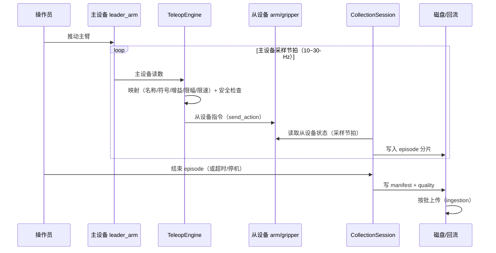

# R2C 遥操与数据采集特性设计

> 本文件负责"基于 r2c 的遥操与数据采集"特性的功能设计；不属于本文件的内容：设备树特性设计见 [r2c-multi-device-tree-design.md](r2c-multi-device-tree-design.md)（本特性以其设备树为组织基础），业界调研见 `docs/research/r2c-multi-device-industry-survey.md`，代码现状见 `docs/research/cloudrobo-r2c-codebase-survey.md`。
>
> 状态：**v0.1，待评审**。章节结构与设备树特性设计一致（特性概述 / 需求分析〔需求背景、场景分析、友商分析、名词解释〕/ 功能方案〔功能约束与依赖、整体方案设计、详细功能设计〕/ 可靠性 / 安全 / 性能规格 / 兼容性 / 测试 / 遗留问题 / 决策点）。本文件只出设计，不含实现。

## 1. 特性概述

**背景**：遥操（人操作主设备驱动从设备）是当前数据采集的主要手段（数据回流配置中 `collect_method` 已有"遥操接管"取值，`packages/cloudrobo-ingestion/examples/ingestion.yaml`）。现状：r2c 只在整机层面提供原始观测录制（`ObservationRecorder` + `--record`/`--duration`，R2CR 自定义格式，cloudroboclient.py:188-193、common/utils/safe_serialization.py:1-20）与回放（playback adapter）；遥操完全在 r2c 之外（LeRobot teleoperate，`--teleop.joint_sign` 见 robot_a1z_lerobot_v2_config.yaml:106-108）。

**特性价值**：
1. 遥操与设备树统一：主设备/从设备都是设备树里的设备，配对、映射与安全约束在配置中声明；
2. 数据采集具备 episode（回合）语义：多设备流按统一时间基准对齐记录，带设备树快照与质量指标；
3. 采集产物直接对接数据回流（`cloudrobo-ingestion`）与回放（playback），形成"遥操采集 → 校验 → 上传 → 回放"闭环；
4. 无高频上云：采集仅在端侧落盘，按批次上传。

**目标**：
- 遥操：`teleop` 配置段声明主从配对、关节映射（名称/符号/增益/限幅）与安全策略（使能、急停、超时、限速）；本机实时闭环，不经云端；
- 采集：`collection` 配置段 + 运行期 episode 生命周期（开始/暂停/恢复/结束/丢弃），多设备流对齐录制，输出 manifest + 质量报告；
- 上传：episode 完成后按批交给 `cloudrobo-ingestion`（沿用 task_type/collect_method/validation）；
- 回放：沿用 playback adapter，按设备树还原多设备数据。

**非目标**（本版本不做）：云端实时遥操（跨公网主从）；VR/手柄等新输入设备驱动（仅定义设备类型接口位）；云端 episode 浏览/标注界面；自动质量修复；多机器人协同遥操。

## 2. 需求分析

### 2.1 需求背景

| 维度 | 现状 | 差距 |
|------|------|------|
| 遥操 | r2c 无遥操实现；主从映射靠外部工具（LeRobot teleoperate；a1z 配置注释 `--teleop.joint_sign`） | 主从配对不进设备树；映射/符号/限幅散落在启动参数；无统一安全策略 |
| 录制 | `ObservationRecorder` 录原始观测到 R2CR 文件；CLI `--record`/`--duration`（cloudroboclient.py:415-425） | 只有整机原始帧，无 episode 语义、无多设备分设备记录、无元数据/质量指标 |
| 多设备 | 设备树（v0.5）已有 devices/channels/transport 与 per-device 采样 | 采集未按设备树组织；录制内容与设备清单无绑定 |
| 上传 | `cloudrobo-ingestion` 扫描目录批量上传 OBS，带 task_type/collect_method/validation（lerobot_v3） | 采集端与上传端无约定（目录结构/manifest 格式） |
| 回放 | playback adapter 回放录制帧 | 回放只按整机帧，无设备树还原 |
| 安全 | 采集侧无急停/使能约束 | 遥操需要 dead-man、急停、超时与限速 |

### 2.2 场景分析

**场景 1：主从臂遥操采集（主力场景）。** 操作员推动主臂（leader），从臂（follower）实时跟随，同时采集从臂关节、夹爪、相机、六维力。要求：低时延本机闭环；按任务分段成 episode；采集数据可训练（LeRobot v3 格式/校验）。

**场景 2：遥操接管（半自动作业中人工介入）。** 机器人自主执行中遇异常，操作员接管；接管时段与自主时段都要记录，供后续训练与问题复现（对应 `collect_method: 遥操接管`）。

**场景 3：只采集不遥操（回放/仿真/已有策略运行）。** 无主设备，采集跟随运行中的设备树（仿真或回放数据），用于数据扩增与评测。

**场景 4：多设备异构采集。** 双臂 + 夹爪 + 双相机 + 六维力，采样率不同（相机 30Hz、力 30Hz、本体 100Hz 视设备），需要统一时间基准对齐。

**能力矩阵**：

| 需求点 | 现状 | 本特性 |
|--------|------|--------|
| 主从配对与映射 | 外部工具/启动参数 | ✔ teleop 配置段（设备引用 + 映射 + 限幅） |
| 遥操实时性 | 不涉及 | ✔ 本机闭环、不云转发 |
| 安全（使能/急停/超时） | ✗ | ✔ teleop 安全策略 |
| episode 语义 | ✗ | ✔ 生命周期 + manifest |
| 多设备分设备记录 | 整机原始帧 | ✔ 按设备树设备记录 |
| 时间对齐 | ✗ | ✔ 统一时间基准 + 偏差指标 |
| 质量指标 | ✗ | ✔ 丢帧率/时长/时间偏差/设备健康 |
| 对接回流 | 目录扫描 | ✔ episode 目录 + manifest 约定 |
| 回放还原 | 整机帧 | ✔ 按设备树还原 |

### 2.3 友商分析

| 友商 / 业界实现 | 关键机制 | 对本特性的启示 |
|----------------|----------|----------------|
| LeRobot | `lerobot_teleoperate` 主从遥操作、`lerobot_record`/`lerobot_replay` 采集回放、`teleoperators/` 把主臂建模为独立设备类型、calibration 目录 | 主设备与从设备同为设备；episode 录制/回放闭环；校准数据随设备保存 |
| Viam | teleop 作为 monitor 能力；session 心跳失联自动 `Stop()`；数据 capture 按"资源×方法"入单表 | 失联即停的安全语义；按设备×方法组织采集数据 |
| Genie Studio（智元） | "Multi-Ontology and Multi-End Effector"采集任务模型；跨场景跨设备采集管理；吞吐按 device 计量；校验规则可定制 | 采集任务/校验规则是独立抽象；设备是计量单元 |
| 灵渠 Link-U OS | AimStudio 批量部署/日志导出；aimrt_health_monitor 心跳 | 采集与运维工具分离；采集期健康快照 |
| 工业（ABB/Unitree） | 多本体协同在控制器层、按控制层级分通道 | 遥操闭环留在端侧控制器，云端只做任务编排 |

完整来源见 `docs/research/r2c-multi-device-industry-survey.md`。

### 2.4 名词解释

| 术语 | 定义 |
|------|------|
| 遥操（teleop） | 操作员通过主设备实时驱动从设备的运行模式；本机闭环，低时延 |
| 主设备（leader） | 操作员操作的输入设备（主臂、手柄、VR 控制器等），设备树中的设备类型 |
| 从设备（follower） | 被主设备驱动的执行设备（从臂、夹爪、底盘等），设备树中的设备 |
| 映射（mapping） | 主设备通道到从设备通道的转换规则：关节名对应、符号、增益、偏移、限幅、速度限制 |
| episode（回合） | 一次采集单元：从开始到结束的一段连续数据，带任务/操作员/设备树快照等元数据 |
| 对齐（alignment） | 多设备流按统一时间基准对齐，使同一时刻的各设备样本可同时使用 |
| manifest | episode 元数据清单：设备树快照、配置哈希、校准信息、任务、质量指标、文件列表 |
| R2CR | r2c 采集落盘格式（magic/version/frame_count/索引），无 pickle 代码执行风险（safe_serialization.py） |
| 质量指标（quality metrics） | 丢帧率、实际时长、设备时间偏差、设备健康状态等采集质量度量 |

## 3. 功能方案

### 3.1 功能约束与依赖

**约束**：
- C1 遥操闭环在本机（端侧），不经云端往返；
- C2 采集数据只在端侧落盘，按批上传（沿用 ingestion 的批上传与进度上报）；
- C3 采集内容按设备树设备组织，设备清单与通道来自设备声明（与设备树特性一致）；
- C4 安全优先：使能失效、急停、超时、主设备断流时立即停止从设备运动；
- C5 兼容：现有 `--record`（整机原始观测）与 R2CR 文件保持可读、可回放；不破坏 v2.1 配置。

**依赖**：
- 设备树特性（adapters 传输上下文 + devices 设备 + channels + config_file 引用）；
- `IRobotHardwareAdapter` 的读写能力（get_observation/send_action）与设备类型 entry-point（`r2c_sdk.devices`）；
- `common/utils/recorder.py`（ObservationRecorder）与 `common/utils/safe_serialization.py`（R2CR 格式）；
- playback adapter（回放）；
- `cloudrobo-ingestion`（批量上传、task_type/collect_method、lerobot_v3 校验）；
- 设备树心跳与逐设备健康（Heartbeat.devices）。

### 3.2 整体方案设计

**技术选型**：

| 选型点 | 决策 | 依据 |
|--------|------|------|
| 遥操组织方式 | `teleop` 为**运行模式 + 配置段**（不是设备类型）：声明主从配对、映射与安全；运行期在主设备采样节拍内完成映射与下发 | 遥操是"关系"而非"设备"；与设备树解耦，主从可来自不同 transport（如主臂串口、从臂 ROS） |
| 采集组织方式 | `collection` 为**会话**：订阅设备输出（设备树），episode 生命周期驱动落盘 | 采集跟随设备树即可覆盖所有设备类型（含历史设备输出的窗口） |
| 落盘格式 | 扩展 R2CR（v2）：在现有帧格式基础上增加 episode 头（manifest 引用）与按设备分组的分片 | 沿用无 pickle 的安全格式；向后兼容 v1 读取 |
| 数据集格式 | 采集原始数据（R2CR v2）+ 导出 LeRobot v3（可选导出器）；上传校验沿用 ingestion 的 `lerobot_v3` | 采集保真（原始帧）与训练格式解耦；ingestion 已有校验 |
| 时间基准 | 端侧单调时钟为主，记录 UNIX 偏移；每样本带时间戳；episode 记录起始锚点 | 与设备树"时间基准统一在样本时间戳"一致 |
| 安全 | 软件使能（dead-man）+ 急停源（设备或外部输入）+ 超时/断流停机 + 限速限幅 | 对齐 Viam 失联即停、工业急停惯例 |

**整体架构**：

```text
设备树 (adapters + devices)
  ├── leader_arm (type: leader_arm, transport: serial)   ──10~30Hz──┐
  ├── arm        (type: arm,        transport: ros)   ◄── 遥操指令 ──┤
  ├── gripper    (type: gripper,    transport: ros)   ◄── 遥操指令 ──┤  TeleopEngine
  ├── camera1/2  (type: opencv_camera)                              │  （映射/限幅/安全）
  └── left_ft / left_ft_hist                                        │
                                                                    ▼
CollectionSession（订阅设备输出，按 episode 落盘）
  ├── EpisodeRecorder → episodes/<episode_id>/ …（R2CR v2 分片 + manifest.json + quality.json）
  └── 完成后按批交给 cloudrobo-ingestion（task_type / collect_method / lerobot_v3 校验）
```

**关键时序（遥操 + 采集）**：



### 3.3 详细功能设计

#### 3.3.1 功能原理

**遥操**：
- 运行模式：`AUTO`（云端策略）/ `TELEOP`（人工）/ `PAUSED`；同一时刻从设备的命令通道只由一个来源独占（对齐 ros2_control 的命令接口独占语义），切换时先停后切。
- 映射：主设备读数 → 从设备指令，规则包括关节名对应表、符号、增益、偏移、单步限幅、速度限制；逐设备声明，支持异构主从（主臂串口 + 从臂 ROS）。
- 安全：使能信号（按住才动）、急停（硬件/软件源）、主设备断流超时（如 200ms）、从设备故障、限速限幅；任一触发即停止从设备并置 DEGRADED。
- 时延：本机闭环目标 ≤ 采样周期（10~30Hz 场景即 33~100ms），不做云端往返。

**采集**：
- episode 生命周期：`START → RECORDING → (PAUSE/RESUME) → STOP`；异常（设备故障/磁盘满/超时）自动 STOP 并标记原因；操作员可 `DISCARD`。
- 多设备记录：按设备树的设备清单订阅各自通道；相机等大流量单独分片；历史设备输出（窗口）可选记录（避免重复存原始流）。
- 对齐：每样本带设备时间戳；episode 记录起始锚点（单调时钟 ↔ UNIX 偏移）；manifest 记录各设备实际采样率与偏差统计。
- 质量指标：每设备丢帧率、实际时长、首末样本时间偏差、设备健康事件（离线/恢复）、编码失败计数。
- 元数据：任务描述、操作员、语言指令（可选）、设备树快照（设备名/类型/通道/参数哈希）、校准版本、配置哈希 —— 保证数据可复现。
- 上传：episode 完成后（或定时批量）交给 `cloudrobo-ingestion`；失败重试与断点续传沿用 ingestion 能力。

**回放**：
- 按 manifest 的设备树快照重建播放映射：R2CR v2 分片 → 各设备通道 → 设备树（playback 设备类型），按原时间戳节奏播放。

#### 3.3.2 接口设计

**遥操配置**（robot_config v3.0 新增段）：

```yaml
teleop:
  enabled: true
  mode: manual                       # manual：操作员触发；auto：随会话
  pairs:
    - leader: leader_arm             # 主设备（设备树中的设备名）
      follower: arm                  # 从设备
      mapping:
        joints:                      # 主→从关节对应（名称可不同）
          - {leader: leader_joint_1, follower: joint_1, sign: 1,  gain: 1.0, offset: 0.0}
          - {leader: leader_joint_2, follower: joint_2, sign: -1, gain: 1.0, offset: 0.0}
        limits: {max_step: 0.02, max_velocity: 1.0}   # 单步限幅 / 限速
    - leader: leader_gripper
      follower: gripper
      mapping: {channels: [{leader: pos, follower: gripper_position, gain: 1.0}]}
  safety:
    deadman: {source: leader_arm.button}     # 使能信号（设备通道或外部输入）
    estop: {sources: [arm.estop, external.io_estop]}
    staleness_ms: 200                        # 主设备断流超时
    rate_limit_hz: 30
```

**采集配置**（同一配置新增段）：

```yaml
collection:
  enabled: true
  output_dir: ./episodes                      # 相对配置文件目录
  storage: r2cr_v2                            # r2cr_v2（采集保真）；导出 lerobot_v3 由 exporter 完成
  devices: [arm, gripper, camera1, camera2, left_ft]   # 记录哪些设备（缺省=设备树全部）
  include_history_outputs: false              # 是否记录历史设备的窗口输出
  pre_roll_s: 1.0                              # episode 前置预滚（利用环形缓冲）
  episode:
    max_duration_s: 120
    pause_timeout_s: 300
  validation:
    min_duration_s: 3.0
    max_drop_rate: 0.01                        # 丢帧率上限
    max_time_skew_ms: 50                       # 设备间时间偏差上限
  upload:
    enabled: true
    task_type: 超市取货                        # 与 ingestion 约定一致
    collect_method: 遥操接管                    # 与 ingestion 约定一致
    on: episode_end                            # episode_end | batch
```

**CLI 接口**（基于现有 `cloudrobo r2c client` 扩展子命令，示意）：

| 命令 | 说明 |
|------|------|
| `cloudrobo r2c teleop start/stop` | 进入/退出遥操模式（受 deadman 约束） |
| `cloudrobo r2c collect start --task <描述> [--operator <id>]` | 开始一个 episode |
| `cloudrobo r2c collect stop [--discard]` | 结束并保存（或丢弃）当前 episode |
| `cloudrobo r2c collect status [--json]` | 当前 episode 状态、时长、丢帧率、设备健康 |
| `cloudrobo r2c replay <episode_dir>` | 按 manifest 回放 episode |

**事件接口**（进程内事件总线，供 UI/日志消费）：`mode_changed`、`episode_started/paused/resumed/stopped/failed`、`safety_triggered{reason}`、`quality_report_ready`、`upload_finished`。

**界面设计**：本版本以 CLI + 结构化日志为主（`collect status --json` 供外部工具消费）；操作员提示（记录中/已暂停/上传中）可通过设备树中的指示设备（如 LED/蜂鸣器设备类型，后续提供）呈现，本版本不新增图形界面。

#### 3.3.3 数据结构设计

**episode 目录约定**（与 ingestion 扫描/上传对接）：

```text
episodes/<episode_id>/
├── manifest.json        # 元数据：设备树快照、任务、操作员、时长、文件清单、哈希
├── quality.json         # 质量指标：逐设备丢帧率/实际时长/时间偏差/健康事件
├── ep_<device>.r2cr     # 逐设备分片（R2CR v2）
└── exports/             # 可选：lerobot_v3 导出（exporter 生成）
```

**manifest.json（字段）**：

| 字段 | 说明 |
|------|------|
| `episode_id`、`started_at`、`ended_at`、`duration_s` | 回合标识与时长 |
| `task`、`language_instruction`、`operator` | 采集语义 |
| `robot`（设备树快照） | devices[{name,type,channels,params_hash}]、adapters[{name,type}]、config_hash |
| `calibration` | 各设备校准版本/文件哈希（如有） |
| `streams` | 每设备：分片文件名、样本数、标称/实际采样率、时间范围 |
| `quality_ref`、`schema_version` | 质量文件引用与格式版本 |
| `collect_method`、`task_type` | 与回流约定一致 |

**quality.json（指标）**：`per_device{name: {frames, expected, drop_rate, actual_hz, first_ts, last_ts}}`、`time_skew_ms{device: x}`、`health_events[]`、`encode_errors`、`verdict`（pass/fail + 原因）。

**R2CR v2**：在 v1 头（magic/version/frame_count/index）之后增加 `episode_header`（manifest 引用、设备列表）与 `stream_table`（每设备分片的偏移/样本数/类型）；帧数据按设备流分段存放。v1 文件继续可读（回放兼容）。

**遥操运行期结构**：`TeleopPair{leader, follower, mapping, limits}`、`TeleopState{mode, enabled, last_leader_ts, estop}`、`SafetyEvent{reason, source, at}`。

## 4. 可靠性与异常设计

| 异常 | 行为 |
|------|------|
| 主设备断流/超时（`staleness_ms`） | 立即停止从设备，置 `safety_triggered(staleness)`；恢复需重新使能 |
| 使能失效 / 急停 | 立即停止从设备；episode 自动 STOP 并标记原因（不静默丢弃） |
| 从设备故障 | 停止该设备及其遥操配对，其他设备不受影响（设备树隔离） |
| 采集期设备离线 | episode 继续记录其他设备，offline 设备标记丢帧/健康事件；质量指标体现 |
| 磁盘满/写入失败 | episode 自动 STOP，保留已写分片，标记 `failed`；不自动删除 |
| 进程崩溃 | manifest 在录制中周期性落盘（如每 5s），重启后可恢复/清理为 `incomplete` |
| 上传失败 | 沿用 ingestion 重试与断点续传；本地保留直到确认上传成功 |
| 时间戳回退 | 丢弃异常样本并计入质量指标 |

## 5. 安全设计

- 遥操必须"按住动"（deadman），松开即停；急停源支持设备通道与外部输入；
- 限速/限幅/单步限制在 TeleopEngine 内强制，不依赖上层配置正确性；
- 采集文件路径限制在配置目录内（与设备树配置引用同一沙箱规则）；manifest 不写密钥；
- 上传凭证沿用现有 `cloudrobo config`/环境变量，不落入 episode 文件；
- 录制格式无 pickle（沿用 R2CR），避免任意代码执行；
- 遥操模式与自主模式的切换需显式操作，切换时先停后切，避免命令来源冲突。

## 6. 性能规格

- 遥操闭环：主设备采样 10~30Hz，端到端（主读数→从指令下发）目标 ≤ 1 个采样周期；不引入云端往返；
- 采集写入：每设备 30Hz 小数据（关节/力）≈ KB/s 级；相机按编码后写入（如 webp/jpeg），双相机 30Hz 640×480 约数 MB/s，需按设备限频或降采样配置；
- manifest/quality 写入为 O(设备数)，周期性落盘间隔可配；
- 预滚（`pre_roll_s`）使用设备树环形缓冲，不额外占用采集带宽。

## 7. 兼容性与升级

- 现有 `--record`（整机原始观测，R2CR v1）保留可用；v1 文件可继续回放；
- 无 `teleop`/`collection` 配置 = 原行为；
- 采集目录格式新增，不影响既有 ingestion 目录扫描（manifest 与分片同目录，扫描规则可配置）；
- 回退：不启用新特性即回到现状；已采集 episode 独立于版本。

## 8. 测试与验收

| 层级 | 内容 |
|------|------|
| 单测 | 映射（符号/增益/偏移/限幅/限速）、deadman/超时/急停状态机、episode 生命周期、对齐与时间偏差计算、质量判定、manifest 序列化 |
| 集成（遥操） | dummy 主设备 + dummy 从设备：遥操跟随、超时停机、急停停机、模式切换命令独占 |
| 集成（采集） | 设备树（arm/gripper/双相机/力 + 历史设备）录制 episode：分片完整、manifest 设备树快照正确、quality 指标计算正确、暂停/恢复/丢弃 |
| 集成（闭环） | episode → ingestion 上传（本地 mock OBS/Zenoh）→ 校验（lerobot_v3）→ 回放还原 |
| 验收标准 | 遥操时从设备跟随且超时/急停 200ms 内停止；一次 episode 产出 manifest+quality+分片且可回放；上传后可被 ingestion 校验通过；v1 录制文件回归可读 |

## 9. 遗留问题与后续规划

1. 主设备类型实现（主臂/手柄/VR）与校准流程（对标 LeRobot calibration）；
2. lerobot_v3 导出器（采集原始 → 训练数据集）；
3. 云端 episode 浏览/标注/筛选（与 Genie Studio Monitor 类能力对齐）；
4. 多机器人协同遥操与远程遥操（跨公网，需时延与安全评估）；
5. 采集期指示设备（LED/蜂鸣）设备类型；
6. 与设备树"历史设备"配合的预滚策略细节（窗口起点与 episode 起点对齐）；
7. 采集质量自动修复/重采建议。

## 10. 决策点汇总

| # | 决策点 | 状态 / 建议 |
|---|--------|-------------|
| T1 | 遥操组织方式 | 建议：运行模式 + `teleop` 配置段（不是设备类型）；待评审 |
| T2 | 采集落盘格式 | 建议：R2CR v2（保真）+ 可选 lerobot_v3 导出；待评审 |
| T3 | 时间对齐策略 | 建议：样本时间戳 + episode 锚点，质量指标暴露偏差；待评审 |
| T4 | 上传触发时机 | 建议：episode 结束即传（`on: episode_end`），批量模式可选；待评审 |
| T5 | 安全信号来源 | 建议：deadman 来自设备通道，急停支持设备+外部输入；待评审 |
| T6 | episode 判定与丢弃 | 建议：质量不达标标记而非自动删除，由操作员/流水线决定；待评审 |
| T7 | 与 `--record` 的关系 | 建议：`--record` 保留为整机原始录制（兼容），新采集走 `collection`；待评审 |
