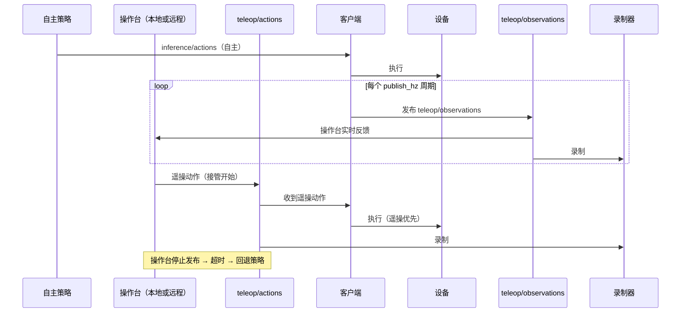

# R2C 遥操与数据采集特性设计

> 本文件负责"基于 r2c 的遥操与数据采集"特性的功能设计；不属于本文件的内容：设备树特性设计见 [PR #1 的 r2c-multi-device-tree-design.md](https://github.com/vincentguiling/cloudrobo-sdk-client/blob/agent/research-r2c-multidevice-d6cf83e2c104/docs/design/r2c-multi-device-tree-design.md)（该文档合入后改为仓库内相对路径），业界调研见 `docs/research/r2c-multi-device-industry-survey.md`，代码现状见 `docs/research/cloudrobo-r2c-codebase-survey.md`。
>
> 状态：**v0.4，待评审**。本版按反馈：**遥操动作与策略动作分话题**（`teleop/actions` 独立于 `inference/actions`）；**遥操数采按 `publish_hz` 发布 `teleop/observations`**；**采集话题固定为 `teleop/actions` + `teleop/observations`**。客户端仍不区分本地/远程遥操（同一 `teleop/actions`），只区分"遥操动作"与"策略动作"。只出设计，不含实现。

## 1. 特性概述

**背景**：本特性主力场景是**遥操接管**——机器人按云端策略自主执行，遇异常时操作员接管，处理完交还自主；接管时段是价值最高的训练数据（回流配置中 `collect_method` 已有"遥操接管"）。现状：r2c 只有整机原始观测录制（`ObservationRecorder` + `--record`，cloudroboclient.py:188-193）与回放；遥操在 r2c 之外（LeRobot teleoperate、`--teleop.joint_sign`）。

**核心思路**：
1. **遥操动作独立话题**：`{p}/{d}/teleop/actions`，与策略动作 `{p}/{d}/inference/actions` 分开，互不覆盖；客户端两条来源都订阅，按"遥操新鲜优先、否则策略"执行。
2. **遥操观测独立话题**：`{p}/{d}/teleop/observations`，按 `runtime.publish_hz`（如 30Hz）发布，供操作台实时反馈与数采录制；与供模型推理的 `inference/observations`（0.5Hz）分离。
3. **本地/远程不区分**：本地操作台与远程操作员都发布到同一个 `teleop/actions`，客户端无本地/远程分支。
4. **采集=录制两个话题**：录制器订阅 `teleop/actions` 与 `teleop/observations`，按时序落盘。

**目标**：
- 新增 `teleop/actions`（客户端订阅、执行）与 `teleop/observations`（客户端按 `publish_hz` 发布）；
- 两条动作来源的仲裁规则（遥操优先、超时回退策略）；
- 录制器支持按 topic 录制 `teleop/actions` + `teleop/observations`，可轮转、可回放；
- 配置最小化（客户端新增 ≤ 4 项，均有默认值）。

**非目标**（本版本不做）：客户端内建接管权限体系（由 Zenoh ACL/发布端承担）；云端 episode 浏览/标注；跨公网低时延专项优化；多机器人协同遥操。

## 2. 需求分析

### 2.1 需求背景

| 维度 | 现状 | 差距 |
|------|------|------|
| 遥操动作通路 | 无；遥操在 r2c 外 | 需要与策略动作分开的遥操动作话题 |
| 遥操观测 | 只有 `inference/observations`（给模型） | 需要 `publish_hz` 的 `teleop/observations` 供操作台与录制 |
| 本地 vs 远程 | 概念上视为两种模式 | 客户端不应区分：同一 `teleop/actions` 话题 |
| 采集 | `--record` 录整机原始观测（cloudroboclient.py:415-425） | 需要按 topic 录制遥操两话题 |
| 回放 | playback 回放整机帧 | 录制产物需可回放 |

### 2.2 场景分析

**场景 1：遥操接管（主力）。** 策略在 `inference/actions` 上执行；操作员在本地或远端操作台接管，开始向 `teleop/actions` 发布。客户端检测到新鲜遥操动作即以遥操为准；操作台停止发布后，客户端回退到策略动作。接管期间 `teleop/observations` 持续以 `publish_hz` 发布，录制器记录两话题。

**场景 2：纯遥操教学/采集。** 无策略，操作台持续发布 `teleop/actions`；录制器记录 `teleop/actions` + `teleop/observations`。

**场景 3：远程遥操。** 操作员跨网络发布到同一 `teleop/actions`、订阅 `teleop/observations`；客户端与本地遥操无差别。

**场景 4：只采集。** 不遥操，录制器仍可订阅遥操两话题（例如采集期间策略动作与遥操动作并存时）。

**能力矩阵**：

| 需求点 | 现状 | 本特性 |
|--------|------|--------|
| 遥操动作与策略动作分离 | ✗（共用一个话题） | ✔ `teleop/actions` vs `inference/actions` |
| 遥操观测独立高频 | ✗ | ✔ `teleop/observations` @ `publish_hz` |
| 本地/远程一致 | 概念上分叉 | ✔ 同一 `teleop/actions`，客户端不分 |
| 动作来源仲裁 | 无 | ✔ 遥操新鲜优先、超时回退策略 |
| 录制遥操两话题 | ✗（只录整机观测） | ✔ `collection.record` 默认两话题 |
| 回放 | 整机帧回放 | ✔ 按 topic 回放 |

### 2.3 友商分析

| 友商 / 业界实现 | 关键机制 | 启示 |
|----------------|----------|------|
| LeRobot | 主从臂 teleoperate、record/replay | 遥操与录制可以很薄：主臂→从臂、录制存帧 |
| Viam | 失联即停；数据 capture 按资源×方法 | 客户端只需超时即停；采集按来源分 |
| ROS 2 + Zenoh | topic → key expression；regex 策略控频率/QoS | 话题即接口；遥操/策略各走各的话题 |
| Genie Studio / 灵渠 OS | 采集任务与校验在云侧/工具链，端侧薄 | 端侧只发动作/录话题，编排上移 |

### 2.4 名词解释

| 术语 | 定义 |
|------|------|
| teleop/actions | 遥操动作话题；本地与远程操作台均发布到这里，客户端统一订阅 |
| teleop/observations | 遥操观测话题；客户端按 `runtime.publish_hz` 发布，供操作台反馈与录制 |
| 动作来源仲裁 | 客户端在遥操动作与策略动作之间的执行选择规则：遥操新鲜优先，超时回退策略 |
| 发布权交接 | 接管/交还的实现方式：操作台开始/停止发布 `teleop/actions`，客户端不感知"接管"概念 |
| 录制器 | 订阅指定 topic、按到达时序落盘的订阅者（R2CR 格式） |

## 3. 功能方案

### 3.1 功能约束与依赖

**约束**：
- C1 遥操动作与策略动作**分话题**，互不覆盖：`teleop/actions` 与 `inference/actions`；
- C2 客户端**不区分**本地/远程遥操，同一 `teleop/actions` 与同一执行路径；
- C3 `teleop/observations` 按 `runtime.publish_hz` 发布，供操作台与录制；
- C4 采集 = 录制 `teleop/actions` + `teleop/observations` 两个话题；
- C5 配置最小化（≤4 项，均有默认值）；兼容现有 `--record`、R2CR v1 与 playback。

**依赖**：
- `transport/zenoh.py`（pub/sub、QoS、TLS）与 `client/session.py`（topic 命名、发布/订阅方法）；
- `Actions`/`Observations` 消息与 `sync_client` 动作执行路径；
- `common/utils/recorder.py` + `safe_serialization.py`（R2CR）；
- Zenoh ACL（谁可发布遥操话题）。

### 3.2 整体方案设计

**技术选型**：

| 选型点 | 决策 | 依据 |
|--------|------|------|
| 遥操动作话题 | **新增** `{p}/{d}/teleop/actions`，与 `inference/actions` 分离 | 策略与遥操互不覆盖、可独立录制与鉴权 |
| 遥操观测话题 | **新增** `{p}/{d}/teleop/observations`，按 `publish_hz` 发布 | 操作台需要实时画面/状态；与 0.5Hz 的推理观测解耦 |
| 仲裁规则 | 收到 `teleop/actions` 且在 `timeout_ms` 内 → 执行遥操；否则回退 `inference/actions`；两者都超时 → 停止 | 简单、确定、客户端无需接管状态机 |
| 本地/远程 | 不区分，同一话题 | 去掉客户端模式分支 |
| 采集 | 录制 `teleop/actions` + `teleop/observations`（默认） | 与约定一致；R2CR 落盘 |
| 上传 | 录制目录交给 `cloudrobo-ingestion` | 端侧薄 |

**整体架构**：

```text
发布端                                          客户端
  ├── 自主策略 ──► inference/actions ─────────► 仲裁（遥操新鲜优先）
  └── 操作台(本地/远程) ──► teleop/actions ────┘        │
                                                       ▼
                                                限幅/安全检查 → 设备

  客户端 ──► teleop/observations（publish_hz，如 30Hz）──► 操作台（反馈）
                                                       │
                                              录制器 ──┴──► recordings/{teleop_actions,teleop_observations}/*.r2cr
```

**关键时序**：



### 3.3 详细功能设计

#### 3.3.1 功能原理

- **动作订阅与仲裁**：客户端同时订阅 `inference/actions` 与 `teleop/actions`。执行规则：若最近 `timeout_ms`（默认 300ms）内收到遥操动作 → 执行遥操；否则若策略动作新鲜 → 执行策略；两者都超时 → 停止执行并保持。仲裁只在来源之间选择，不改变既有的 stale 判定、chunk 对齐、n-skip、fusion。
- **遥操观测发布**：客户端在控制循环的每个 `publish_hz` 节拍组装 Observations，发布到 `teleop/observations`（与 `inference/observations` 共用组装逻辑，但独立 topic 与频率）。操作台订阅该话题获得实时反馈；录制器同时录制。
- **本地/远程统一**：操作台无论本地进程还是远端节点，都向 `teleop/actions` 发布、从 `teleop/observations` 订阅；客户端无模式分支。
- **接管**：发布权交接——操作台开始/停止发布 `teleop/actions`；客户端仅按时间新鲜度仲裁，不需要"接管"状态机。权限由 Zenoh ACL 控制（谁可发布遥操话题）。
- **采集**：录制器订阅 `teleop/actions` + `teleop/observations`，原样落盘（R2CR v1，按 topic 分文件），按大小/时长轮转；可选 `meta.json` 记设备树快照与配置哈希。
- **回放**：按录制文件与 topic 回放；playback 设备类型注入设备树。

#### 3.3.2 接口设计

**话题清单**：

| 话题 | 方向 | 频率 | 说明 |
|------|------|------|------|
| `{p}/{d}/inference/actions` | 策略 → 客户端 | 策略驱动 | 现有；策略动作 |
| `{p}/{d}/teleop/actions` | 操作台 → 客户端 | 操作驱动 | **新增**；本地/远程遥操动作 |
| `{p}/{d}/inference/observations` | 客户端 → 云模型 | 0.5Hz（D3） | 现有；推理观测 |
| `{p}/{d}/teleop/observations` | 客户端 → 操作台 | **`publish_hz`（如 30Hz）** | **新增**；遥操反馈 + 录制 |
| `{p}/{d}/state/*` | 客户端 → 云 | 各自配置 | 现有（joint_states/heartbeats 等） |

**配置（极简，全部有默认值）**：

```yaml
teleop:
  actions_topic: "{project_id}/{device_id}/teleop/actions"              # 默认
  observations_topic: "{project_id}/{device_id}/teleop/observations"    # 默认
  timeout_ms: 300                                                       # 遥操动作超时 → 回退策略

collection:
  record: ["teleop/actions", "teleop/observations"]   # 默认两话题
  output_dir: ./recordings
```

不配 `teleop`/`collection` 段即为原有行为（不发布 `teleop/observations`、不录制）。

**CLI（在 `cloudrobo r2c client` 基础上增加）**：

| 命令/参数 | 说明 |
|-----------|------|
| `--record-topics "teleop/actions,teleop/observations"` | 命令行录制（等价 collection.record） |
| `--record-dir <dir>` | 录制目录 |
| `cloudrobo r2c record status` | 录制状态：topic、文件数、大小 |
| `cloudrobo r2c replay <record_dir>` | 回放 |

本地/远程操作台都只做"发布 `teleop/actions`、订阅 `teleop/observations`"，客户端无对应命令。

**界面设计**：无图形界面；录制状态用 CLI 与日志。

#### 3.3.3 数据结构设计

**录制目录**：

```text
recordings/
├── teleop_actions/2026-11-05T10-00-00.r2cr
├── teleop_observations/2026-11-05T10-00-00.r2cr
└── meta.json            # 可选：设备树快照、配置哈希、录制起止、publish_hz
```

- 文件内容沿用 **R2CR v1**（magic/version/frame_count/索引），帧为消息字节 + 时间戳；不引入新格式。
- 轮转按大小（默认 512MB）或时长（默认 10min），文件名带起始时间；`meta.json` 为可选旁注，不参与回放正确性。

## 4. 可靠性与异常设计

| 异常 | 行为 |
|------|------|
| `teleop/actions` 超时（默认 300ms） | 回退 `inference/actions`；若策略也超时 → 停止并保持 |
| 操作台与策略同时发布 | 以遥操新鲜度为准（遥操优先）；策略动作不丢弃但暂不执行 |
| 遥操观测发布失败 | 仅影响反馈/录制，不影响控制执行；记录告警 |
| 远程链路抖动 | Zenoh 可靠传输/重连沿用现有；超时保护兜底 |
| 录制磁盘满 | 停止录制并告警，保留已写文件 |
| 录制丢帧 | 记录丢帧计数到 meta；不阻断控制 |
| 进程崩溃 | 已写 R2CR 文件可读；未完成文件标记 `.partial` |

## 5. 安全设计

- 谁能发布 `teleop/actions` 由 **Zenoh ACL** 控制；建议策略与操作台使用不同凭证，操作台凭证才可写遥操话题；
- 客户端保留限幅/限速；遥操使能（deadman）由操作台实现，客户端以超时即停兜底；
- TLS/凭证沿用现有 bundle；
- 录制文件路径限制在配置目录内；录制内容不含凭证。

## 6. 性能规格

- `teleop/observations` @30Hz：若含图像，带宽与 `inference/observations` 同级；建议按操作台需要裁剪图像或降编码质量（可配）；
- `teleop/actions`：每帧数十 KB（chunk 大小决定），30Hz 约 MB/s 级；
- 录制：磁盘吞吐为瓶颈；两话题同时录制时按 topic 独立文件；
- 客户端新增开销：一次来源仲裁 + 一路发布节拍，可忽略。

## 7. 兼容性与升级

- 新增两话题，不影响既有 `inference/*` 与 `state/*`；
- 不配 `teleop`/`collection` = 原有行为；`--record` 保留；
- R2CR v1 与 playback 兼容。

## 8. 测试与验收

| 层级 | 内容 |
|------|------|
| 单测 | 来源仲裁（遥操优先/超时回退/双超时停）、录制轮转与命名、回放解析、meta 生成 |
| 集成（仲裁） | 策略与遥操交替发布：遥操新鲜时执行遥操、停止后回退策略、双停则停止 |
| 集成（遥操观测） | 校验 `teleop/observations` 以 `publish_hz` 发布（频率误差 ±10%），内容与 `inference/observations` 组包一致 |
| 集成（本地/远程一致） | 本机发布者与跨进程/跨节点发布者驱动同一客户端，行为一致 |
| 集成（录制/回放） | 录制两话题，文件完整、可回放；磁盘满停止录制 |
| 验收标准 | 遥操与策略动作分话题且互不覆盖；`teleop/observations` 频率符合 `publish_hz`；录制含两话题并可回放；客户端无本地/远程分支 |

## 9. 遗留问题与后续规划

1. `publish_hz` 下 `teleop/observations` 的图像裁剪/降质策略（带宽与操作台体验平衡）；
2. 录制文件与 `cloudrobo-ingestion` 的目录/元数据对接细则；
3. 远程遥操时延测量与跨公网 QoS 调优；
4. 操作台侧工具（主臂/手柄/VR 发布端）与校准；
5. 录制期间的 episode 分段（按接管起止自动切文件）。

## 10. 决策点汇总

| # | 决策点 | 状态 / 建议 |
|---|--------|-------------|
| U1 | 遥操动作是否独立话题 | **已定案（2026-11-05）**：独立 `teleop/actions`，与 `inference/actions` 分开 |
| U2 | 遥操观测话题与频率 | **已定案**：`teleop/observations`，按 `runtime.publish_hz` 发布 |
| U3 | 采集话题范围 | **已定案**：`teleop/actions` + `teleop/observations` |
| U4 | 动作来源仲裁规则 | 建议：遥操新鲜优先（`timeout_ms` 默认 300），超时回退策略，双超时停止；待评审 |
| U5 | 录制粒度与轮转 | 建议：按 topic 原样录制（R2CR v1），大小/时长轮转；待评审 |
| U6 | 配置项范围 | 建议：`teleop.actions_topic/observations_topic/timeout_ms` + `collection.record/output_dir`；待评审 |
