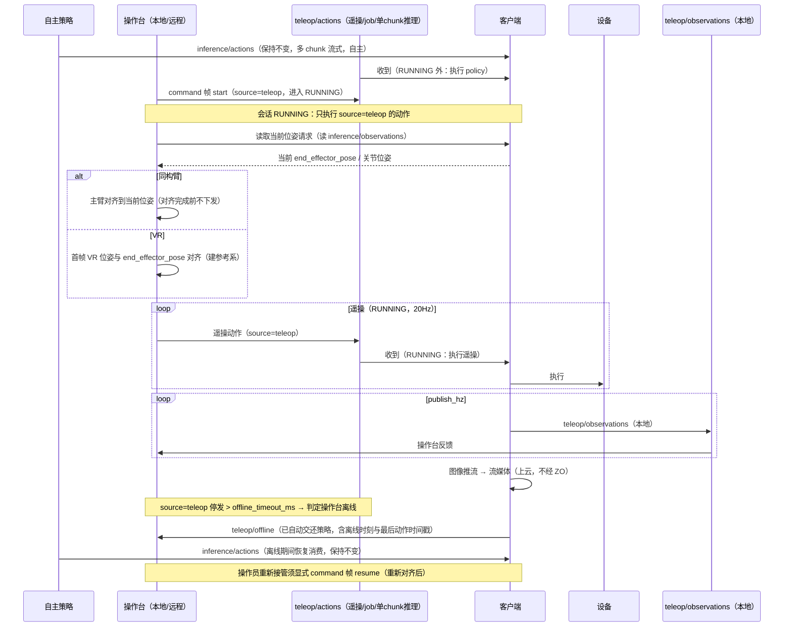

# R2C 遥操特性设计

> 本文件负责"基于 r2c 的遥操"特性的功能设计（数据采集已裁撤，见非目标）；不属于本文件的内容：设备树特性设计见 [PR #1 的 r2c-multi-device-tree-design.md](https://github.com/vincentguiling/cloudrobo-sdk-client/blob/agent/research-r2c-multidevice-d6cf83e2c104/docs/design/r2c-multi-device-tree-design.md)（该文档合入后改为仓库内相对路径），业界调研见 `docs/research/r2c-multi-device-industry-survey.md`，代码现状见 `docs/research/cloudrobo-r2c-codebase-survey.md`。
>
> 状态：**v1.5，待评审**。v1.5（2026-11-07 反馈）：§3.3.1.6 视频回传刷新——遥操推流**已在官方最新代码实现**（r2c `camera` 模块：LiveKit WebRTC 推流 + `job/command` CAMERA_START/STOP/RTC_TOKEN_RENEW 命令 + JWT 自动续签 + 相机能力上报），特性设计直接复用。v1.4（2026-11-07 定案）：动作话题布局修订——**`inference/actions` 保持不变**（策略流式通路零迁移）；**移除 `job/action`**；**新增 `teleop/actions`** 承载遥操动作（20Hz）+ job 任务动作 + 单 chunk 推理动作，生命周期经话题内 `command` 帧承载。此前 v1.3：砍掉数据采集功能（详见 git 历史）；v1.2 曾讨论三话题合并为一（本版修订其合并范围）。v1.3（2026-11-06 反馈）：**砍掉数据采集功能**——移除本地录制（R2CR）与 LeRobot v2.1/v3 格式转换、采集配置与录制相关测试/决策点；生命周期不再与录制耦合；`teleop/observations` 保留本地发布供操作台反馈；数据采集列为非目标（后续如需另行立项）。v1.2（2026-11-06，管理面/console 研讨结论）：①**动作话题合并**——遥操动作、策略动作、任务（job）动作统一到**统一动作话题** `{p}/{d}/teleop/actions`，消息携带 `source`（policy/job/teleop）与 `command`（start/pause/resume/finish/quit）字段，生命周期由 command 帧承载；②**遥操相关功能在 r2c 包内实现**（不同入口/不同配置文件），独立 teleop 包方案否决（§11 定案）。实现范围（2026-11-05 决策）：**VR 输入与云端实时遥操（远程遥操）为原始需求但仍在设计阶段——实现已从 PR #2 移除**，本文档按保留实现对齐（已实现 = 主从臂 + mock_joints 源、局域网现场遥操）。只出设计，不含实现。

## 1. 特性概述

**背景**：本特性主力场景是**遥操接管**——机器人按云端策略自主执行，遇异常时操作员接管，处理完交还自主。现状：遥操在 r2c 之外（LeRobot teleoperate、`--teleop.joint_sign`），r2c 仅有整机原始观测录制（`ObservationRecorder` + `--record`，与本期无关）。

**核心思路**：
1. **动作话题布局（2026-11-07 定案）**：`inference/actions` **保持不变**（策略多 chunk 流式动作，现网无感）；**移除 `job/action`**；**新增 `teleop/actions`**——承载**遥操动作（20Hz，`source=teleop`）+ job 任务动作（`source=job`）+ 单 chunk 推理动作（`source=policy`，chunk_size=1）**，生命周期经话题内 `command` 帧承载。**执行来源由会话状态决定**：IDLE/FINISHING 执行 `inference/actions` + `teleop/actions`(policy/job)；RUNNING 只执行 `teleop/actions`(teleop)；PAUSED 都不执行。
2. **生命周期 command 帧**：遥操生命周期（start/pause/resume/finish/quit）不再使用独立话题，以 `teleop/actions` 内消息的 **`command` 字段**（`TeleopControl`）承载，任何状态先处理命令帧再做动作仲裁。
3. **遥操观测独立话题**：`{p}/{d}/teleop/observations`，按 `publish_hz` 发布，**只在本地流转、不上云**（本地操作台反馈消费）；**数据格式与内容与 `inference/observations` 一致**（同一 `Observations` 消息）。**图像通过推拉流上云**（不经 teleop/observations 承载）。
4. **本地/远程不区分**：本地操作台与远程操作员都发布到 `teleop/actions`（`source=teleop`），客户端无本地/远程分支。

6. **遥操输入两类**：同构臂——先对齐位姿再跟随；VR——相对位姿模式（首帧对齐 `end_effector_pose`）。
6. **遥操离线机制（自动交还策略）**：RUNNING 态内超过 `offline_timeout_ms`（默认 300ms）未收到 `source=teleop` 动作，客户端判定**操作台离线**，自动切回策略模式（恢复执行 policy/job 动作），并发布 `teleop/offline` 事件通知操作台；离线期间遥操动作不再执行，**操作员须显式 `resume` command 帧才能重新接管**（避免误以为仍在控制）。
8. **实现归属**：遥操相关功能**全部在 r2c 包内实现**——机器人端增量在 client 执行路径（sync_client），操作端运行时以独立入口（`cloudrobo r2c teleop`）与独立配置文件（teleop YAML）承载，不新建包（§11 定案）。

**目标**：
- 新增 `teleop/actions`：承载遥操动作（20Hz）+ job 任务动作 + 单 chunk 推理动作（`source`/`command` 字段扩展）；`inference/actions` 保持不变；`job/action` 移除；
- 会话生命周期门控：command 帧驱动的客户端状态机（§3.3.1.2），仅 RUNNING 态执行 `source=teleop` 动作；
- 遥操离线机制：RUNNING 内超时判定离线 → 自动交还策略模式 + `teleop/offline` 事件 + 显式 `resume` 重新接管；
- 同构臂遥操的位姿预对齐流程；VR 遥操的相对位姿模式（VR 客户端实现见 §3.3.3）；

- 图像经推拉流上云（teleop/observations 不承载图像上云）；
- 配置最小化（客户端新增 ≤ 5 项，均有默认值）。

**非目标**（本版本不做）：**数据采集**（本地端录制 R2CR、LeRobot v2.1/v3 导出、回放——2026-11-06 裁撤，后续如需另行立项）；客户端内建接管权限体系（由 Zenoh ACL/发布端承担）；推拉流云侧服务（LiveKit SFU）运维——端侧推流已实现（camera 模块，§3.3.1.6），本特性直接复用；云端 episode 浏览/标注；多机器人协同遥操。

## 2. 需求分析

### 2.1 需求背景

| 维度 | 现状 | 差距 |
|------|------|------|
| 动作通路 | 策略动作 `inference/actions` 与任务动作 `job/action` 分话题；遥操在 r2c 外 | **`inference/actions` 不变**；移除 `job/action`；新增 `teleop/actions`（遥操 20Hz + job + 单 chunk 推理动作），生命周期以 `command` 帧承载 |
| 遥操观测 | 只有 `inference/observations`（给模型） | 需要本地高频的 `teleop/observations`（不上云），图像另走推拉流 |
| 遥操输入模式 | 只有外部主从臂 | 需要同构臂位姿预对齐与 VR 相对位姿两种模式（VR 客户端 §3.3.3） |
| 本地 vs 远程 | 概念上视为两种模式 | 客户端不应区分：同一 `teleop/actions`（`source=teleop`） |

### 2.2 场景分析

**场景 1：遥操接管（主力）。** 策略继续在 `inference/actions` 上发布（不变）；操作员发 `start` command 帧（`source=teleop`，`teleop/actions`）进入会话（RUNNING），随后以 20Hz 发布 `source=teleop` 动作。客户端在 RUNNING 内只执行 `source=teleop` 动作；操作台停发超过 `offline_timeout_ms` 判定遥操离线，**自动交还策略模式**（恢复消费 `inference/actions` 与 `teleop/actions` 的 policy/job 动作、发布 `teleop/offline` 事件），操作员重新接管需显式 `resume` command 帧；`pause` 则整机保持。接管期间 `teleop/observations` 按 `publish_hz` 本地发布（操作台反馈），图像另行推拉流上云供远程观看。

**场景 2：同构臂遥操（同型号臂作主臂）。** 开始遥操前，客户端/操作台先把同构臂（主臂）的位姿**对齐到当前从臂位姿**（读 `inference/observations` 的当前 `end_effector_pose`/关节位姿），对齐完成前不下发动作；对齐后主臂增量即从臂增量。

**场景 3：VR 遥操（相对位姿）。** VR 客户端（§3.3.3）为输入：首帧 VR 位姿与 `inference/observations` 的 `end_effector_pose` 对齐（建立参考系），之后按 VR 相对位姿增量驱动从臂末端；无需物理对齐主臂。

**场景 4：远程遥操。** 操作员跨网络向 `teleop/actions` 发布 `source=teleop` 动作、图像经推拉流观看；`teleop/observations` 仍只本地流转。

**能力矩阵**：

| 需求点 | 现状 | 本特性 |
|--------|------|--------|
| 动作话题布局（遥操/job/单chunk推理） | ✗（job/action 分话题，遥操缺失） | ✔ `inference/actions` 不变 + `teleop/actions`（遥操/job/单chunk推理）|作话题 + `source` 字段；生命周期走 `command` 帧 |
| 遥操观测本地高频、不上云 | ✗ | ✔ `teleop/observations` @ `publish_hz`，仅本地流转，格式与 inference 一致 |
| 图像上云 | 现有推理观测含图像 | ✔ 图像走推拉流（teleop 观测不承载上云） |
| 同构臂位姿预对齐 | ✗ | ✔ 操作前对齐到当前位姿（读 inference/observations） |
| VR 相对位姿遥操 | ✗ | ✔ 首帧对齐 `end_effector_pose`，后续增量（VR 客户端 §3.3.3） |
| 本地/远程一致 | 概念上分叉 | ✔ 同一统一话题，客户端不分 |
| 遥操离线机制 | 无 | ✔ RUNNING 内超时判定操作台离线 → 自动交还策略模式（`teleop/offline` 事件），重新接管须显式 `resume` command 帧 |

### 2.3 友商分析

| 友商 / 业界实现 | 关键机制 | 启示 |
|----------------|----------|------|
| LeRobot | 主从臂 teleoperate | 遥操操作端可以很薄：输入→映射→发动作 |
| Viam | 失联即停 | 客户端只需超时即停 |
| ROS 2 + Zenoh | topic → key expression；regex 策略控频率/QoS | 话题即接口；来源可用消息字段承载 |
| Genie Studio / 灵渠 OS | 采集任务与校验在云侧/工具链，端侧薄 | 端侧只发动作，编排上移 |

### 2.4 名词解释

| 术语 | 定义 |
|------|------|
| `teleop/actions` | **新增统一副话题**：承载遥操动作（`source=teleop`，20Hz）+ 任务动作（`source=job`）+ 单 chunk 推理动作（`source=policy`，chunk_size=1）的动作与 `command` 生命周期控制帧；`inference/actions` 保持不变 |
| `source` 字段 | 动作消息的发布来源标记（`teleop/actions` 内）：`policy`（单 chunk 推理动作）/ `job`（任务）/ `teleop`（遥操操作台）；客户端按会话状态决定消费哪些 source |
| `source` 字段 | 动作消息的发布来源标记：`policy`（策略，缺省，兼容旧发布端）/ `job`（任务）/ `teleop`（遥操操作台）；客户端按会话状态决定消费哪些 source |
| `command` 帧 | 携带 `TeleopControl`（start/pause/resume/finish/quit）的遥操生命周期命令消息，在 `teleop/actions` 上随动作流传输；无动作步 |
| teleop/observations | 遥操观测话题；客户端按 `publish_hz` 发布，**仅本地流转、不上云**（操作台反馈消费），格式与内容与 `inference/observations` 一致 |
| 推拉流 | 图像上云方式：客户端把相机画面推到流媒体服务，云端/远程操作台拉流观看；teleop/observations 不承载图像上云 |
| 同构臂位姿预对齐 | 同构臂遥操开始前，把主臂位姿调整到与从臂当前位姿一致（读 `inference/observations`），对齐完成前不下发动作 |
| VR 相对位姿遥操 | VR 首帧位姿与从臂当前 `end_effector_pose` 对齐建立参考系，之后按 VR 相对位姿增量驱动 |
| 遥操离线机制 | RUNNING 内超过 `offline_timeout_ms` 未收到 `source=teleop` 动作 → 判定操作台离线：自动交还策略模式、发布 `teleop/offline`；重新接管须显式 `resume` command 帧 |
| 会话状态门控 | 客户端维护数采会话状态（IDLE/RUNNING/PAUSED/FINISHING/FALLBACK 语义见 §3.3.1.2），按状态决定消费的 `source`；**客户端感知"会话状态"，但不判断"接管权限/归属"**（谁可接管由 Zenoh ACL 与操作台约定） |

## 3. 功能方案

### 3.1 功能约束与依赖

**约束**：
- C1 动作话题布局：`inference/actions` 保持不变；`teleop/actions` 承载遥操（20Hz）+ job + 单 chunk 推理动作（`source` 区分）；生命周期以 `command` 帧（`TeleopControl`）承载，不再使用独立生命周期话题；
- C2 客户端**不区分**本地/远程遥操，同一 `teleop/actions` 与同一执行路径（`source=teleop`）；
- C3 `teleop/observations` 按 `publish_hz` 发布、**仅本地流转不上云**，格式与内容与 `inference/observations` 一致；
- C4 图像通过**推拉流**上云（复用官方 `camera` 模块 LiveKit 实现，§3.3.1.6），`teleop/observations` 不承载图像上云；
- C5 遥操输入两类：同构臂（位姿预对齐）与 VR（相对位姿，首帧对齐 `end_effector_pose`）；
- C6 数据采集为非目标（2026-11-06 裁撤）：本地录制、格式转换、回放均不在本期范围；
- C7 遥操功能**全部在 r2c 包内实现**（机器人端增量在 client 执行路径；操作端走独立入口 `cloudrobo r2c teleop` 与独立配置文件），不新建包；
- C7 配置最小化（均有默认值）；`inference/actions` 发布端零改动；`job/action` 发布端过渡期并行迁移。

**依赖**：
- `transport/zenoh.py`（pub/sub、QoS、TLS）与 `client/session.py`（topic 命名、发布/订阅方法）；
- `Actions`/`Observations` 消息扩展（`source`/`command` 字段，proto3 只增不改）与 `sync_client` 动作执行路径；
- （数据采集依赖已随功能裁撤移除）
- Zenoh ACL（谁可发布 `teleop/actions` 与 `inference/actions`）。

### 3.2 整体方案设计

**技术选型**：

| 选型点 | 决策 | 依据 |
| 动作话题 | **统一** `{p}/{d}/teleop/actions`：策略/job/遥操三类动作同话题，消息带 `source`（policy/job/teleop） | 管理面/console 研讨结论：减少话题数量，管理面与 console 按单一动作话题接入；来源在消息内区分 |
| 动作话题 | **定案（2026-11-07）**：`inference/actions` **保持不变**；移除 `job/action`；新增 `teleop/actions`（遥操 20Hz + job + 单 chunk 推理动作，消息带 `source`） | 管理面/console 研讨：策略流式通路零迁移；job 与单次推理动作、遥操动作收敛到副话题，console 只对接 `teleop/actions` |
| 遥操观测话题 | **新增** `{p}/{d}/teleop/observations`，按 `publish_hz` 发布，**仅本地流转**，格式与 `inference/observations` 一致 | 操作台反馈与本地录制；不上云降低公网带宽 |
| 图像上云 | **推拉流（已实现，直接复用）**：官方 `camera` 模块经 LiveKit WebRTC 推流（`job/command` 的 CAMERA_START/STOP + JWT 续签），云端/远程拉流 | 高频图像不走 Zenoh 观测话题；teleop/observations 保持轻量 |
| 同构臂预对齐 | 遥操开始前读 `inference/observations` 当前位姿，主臂对齐后才进入跟随 | 消除初始位姿差，避免起跳 |
| VR 相对位姿 | 首帧 VR 位姿与 `end_effector_pose` 对齐，后续按增量映射 | VR 无物理对齐手段，用参考系平移 |
| 执行来源与离线机制 | 会话状态决定执行来源（IDLE/FINISHING→policy/job；RUNNING→teleop；PAUSED→都不执行）+ 离线检测（RUNNING 内超 `offline_timeout_ms` 无 `source=teleop` 动作 → 判定离线、自动交还策略、发 `teleop/offline`、需显式 `resume` command 帧重新接管；策略也停 → 停止保持） | 离线是显式状态迁移而非隐式回退；操作员始终知道当前是遥操还是策略 |
| 本地/远程 | 不区分，同一话题（`source=teleop`） | 去掉客户端模式分支 |
| 采集 | 本期不做（非目标，2026-11-06 裁撤） | — |
| 实现归属 | **全部在 r2c 包内**：机器人端增量在 client 执行路径；操作端走独立入口与配置文件（§11 定案） | 管理面/console 研讨结论：不新建包 |

**整体架构**：

```text
发布端                                                客户端
  ├── 自主策略 ──► inference/actions（保持不变，多 chunk 流式）──► 会话门控（IDLE/离线时执行）
  ├── 任务(job) ──► source=job ─────┐
  └── 推理(单chunk) ─► source=policy ─┴─► {p}/{d}/teleop/actions ──► 会话门控 + 离线检测/自动交还
  └── 操作台(本地/远程) ─► source=teleop（20Hz）+ command 帧 ─┘        │
                                                                    ▼
                                                          限幅/安全检查 → 设备

  客户端 ──► teleop/offline（事件，离线时）──► 操作台（提示已被自动交还）
  客户端 ──► teleop/observations（publish_hz，仅本地流转）──► 本地操作台（反馈）
  客户端 ──► 相机画面 ──推流──► 流媒体服务 ──拉流──► 云端/远程观看（图像上云）
```

**关键时序（同构臂 / VR 遥操）**：



### 3.3 详细功能设计

> 3.3 按功能拆分（功能实现在前、接口设计在底部）：3.3.1 遥操功能实现（客户端执行侧）、3.3.2 VR客户端功能实现（Quest 操作端，参考 metaquest-dist）、3.3.3 接口设计（共享话题/配置/CLI）。数据采集（录制/格式转换）已裁撤。

#### 3.3.1 遥操功能实现

##### 3.3.1.1 功能原理

- **动作订阅与执行规则（会话状态决定来源 + 在线/离线状态）**：客户端订阅 `inference/actions`（不变）与 `teleop/actions`（遥操/job/单 chunk 推理混流，20Hz 遥操节拍），按话题与消息 `source`/`command` 字段分流。
  - `IDLE` / `FINISHING`：执行 `inference/actions`（不变）+ `teleop/actions` 内 `source∈{policy,job}` 动作；`source=teleop` 动作丢弃（计数告警）；
  - `RUNNING` + **遥操在线**（最近 `offline_timeout_ms` 内有 `source=teleop` 动作）：只执行 `teleop/actions` 内 `source=teleop` 动作；`policy/job` 动作不消费（不丢弃、不缓存）；
  - `RUNNING` + **遥操离线**（超过 `offline_timeout_ms` 无 `source=teleop` 动作）：判定操作台离线 → **自动交还策略模式**，恢复执行 `inference/actions` 与 `teleop/actions` 内 policy/job 动作，发布 `teleop/offline` 事件；离线期间新到的 `source=teleop` 动作一律不执行（须 `resume` command 帧重新接管）；
  - `RUNNING` + 遥操离线且策略动作也过期：停止并保持（安全兜底）；
  - `PAUSED`：两路都不执行（保持位姿），避免"暂停遥操但策略继续动"；PAUSED 不做离线检测（人工暂停与失联区分开）。
  在线/离线只影响"由谁驱动"，不改变既有的 stale 判定、chunk 对齐、n-skip、fusion。
- **command 帧优先**：任何状态下，携带 `command`（TeleopControl）的消息先按状态机处理（§3.3.1.2），再做动作仲裁；command 帧无动作步，不进入执行路径。
- **本地/远程统一**：操作台无论本地进程还是远端节点，都以 `source=teleop` 向 `teleop/actions` 发布；`teleop/observations` 的消费者在本地。客户端无模式分支。
- **接管、离线自动交还与显式交还**：
  - **接管** = 控制端发 `command=start`（`source=teleop`）进入 RUNNING，操作台发布 `source=teleop` 动作即被执行；**策略在会话期间持续发布**，作为离线交还后的执行来源；
  - **离线自动交还** = RUNNING 内超过 `offline_timeout_ms` 无 `source=teleop` 动作 → 判定操作台离线 → 自动切回策略模式（执行 `policy/job` 动作）、发布 `teleop/offline` 事件；**这是状态迁移，不是隐式回退**——离线期间遥操动作不被执行，操作员侧 UI 由该事件提示"已自动交还"；
  - **重新接管** = 操作员排除故障后发 `command=resume`（操作台侧完成重新对齐/确认）→ 回到遥操在线；
  - **显式交还** = 控制端发 `command=finish`/`quit` → 回 IDLE，恢复纯策略执行。
  客户端按会话状态 + 在线/离线决定执行来源，**不判断"谁有接管权限"**（权限由 Zenoh ACL 与操作台约定）。

##### 3.3.1.2 会话生命周期与数采门控

客户端维护会话状态机（事件源为 `teleop/actions` 上的 `command` 帧 + 遥操在线/离线检测）：

```text
IDLE --command:start--> RUNNING --command:pause--> PAUSED --command:resume--> RUNNING
RUNNING --command:finish--> FINISHING（会话收尾）--> IDLE
RUNNING/PAUSED --command:quit--> IDLE
任意态 --command:quit--> IDLE；start 仅在 IDLE 有效，重复 start 忽略并告警
RUNNING 内部子态：teleop_online（默认，start/resume 后）--超时无 source=teleop 动作--> teleop_offline（自动交还策略，发 offline 事件）--command:resume--> teleop_online
```

- **门控规则（核心安全语义）**：仅 **RUNNING 且遥操在线**时客户端执行 `source=teleop` 动作；IDLE/PAUSED/FINISHING/离线态收到的遥操动作一律丢弃（计数并限频告警）。PAUSED 时策略动作也不执行（整体保持），避免"暂停遥操但策略继续动"的意外。**command 帧任何状态都先处理**（状态机合法性校验后转移）。
- **生命周期语义**：`start/finish/quit/pause/resume` 仅驱动会话状态与门控——`finish` 会话收尾（回 IDLE，恢复纯策略执行）、`quit` 中止回 IDLE；录制相关语义随数据采集裁撤（非目标）。
- **消息形态**：`Actions` 消息扩展（proto3 只增不改，兼容旧发布端）：

```protobuf
message Actions {
  // …… 现有字段（timestamp/id/chunk_size/joint_states/end_effector_poses/…）……
  string source = N;             // 发布来源：policy（缺省）/ job / teleop；
                                 // 旧发布端不携带 → 缺省 policy，兼容现有链路
  TeleopControl command = N;     // 携带时为本帧为遥操生命周期命令（无动作步）
}

message TeleopControl {
  string session_id = 1;       // start 生成，后续控制携带；不匹配则忽略
  string operator = 2;         // 触发源：local_pad / cloud / watchdog
  int64  timestamp_us = 3;     // 乱序/过期控制按此校验
  oneof payload {
    Start   start   = 10;      // input_mode: isomorphic_arm | vr
    Pause   pause   = 11;
    Resume  resume  = 12;      // 离线自动交还后重新接管（操作台侧须先完成重新对齐/确认）
    Finish  finish  = 13;      // 会话收尾（无录制语义）
    Quit    quit    = 14;
  }
}
```

- **发布者**：操作台/云端控制台均可发布 command 帧（权限由 Zenoh ACL 控制）；本地操作台"开始遥操"按钮即发 `command=start`。**兼容性**：`inference/actions` 现有发布端**零改动**（话题不变、schema 不变）；`job/action` 发布端迁移到 `teleop/actions`（`source=job`）。
- **离线兜底**：`RUNNING` 且遥操在线时超过 `offline_timeout_ms`（默认 300ms）无 `source=teleop` 动作 → 判定操作台离线，自动交还策略模式（见 3.3.1.1），会话仍 RUNNING、录制继续；`PAUSED`/`IDLE`/`FINISHING` 不做离线检测，直接阻断遥操执行。

##### 3.3.1.3 同构臂位姿预对齐

遥操开始前，操作台读取当前位姿（`inference/observations` 的 `end_effector_pose`/关节位姿），驱动主臂运动到该位姿；对齐完成（误差 < 阈值）前操作台不下发 `source=teleop` 动作。对齐由操作台侧流程完成，客户端无需新状态机。

##### 3.3.1.4 VR 相对位姿遥操

VR 首帧位姿作为参考原点，与 `inference/observations` 的 `end_effector_pose` 对齐；之后按 VR 相对位姿增量（平移+旋转）叠加到参考位姿生成目标末端位姿。首帧对齐与增量映射在操作台/VR 侧实现（VR 客户端实现见 §3.3.3）。

##### 3.3.1.5 遥操观测发布

客户端在控制循环的每个 `publish_hz` 节拍组装 Observations，发布到 `teleop/observations`；**发布时段与会话门控一致**——RUNNING/PAUSED 态发布（PAUSED 供操作台确认现场），IDLE/FINISHING 停止发布。**格式与内容与 `inference/observations` 一致（同一 `Observations` 消息）**，区别仅在话题、频率（`publish_hz` vs 0.5Hz）与流转范围（仅本地、不上云）。图像不在此话题承载上云。

##### 3.3.1.6 视频回传（推拉流上云，复用官方 camera 模块）

**通道划分**：图像不经 `teleop/observations`（该话题仅本地、非图像字段，保持轻量），独立走**推拉流**通道上云。**端侧推流已在官方最新代码实现**（`packages/cloudrobo-r2c/src/cloudrobo_r2c/camera/`，随 r2c_sdk 0.2.8 同步），特性设计直接复用：

| 要素 | 方案（官方实现） |
|------|------|
| 推流端 | r2c `camera` 模块：`CameraManager` 编排全生命周期（能力枚举上报 → 命令执行 → JWT 续签 → 结果/告警上报）；`StreamPublisher` 基于 **LiveKit WebRTC**（livekit-rtc，1 个 wss 连接连 Room，逐路相机发布 VideoSource/LocalVideoTrack） |
| 帧源 | 硬件适配器实现 `ICameraFrameSource`（`get_latest_frame(camera_id)`）注入；未实现则推流按资源不可用上报 |
| 命令流 | 云端 → 端 `{p}/{d}/job/command`（`CameraCommand`）：`CAMERA_START`（JWT + wss URL + room，camera_id=all/front/wrist…）/ `CAMERA_STOP` / `RTC_TOKEN_RENEW`（到期前自动续签） |
| 能力上报 | 启动时枚举适配器相机 → `CameraCapabilityReport` 上报 `device/camera_capability` 话题 |
| 编码 | 默认 640×480；宽/高/帧率/码率可配（TrackPublishOptions max_framerate/max_bitrate + SFU REMB） |
| 观看端 | LiveKit Room 拉流：①本地操作台（低延迟窗口）；②云端控制台；③**VR 客户端（Quest）拉流观看**（对齐 metaquest `teleop/{session}/video` 语义，不经 Zenoh 话题） |
| 与控制流隔离 | 视频与 `teleop/actions`（Zenoh）完全独立通道，互不阻塞；视频中断不影响遥操控制（§4） |

**观看端与反馈语义**：远程操作员与 VR 客户端**只通过视频获得视觉反馈**（`teleop/observations` 不上云），因此视频时延直接决定遥操手感——端到端时延目标 ≤300ms（与 `offline_timeout_ms` 同量级，避免视频滞后引发误判）；时延测量与调优列入遗留问题（§9）。
#### 3.3.2 VR客户端功能实现

> 参考材料：`docs/metaquest-dist.tar.gz`（Meta Quest 遥操客户端开发资料库：六层架构 `design/architecture.md`、teleop.v1 协议 `design/protocol.md`、技术栈 `design/tech-stack.md`、13 个开源参考项目 `teleop/`）。本节定义 VR 客户端（Quest 头显 + 双手柄）的实现方案，作为 §3.3.1.4 VR 相对位姿遥操的操作端落地。

##### 3.3.2.1 功能概述

| 项 | 说明 |
|----|------|
| 形态 | Quest 上的 **Unity + OpenXR** 应用（C#，APK，Horizon Store/侧载分发）；WebXR 浏览器版作为轻量验证补充 |
| 输入 | 双 VR 手柄 6-DoF 位姿 + trigger/grip/thumbstick/按键；手部追踪（21 关键点）作为后续扩展输入 |
| 输出 | 经离合相对位姿映射生成末端目标，按 **20Hz** 发布到 `teleop/actions`（`source=teleop`，r2c `Actions` 消息）；生命周期以 **`command` 帧**承载 |
| 反馈 | 订阅 `teleop/observations`（本地）+ 拉流观看相机画面；关节限位/接近奇异点经**手柄振动**反馈 |
| 会话 | 发布/消费 `teleop/actions` 上的 `command` 帧（start/pause/resume/finish/quit）与 `teleop/offline` 事件 |
| 归属 | VR 客户端 Unity 工程独立仓库；**遥操运行时在 r2c 包内**（§11 定案 A），proto 契约与映射参考实现随 r2c 包发布 |

##### 3.3.2.2 分层架构（借鉴 metaquest 六层架构）

| 层 | 职责 | 归属 | 平台相关性 |
|----|------|------|-----------|
| ① 平台层 | 运行时/渲染/生命周期（Unity + OpenXR，`enumerateInputDevices()`/`runloop()`） | Unity 工程（C#） | **强相关** |
| ② 输入采集层 | `VRControllerAcquirer`：OpenXR 手柄 6-DoF + 按键采样；后续 `VRHandAcquirer`（手部追踪） | Unity 工程（C#） | **强相关** |
| ③ 输入抽象层 | 归一化为 `InputSample`（oneof：ControllerSample/HandSample） | 核心库（跨端复用） | 无关 |
| ④ 映射层 | `MappingStrategy.apply(input, state) → RobotCommand`（策略可插拔 + 滤波链） | 核心库（跨端复用） | 无关 |
| ⑤ 通信层 | protobuf 序列化 + Zenoh pub/sub（peer 直连 / Router 路由） | 核心库（跨端复用） | 弱相关 |
| ⑥ 机器人层 | IK/安全/驱动——**在机器人端（r2c client）实现**，操作端只发末端目标 | r2c（已有） | 无关 |

**关键约束**：③④⑤ 构成平台无关核心；①② 随平台替换（Quest/PICO/PC 同一核心，换 OpenXR 插件即可，参考 PICO 4 Ultra 同工程部署）。落到我们：**C# 侧自持平台层 + 采集层，映射后动作直接进 r2c 协议；映射层（④）放在 C# 侧**（离合映射是手感核心、与头显渲染节拍耦合），机器人端不做映射，只做 IK 与安全拦截（与 §11 分层边界一致）。

##### 3.3.2.3 输入采集与映射（功能原理）

- **采集**：OpenXR 每帧采样双手柄 → `ControllerSample{pose, trigger, grip, thumbstick, buttons, side}`（`InputProfile.CONTROLLER`）；grip 扳机兼作 **deadman**（按住才跟随）。
- **映射策略（首选）`ClutchRelativeMapping`**（借鉴 vr-teleop-kit `ClutchPoseMapper`、Quest2ROS2 相对运动控制）：
  1. **首帧对齐**：会话建立时读 `inference/observations` 当前 `end_effector_pose` 作为参考锚点（§3.3.1.4）；
  2. 按住 grip：手柄位姿**相对锚点**的增量 × `position_scale`/`rotation_scale`（默认 1.0，可配）→ 末端目标增量叠加；
  3. **reach limit**：手柄到达工作空间边界（box/圆柱）→ 停止增量并振动提示；松开 grip（离合）：目标保持，手柄可重新定位到舒适位姿再按住继续（slipping clutch）；
  4. 滤波链：EMA（α 可配）+ 死区，抑制手柄抖动。
- **双臂**：`BimanualMapping` = 单策略实例 ×2（laterality：左手柄→左臂、右手柄→右臂），各自独立锚点与离合；输出 `CartesianCommand.targets[2]`。
- **手部追踪（后续扩展）**：`HandSample`（腕 6-DoF + 21 关键点）→ `HandRetargetingMapping`（dex-retargeting）→ 灵巧手关节目标；本期不实现，`InputSample` oneof 预留。
- **触觉反馈**：机器人端在接近关节限位/奇异点时经反馈通道下发振动参数，客户端触发手柄振动（借鉴 vr-teleop-kit）。

##### 3.3.2.4 协议映射（teleop.v1 → r2c 话题）

**以 r2c `.proto`（proto3）为唯一 schema 源**；teleop.v1 `Envelope` 不整体引入，仅映射语义（§11，避免双 schema 并存）。protoc 生成 C# 供 Unity 使用（`Google.Protobuf` NuGet，按需裁剪）：

| metaquest 概念 | r2c 落地 | 说明 |
|----------------|----------|------|
| `Envelope(RobotCommand/InitialSample)` 控制流（60–120Hz BEST_EFFORT） | `teleop/actions` `{p}/{d}/teleop/actions`（`Actions` 消息 `source=teleop`，**20Hz**，BEST_EFFORT） | 映射层输出末端目标 → 填 `Actions`（chunk 对齐沿用 r2c） |
| `RobotState` 状态反馈（30–60Hz） | `{p}/{d}/teleop/observations`（`Observations`，`publish_hz`，仅本地） | 操作端读取当前位姿/关节做锚点与 UI 显示 |
| `ControlEvent`（E_STOP/PAUSE/RESUME/RESET/RECORD_TOGGLE） | `teleop/actions` 内 **`command` 帧**（`TeleopControl`：start/pause/resume/finish/quit） | E_STOP → 立即 `pause` + 停发动作；RECORD_TOGGLE → `finish`/`start` |
| `Heartbeat`（10Hz RELIABLE） | 离线检测（`offline_timeout_ms`，§3.3.1.2） | 客户端侧超时判定，无需显式心跳消息 |
| `teleop/{session}/video`（H.264） | **LiveKit Room 拉流**（官方 camera 模块推流，§3.3.1.6） | Quest 端入 LiveKit Room 拉流观看，不新增 Zenoh 视频话题 |
| `Handshake`/`protocol_version` 协商 | 不需要——两端共用同一 r2c proto，随包版本对齐 | schema 漂移由 monorepo CI 校验生成物 |

##### 3.3.2.5 传输与部署

- **局域网**：Quest 与机器人端 Zenoh **peer 直连**（最低延迟）；**远程**：两端分别接 Zenoh Router 自动路由（无需中继/TURN），凭证走 Zenoh TLS + ACL（操作台凭证才可写 `teleop/actions`，§5）；
- **QoS**：控制流 BEST_EFFORT（可丢旧帧），command 帧/事件 RELIABLE（确保送达）；
- **部署**：Unity 构建 APK（Horizon Store 或侧载）；**r2c 包**提供 proto 契约、映射参考实现（Python 侧仿真映射器，供无头显调试）与离线仿真回放（遥操运行时所在包，§11 定案 A）；Unity 工程仓库不进 monorepo（构建产物不入库）。

##### 3.3.2.6 安全

- deadman（grip）+ `SafetyMeta` 随每帧动作下发；机器人端 `SafetyMonitor` 做最终拦截（工作空间 clamp、速度/加速度限幅、关节限位，§5）；
- 离线机制沿用 §3.3.1.2：操作台停发超时 → 自动交还策略 + `teleop/offline`，Quest 端 UI 显示"已切回策略模式"，重新接管须 `resume` + 重新对齐锚点；
- 急停最高优先级：Quest 侧任意时刻可发 `command=pause`（RELIABLE），客户端先停后处理。

##### 3.3.2.7 实现路线（阶段化，借鉴 metaquest 技术栈路线）

| 阶段 | 内容 | 验收 |
|------|------|------|
| 0：协议与骨架（2–3 周） | protoc 生成 C#；Zenoh C# 绑定集成；`Actions`（`source=teleop` + `command`）收发与序列化 | Quest APK 发动作帧，机器人端字节级一致 |
| 1：单手柄→单臂闭环（3–4 周） | `VRControllerAcquirer` + `ClutchRelativeMapping`（离合/缩放/EMA）+ 20Hz 发布；局域网 peer 直连 | Quest 手柄离合遥操单臂，首帧对齐正确 |
| 2：双手柄双臂 + PICO（3–4 周） | `BimanualMapping`（laterality）；同一 Unity 工程切 OpenXR 插件部署 PICO 4 Ultra | 双手柄控双臂；PICO 手柄遥操可用 |
| 3：远程与观感（3–4 周） | Zenoh Router 远程路由；推拉流观看；触觉反馈（限位/奇异点振动） | 跨互联网遥操 + 视频回传观感达标 |

**参考项目选型**（metaquest `teleop/`）：快速验证链路用 **telegrip / vr-teleop-kit**（WebXR，Quest 浏览器直跑，离合映射已验证）；正式 Unity 实现参考 **meta_quest_teleoperation**（干净的手柄数据管道）与 **beavr-bot**（双臂示范采集框架）；宇树机型直接以 **xr_teleoperate** 为基座。

#### 3.3.3 接口设计

**话题清单**：

| 话题 | 方向 | 频率 | 说明 |
|------|------|------|------|
| `{p}/{d}/teleop/actions` | **新增**（job/推理单chunk/操作台 → 客户端） | 遥操 **20Hz** + 事件 | 承载：**遥操动作**（`source=teleop`，20Hz）+ **job 任务动作**（`source=job`，替代 `job/action`）+ **单 chunk 推理动作**（`source=policy`，chunk_size=1）；生命周期经 `command`（TeleopControl）控制帧；**仅 RUNNING 态执行 `source=teleop`**（见 §3.3.1.2） |
| `{p}/{d}/teleop/offline` | 客户端 → 控制端 | 事件 | **新增**；操作台离线被自动交还时发布（含离线时刻与最后动作时间戳），提示操作员"已切回策略模式，重新接管须 resume" |
| `{p}/{d}/inference/observations` | 客户端 → 云模型 | 0.5Hz（D3） | 现有；推理观测（含当前位姿，供预对齐/VR 首帧读取） |
| `{p}/{d}/teleop/observations` | 客户端 → **本地**操作台 | `publish_hz` | **新增**；仅本地流转不上云，格式与 inference/observations 一致 |
| 推拉流通道 | 客户端 → 流媒体 → 云端/远程 | 视频帧率 | **图像上云**（teleop/observations 不承载图像上云） |
| `{p}/{d}/state/*` | 客户端 → 云 | 各自配置 | 现有（joint_states/heartbeats 等） |

> 迁移说明：`job/action` 发布端迁移到 `teleop/actions`（`source=job`，旧话题下线）；**`inference/actions` 保持不变（零迁移）**；五个生命周期话题（teleop/start|pause|resume|finish|quit）取消，由 `teleop/actions` 内 command 帧替代。

**配置（极简，全部有默认值）**：

```yaml
teleop:
  actions_topic: "{project_id}/{device_id}/teleop/actions"              # 遥操/job/单chunk推理动作话题（默认）
  observations_topic: "{project_id}/{device_id}/teleop/observations"    # 默认；仅本地订阅/反馈
  actions_rate_hz: 20                                                    # 遥操动作下发频率（建议值，由操作台遵守）
  offline_timeout_ms: 300                                                # 遥操动作超时 → 判定操作台离线，自动交还策略模式

```
不配 `teleop` 段即为原有行为（不发布 `teleop/observations`）。

**CLI（在 `cloudrobo r2c client` 基础上增加）**：

| 命令 | 说明 |
|------|------|
| `cloudrobo r2c teleop start/pause/resume/finish/quit` | 操作端发布对应 command 控制帧（含 `source=teleop`） |
| `cloudrobo r2c teleop run --config teleop_operator.yaml` | 启动操作端运行时（输入源→映射→20Hz 发布） |

操作台职责：**本地操作台** = 以 `source=teleop` 发布动作（20Hz）与 command 帧、订阅 `teleop/observations` 作反馈；**远程操作台** = 同样发布动作与 command 帧，画面经推拉流观看，**不订阅 `teleop/observations`**（不上云）。客户端无对应命令。

**界面设计**：无图形界面；会话状态用 CLI 与日志。
## 4. 可靠性与异常设计

| 异常 | 行为 |
|------|------|
| 同构臂对齐未完成即收到动作 | 操作台不下发（对齐门禁在操作台侧）；客户端按会话门控 + 在线/离线状态执行 |
| 操作台与策略同时发布（RUNNING 且在线） | 只执行 `source=teleop`；policy/job 动作不丢弃但暂不执行 |
| 远程链路抖动 | Zenoh 可靠传输/重连沿用现有；超时保护兜底 |
| 旧发布端未迁移 | `inference/actions` 不受影响；`job/action` 未迁移时其动作仍按旧话题消费（过渡期客户端并行订阅） |

## 5. 安全设计

- `teleop/actions` 的发布方（job/单 chunk 推理/操作台）与 `inference/actions`（不变）由 **Zenoh ACL** 控制；建议策略与操作台使用不同凭证，操作台凭证才可写 `source=teleop` 动作与 command 帧；
- 会话门禁（仅 RUNNING 且遥操在线执行 `source=teleop` 动作）保证非数采状态与操作台离线时遥操动作不驱动设备；`start` command 建议附加操作台侧确认（防误触发）；
- 客户端保留限幅/限速；遥操使能（deadman）由操作台实现，客户端以超时即停兜底；
- TLS/凭证沿用现有 bundle；
- 录制已随数据采集裁撤，无录制相关安全面。

## 6. 性能规格

- `teleop/observations` 仅本地流转：带宽占用在本地网段；格式与 `inference/observations` 一致（不含图像上云负担），30Hz 下小数据 KB/s 级（图像走推拉流）；
- `inference/actions` 流量沿用现状；`teleop/actions`：遥操 @20Hz 每帧数十 KB（chunk 大小决定）+ job/单 chunk 推理动作事件级流量，约百 KB/s 级；
- 图像推拉流带宽单独计（视分辨率/码率，不经 Zenoh 话题）；
- 客户端新增开销：source 分流 + 在线/离线检测 + 一路本地发布节拍，可忽略。

## 7. 兼容性与升级

- **动作话题迁移**：`inference/actions` **零迁移**（不变）；`job/action` 发布端过渡期并行（客户端双话题订阅，旧端动作按 `source=job` 语义处理），迁移完成后 `job/action` 下线；
- `Actions` proto 扩展（`source`/`command` 字段）proto3 只增不改，旧端忽略未知字段；

## 8. 测试与验收

| 层级 | 内容 |
|------|------|
| 集成（离线交还） | RUNNING 内操作台停发 `source=teleop` >offline_timeout_ms → 自动交还策略（policy 动作恢复执行）、teleop/offline 发布、录制含离线标记；离线期间下发遥操动作被丢弃；resume command 后重新执行遥操 |
| 集成（生命周期 command） | 统一话题上 command 帧驱动状态机：IDLE 下发 `source=teleop` 动作被丢弃；start 后执行；pause 停止执行且策略保持；resume 恢复；finish 落盘后回 IDLE 再次阻断；quit 丢弃未落盘数据；非法转移（IDLE 收 resume）忽略并告警 |
| 集成（同构臂对齐） | 模拟主臂位姿 ≠ 当前位姿：对齐完成前操作台不下发；对齐后跟随 |
| 集成（VR 相对位姿） | 首帧对齐 end_effector_pose 后，增量映射正确、参考系不漂移 |
| 集成（遥操观测） | 校验 `teleop/observations` 以 `publish_hz` 发布（±10%）、仅本地订阅可见、格式与 `inference/observations` 一致 |
| 集成（推拉流） | 图像经流媒体可拉流观看；teleop/observations 无图像上云负载 |
| 集成（录制/回放） | 本地录制统一话题 + teleop/observations，文件完整、可回放；磁盘满停止录制 |
| 集成（格式转换） | 录制 → lerobot_v21 导出：episode 按 start..finish 分段、`source=teleop` 过滤正确、字段映射正确、视频编码可读；lerobot_v3 两段式与直接模式产物等价；自定义 transformer 管道生效；导出通过 lerobot_v3 校验 |

## 9. 遗留问题与后续规划

1. 推拉流对接验收（官方 camera 模块已实现端侧推流，LiveKit 服务端运维与 Quest 端拉流联调）；
2. 同构臂对齐的阈值与操作台引导 UI（对齐进度/误差显示）；
3. VR 相对位姿映射的奇异位形/工作空间边界保护；
5. 远程遥操时延测量与跨公网 QoS 调优（动作 20Hz + 拉流）；
6. 操作台侧工具（主臂/手柄/VR 发布端）与校准；
9. 动作话题迁移细则（`job/action` 发布端与消费端的迁移节奏、双话题并行期时长；`inference/actions` 零迁移）。

## 10. 决策点汇总

| # | 决策点 | 状态 / 建议 |
|---|--------|-------------|
| U1 | 动作话题布局 | **修订定案（2026-11-07）**：`inference/actions` 保持不变；移除 `job/action`；新增 `teleop/actions`（遥操 20Hz + job + 单 chunk 推理动作，`source` 区分，`command` 帧承载生命周期） |
| U2 | 遥操观测话题与频率 | **已定案**：`teleop/observations`，按 `publish_hz` 发布 |
| U3 | 数据采集 | **裁撤（2026-11-06 反馈）**：本地录制/格式转换/回放全部移出本期范围（非目标） |
| U4 | 遥操动作下发频率 | **已定案**：20Hz |
| U5 | teleop/observations 流转范围与格式 | **已定案**：仅本地流转不上云，格式与内容与 inference/observations 一致；图像走推拉流 |
| U6 | 遥操输入模式 | **已定案**：同构臂（位姿预对齐）与 VR（相对位姿，首帧对齐 end_effector_pose）两类 |
| U7 | 遥操离线机制 | **已定案（2026-11-06 反馈）**：RUNNING 内超 `offline_timeout_ms`（默认 300ms）无 `source=teleop` 动作 → 判定操作台离线，**自动交还策略模式**（策略恢复执行、录制继续）并发布 `teleop/offline`；重新接管须显式 `resume` command 帧 |
| U9 | 配置项范围 | 建议：`teleop.actions_topic/observations_topic/actions_rate_hz/offline_timeout_ms` + `collection.record/output_dir`；待评审 |
| U10 | 会话生命周期承载方式 | **修订定案（2026-11-06）**：取消五个独立生命周期话题，生命周期以 `teleop/actions` 内 `command` 帧（TeleopControl）承载；非 RUNNING 态不接收&执行 `source=teleop` 动作 |
| U11 | client 实现归属 | **修订定案（2026-11-06 管理面/console 研讨）**：遥操相关功能全部在 r2c 包内实现——机器人端增量在 client 执行路径，操作端走独立入口（`cloudrobo r2c teleop`）与独立配置文件；不新建独立 teleop 包（§11） |
| U13 | VR 客户端实现路线 | 建议：Unity + OpenXR APK 正式操作台（WebXR 浏览器版轻量验证补充）；离合相对映射 + deadman + 振动反馈；详见 §3.3.3；待评审 |

## 11. 实现归属：r2c 包内实现（定案）

**定案（2026-11-06，管理面/console 研讨）**：遥操相关功能**全部在 r2c 包内实现**，不新建独立 teleop 包。落地形态：

1. **机器人端增量（client 执行路径，r2c）**：`inference/actions`（不变）与 `teleop/actions` 订阅与 `source` 分流、command 帧状态机（§3.3.1.2）、遥操离线检测/自动交还、`teleop/observations` 按 `publish_hz` 本地发布——都在 `sync_client`/`cloudroboclient` 执行路径上，属 r2c 职责；
2. **操作端运行时（r2c 内 `teleop/` 子包，PR #2 已有雏形）**：输入源抽象（主臂/mock；VR bridge 按本设计后续补）、映射（同构臂透传、VR 相对位姿）、20Hz 发布、command 帧会话客户端、本地录制器（订阅统一话题 + teleop/observations 落盘）；依赖 r2c 现有 session/序列化/R2CR；
3. **不同入口与不同配置文件**：机器人端 `cloudrobo r2c client --robot-config …`（既有）；操作端 `cloudrobo r2c teleop --teleop-config …`（独立 YAML：source/action/离线阈值/录制）；两端共享 r2c proto 与序列化；
4. **VR 客户端协作**：以 r2c `.proto`（proto3）为唯一 schema 源，C# 生成物由 Unity 工程自行编译或随 r2c 包构建产物分发；metaquest `teleop.v1` 不整体引入，仅将其 `ControlEvent`/`SafetyMeta`/心跳语义映射到 command 帧与离线机制（避免双 schema 并存）；
5. **部署权衡的缓解**：操作台安装通过 extras 精简（如 `hw-cloudrobo-r2c[teleop]` 只拉运行时依赖，不装机器人适配器硬件 SDK）；单包多入口在 monorepo 内已有先例，减少包数量与集成成本。

**历史方案 B（独立 `hw-cloudrobo-teleop` 包）保留于 git 历史（v1.1），如后续操作端迭代节奏与 r2c 发版冲突，可再评估拆包——本版本不拆。**
