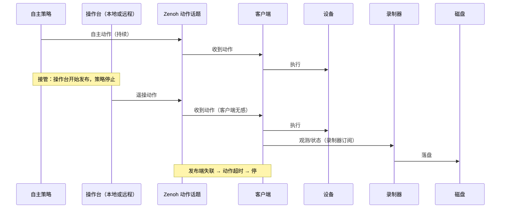

# R2C 遥操与数据采集特性设计

> 本文件负责"基于 r2c 的遥操与数据采集"特性的功能设计；不属于本文件的内容：设备树特性设计见 [PR #1 的 r2c-multi-device-tree-design.md](https://github.com/vincentguiling/cloudrobo-sdk-client/blob/agent/research-r2c-multidevice-d6cf83e2c104/docs/design/r2c-multi-device-tree-design.md)（该文档合入后改为仓库内相对路径），业界调研见 `docs/research/r2c-multi-device-industry-survey.md`，代码现状见 `docs/research/cloudrobo-r2c-codebase-survey.md`。
>
> 状态：**v0.3，待评审**。本版按反馈**整体简化**：遥操统一走 Zenoh 话题（复用 `inference/actions` 或新增 teleop 话题），**客户端不区分本地/远程遥操**；数据采集就是**录制话题**（订阅 → 落盘）；配置收缩到最少。只出设计，不含实现。

## 1. 特性概述

**背景**：本特性的主力场景是**遥操接管**——机器人按云端策略自主执行，遇到异常时由操作员接管处理，处理完交还自主；接管时段是价值最高的训练数据（数据回流配置中 `collect_method` 已有"遥操接管"，`packages/cloudrobo-ingestion/examples/ingestion.yaml`）。现状：r2c 只有整机原始观测录制（`ObservationRecorder` + `--record`，R2CR 格式，cloudroboclient.py:188-193）与回放；遥操在 r2c 之外（LeRobot teleoperate、`--teleop.joint_sign`，robot_a1z_lerobot_v2_config.yaml:106-108）。

**核心思路（本版定调）**：
1. **遥操 = 往动作话题发消息**。客户端只做它本来就会做的事：订阅动作话题 → 下发设备。**本地遥操与远程遥操对客户端完全一样**——区别只在于谁在发布（本机操作台或远端操作员），因此新增能力只有"一个话题"，不是一套本地/远程模式。
2. **采集 = 录制话题**。录制器是普通订阅者：订阅配置的 topic，按时序落盘。不做设备树重建、不做会话编排、不做复杂元数据。
3. **接管 = 发布权交接**。自主策略停止发布、操作台开始发布（或反之），客户端按"最近收到的动作 + 超时保护"执行；不需要客户端理解"接管"这个概念。

**目标**：
- 新增/复用遥操动作话题，客户端统一消费（无本地/远程分支）；
- 录制器支持按 topic 录制、文件轮转、可回放；
- 配置项最小化：客户端侧只需 `teleop.actions_topic`（可默认复用）与 `collection.record/output_dir`；
- 复用现有 Zenoh 传输、QoS、TLS 与凭证体系。

**非目标**（本版本不做）：客户端内建接管状态机与权限体系（由发布端与 Zenoh ACL 承担）；云端 episode 浏览/标注；跨公网低时延优化；多机器人协同。

## 2. 需求分析

### 2.1 需求背景

| 维度 | 现状 | 差距 |
|------|------|------|
| 遥操通路 | 无；遥操在 r2c 外（外部工具） | 需要一条与 action 同构的话题通路，本地/远程共用 |
| 本地 vs 远程 | 概念上被视为两种模式 | 客户端不应区分：同一话题、同一执行路径 |
| 接管 | 无 | 发布权交接 + 客户端超时保护即可，不需要客户端状态机 |
| 采集 | `--record` 录整机原始观测（cloudroboclient.py:415-425） | 需要按 topic 录制（观测/动作/状态都可录），可配置、可轮转 |
| 回放 | playback adapter 回放整机帧 | 录制产物需可按 topic 回放 |
| 配置 | 设备树配置已较丰富 | 遥操/采集不应再叠加大量配置项 |

### 2.2 场景分析

**场景 1：遥操接管（主力）。** 自主策略执行中，操作员在操作台推动主臂。操作台（本地或远端）向动作话题发布 action；策略停止发布。客户端收到 action 即执行。接管时段被录制器完整录下（观测 + 动作），供训练与复现。交还时策略恢复发布，客户端无感切换。

**场景 2：纯遥操教学/采集。** 无自主策略，操作台持续发布 action，录制器记录整段过程。

**场景 3：远程遥操。** 操作员在远端（跨网络），经 Zenoh 发布到同一动作话题；与本地遥操在客户端侧无差别（仅网络时延与 QoS 不同）。

**场景 4：只采集。** 不遥操，录制器订阅运行中设备的 topic（仿真/回放/策略运行）落盘。

**能力矩阵**：

| 需求点 | 现状 | 本特性 |
|--------|------|--------|
| 遥操动作通路 | ✗ | ✔ 复用 `inference/actions` 或新增 `teleop/actions` |
| 本地/远程一致 | 概念上分叉 | ✔ 客户端不区分，同一话题 |
| 接管 | ✗ | ✔ 发布权交接 + 客户端超时保护 |
| 按 topic 录制 | ✗（只录整机观测） | ✔ `collection.record` 列出 topic |
| 录制回放 | 整机帧回放 | ✔ 按 topic 回放 |
| 配置复杂度 | — | ✔ 客户端侧 ≤ 4 个配置项 |

### 2.3 友商分析

| 友商 / 业界实现 | 关键机制 | 启示 |
|----------------|----------|------|
| LeRobot | 主从臂 teleoperate（`lerobot_teleoperate`）、record/replay | 遥操与录制可以很薄：主臂读数直接驱动从臂，录制就是存帧 |
| Viam | 失联即停（session 心跳）；数据 capture 按资源×方法 | 客户端侧只需"超时即停"，不需要复杂接管状态机 |
| ROS 2 + Zenoh | topic → key expression；regex 策略面控频率/QoS | 话题即接口；本地/远程的差别是网络位置，不是客户端模式 |
| Genie Studio / 灵渠 OS | 采集任务与校验在云侧/工具链，端侧薄 | 端侧只负责"发动作、录话题"，编排与校验上移 |

### 2.4 名词解释

| 术语 | 定义 |
|------|------|
| 遥操话题 | 承载遥操动作的 Zenoh topic；复用 `inference/actions` 或新增 `teleop/actions` |
| 发布权交接 | 接管/交还的实现方式：自主策略与操作台谁在往动作话题发布；客户端不感知 |
| 超时保护 | 动作话题超过阈值无消息时停止执行（防止发布端失联导致失控） |
| 录制器（recorder） | 订阅指定 topic、按到达时序落盘的订阅者 |
| R2CR | r2c 落盘格式（magic/version/frame_count/索引），无 pickle（safe_serialization.py） |

## 3. 功能方案

### 3.1 功能约束与依赖

**约束**：
- C1 客户端**不区分**本地/远程遥操：只有一条动作执行路径；
- C2 遥操动作复用 `Actions` 消息与现有 action 话题语义（或新增同构话题），不新造消息类型；
- C3 采集 = 订阅 topic 落盘，不依赖设备树内部结构（但可记录设备树快照作为旁注）；
- C4 配置最小化：客户端新增配置不超过 4 项，其余用默认值；
- C5 兼容：现有 `--record`、R2CR v1 文件、playback 回放保持可用。

**依赖**：
- `transport/zenoh.py`（pub/sub、QoS、TLS）与 `client/session.py`（topic 命名）；
- `Actions` 消息与 `sync_client` 的 action 执行路径（现状已具备）；
- `common/utils/recorder.py` + `safe_serialization.py`（R2CR）；
- Zenoh ACL（谁可以发布到遥操话题，由传输层鉴权，不在客户端做）。

### 3.2 整体方案设计

**技术选型**：

| 选型点 | 决策 | 依据 |
|--------|------|------|
| 遥操通路 | **复用 `inference/actions`**（默认）或新增 `teleop/actions`（需要与策略动作分离时可配） | 客户端动作执行路径现成；消息、QoS、回放全部复用 |
| 本地/远程 | 不区分：谁发布谁负责；本地操作台就是"本机发布者" | 去掉客户端模式分支，配置与代码都最简 |
| 接管 | 发布权交接 + 客户端"动作超时即停"（默认 300ms，可配） | 客户端无需知道接管的存在 |
| 采集 | 录制器订阅 topic → R2CR 文件（按 topic 分文件 + 时间轮转） | 复用现有记录格式与回放；不做会话编排 |
| 上传 | 录制目录交给 `cloudrobo-ingestion` 批量上传（沿用 task_type/collect_method） | 端侧薄、云端编排 |

**整体架构**：

```text
发布端（择一或交接）                        客户端（不区分来源）
  ├── 自主策略 ──┐                        ┌─ 订阅动作话题 ─► 限幅/安全检查 ─► 设备
  ├── 本地操作台 ├─► Zenoh 动作话题 ──────┤
  └── 远程操作员 ┘   {p}/{d}/inference/actions（或 teleop/actions）
                                          └─ 订阅观测/状态话题（录制器）
                                                └─► recordings/<topic>/<ts>.r2cr
                                                      └─►（按批）cloudrobo-ingestion 上传
```

**关键时序**：



### 3.3 详细功能设计

#### 3.3.1 功能原理

- **动作通路**：客户端订阅动作话题（默认 `{project_id}/{device_id}/inference/actions`），收到 `Actions` 后走现有 `translator.r2c_to_device → adapter.send_action`。既有 stale 判定、chunk 对齐、n-skip、fusion 全部继续生效。
- **本地/远程统一**：本地操作台与远程操作员都是"发布者"，客户端不做任何区分；差别只有网络时延与 Zenoh 路由。本地操作台可运行在同一进程（进程内直接调用同一发布接口）或同机另一进程，对客户端仍是同一话题。
- **接管**：发布权交接——策略停止发布、操作台开始发布（或反向）。客户端只做超时保护：超过 `action_timeout_ms`（默认 300ms）未收到动作则停止执行并保持（沿用现有 `action_response_timeout_s` 的思路，独立可配）。是否允许某发布者接管由 Zenoh ACL/凭证控制，客户端不实现权限。
- **采集**：录制器是普通订阅者，按配置的 topic 列表订阅，消息原样落盘（R2CR，按 topic 分文件），支持按大小/时长轮转；可选记录一条设备树快照旁注文件，便于回放时还原设备清单。
- **回放**：按录制文件与 topic 回放；playback 设备类型按 topic 数据注入设备树。

#### 3.3.2 接口设计

**话题清单**：

| 话题 | 方向 | 说明 |
|------|------|------|
| `{p}/{d}/inference/actions` | 发布端 → 客户端 | **复用**：策略动作与遥操动作共用（默认） |
| `{p}/{d}/teleop/actions` | 发布端 → 客户端 | **可选新增**：需要把遥操动作与策略动作分开时使用 |
| `{p}/{d}/inference/observations` | 客户端 → 云/操作台 | 现有；操作台据此看到现场 |
| `{p}/{d}/state/*` | 客户端 → 云 | 现有（joint_states/end_effector_states/localization_states/imu_states/heartbeats） |

**配置（极简，全部有默认值）**：

```yaml
teleop:
  actions_topic: "{project_id}/{device_id}/inference/actions"   # 默认复用；也可填 teleop/actions
  action_timeout_ms: 300                                        # 超时即停（可省略）

collection:
  record: ["inference/observations", "inference/actions", "state/joint_states"]
  output_dir: ./recordings                                      # 相对配置文件目录
```

不配 `teleop`/`collection` 段即为原有行为。

**CLI（在现有 `cloudrobo r2c client` 基础上增加）**：

| 命令/参数 | 说明 |
|-----------|------|
| `--record-topics "inference/observations,inference/actions"` | 命令行录制（等价于 collection.record） |
| `--record-dir <dir>` | 录制目录（等价于 collection.output_dir） |
| `cloudrobo r2c record status` | 录制状态：topic、文件数、大小 |
| `cloudrobo r2c replay <record_dir>` | 按录制文件回放 |

本地遥操操作台与远程操作台都只需"发布到动作话题"；客户端无对应命令。

**界面设计**：无图形界面；录制状态用 CLI 与日志。

#### 3.3.3 数据结构设计

**录制目录约定**：

```text
recordings/
├── inference_observations/2026-11-05T10-00-00.r2cr   # 按 topic 分目录，按时间轮转
├── inference_actions/2026-11-05T10-00-00.r2cr
├── state_joint_states/...
└── meta.json                                          # 可选：设备树快照、配置哈希、录制起止
```

- 文件内容沿用 **R2CR v1**（`safe_serialization.py`：magic/version/frame_count/索引），帧为原始消息字节 + 时间戳；不引入新格式。
- `meta.json` 为可选旁注（不参与回放正确性），用于记录设备清单与配置哈希。
- 轮转策略：按大小（如 512MB）或时长（如 10min）滚动，文件名带起始时间。

## 4. 可靠性与异常设计

| 异常 | 行为 |
|------|------|
| 动作话题超时（默认 300ms） | 停止执行动作并保持；恢复需重新收到动作 |
| 发布端切换（接管） | 客户端无感；以最近动作继续，超时保护兜底 |
| 远程链路抖动 | Zenoh 可靠传输/重连沿用现有；短时抖动由超时保护兜底 |
| 录制磁盘满 | 停止录制并告警，保留已写文件；不删除既有录制 |
| 录制丢帧 | 记录丢帧计数（订阅回调丢弃/队列溢出），写入 meta |
| 进程崩溃 | 已写 R2CR 文件可读（帧边界完整），未完成文件标记 `.partial` |

## 5. 安全设计

- 谁能发布遥操动作由 **Zenoh ACL** 控制（本版不在客户端做权限）；建议策略与操作台使用不同凭证；
- 客户端保留限幅/限速/使能语义（若遥操动作来源于设备树，deadman 由发布端实现；客户端仅做超时即停）；
- TLS/凭证沿用现有 bundle 机制；
- 录制文件路径限制在配置目录内；录制内容不含凭证。

## 6. 性能规格

- 遥操动作：每帧 `Actions` 数十 KB（chunk 大时）；30Hz 场景 ≈ 1MB/s 级，遥操通常 10~30Hz，现有 RELIABLE/REAL_TIME QoS 适用；
- 录制：按 topic 原样落盘，磁盘吞吐为主要瓶颈；相机等大流量 topic 可只录元数据或降低频率（录制器按 topic 独立配置可选）；
- 客户端新增开销：每条动作一次路由判断 + 超时检查，可忽略。

## 7. 兼容性与升级

- 复用动作话题：现有策略与客户端不改即可用；新增 `teleop/actions` 为可选项；
- 现有 `--record` 保留（整机观测录制）；新录制器按 topic 组织，两者可共存；
- R2CR v1 文件与 playback 回放保持兼容；
- 不启用新配置 = 原行为。

## 8. 测试与验收

| 层级 | 内容 |
|------|------|
| 单测 | 话题路由与超时保护、录制器轮转与文件命名、回放解析、meta 生成 |
| 集成（遥操） | 两个发布者（模拟策略 + 模拟操作台）向同一动作话题发布：客户端执行、切换无感、超时停机 |
| 集成（远程/本地一致） | 同一 mock 客户端分别由本机发布者与远程（跨进程/跨节点）发布者驱动，行为一致 |
| 集成（录制/回放） | 录制 observations/actions/joint_states，文件完整、可回放、meta 正确；磁盘满停止录制 |
| 验收标准 | 客户端无本地/远程分支代码路径；动作超时后停止；录制文件可按 topic 回放；配置项不超过 4 个 |

## 9. 遗留问题与后续规划

1. `teleop/actions` 是否长期独立于 `inference/actions`（若独立，需同步客户端订阅与 ACL 配置）；
2. 录制器对大流量 topic（相机）的降频/抽帧策略；
3. 录制文件与 `cloudrobo-ingestion` 的目录/元数据对接细则；
4. 远程遥操的时延测量与跨公网 QoS 调优；
5. 操作台侧工具（主臂/手柄/VR 发布端）与校准。

## 10. 决策点汇总

| # | 决策点 | 状态 / 建议 |
|---|--------|-------------|
| U1 | 遥操复用 `inference/actions` 还是新增 `teleop/actions` | 建议默认复用；需要与策略动作分离时配置切换；待评审 |
| U2 | 接管控制方式 | 建议发布权交接 + 客户端超时即停 + Zenoh ACL；客户端不实现状态机；待评审 |
| U3 | 录制粒度 | 建议按 topic 原样录制（R2CR v1），轮转按大小/时长；待评审 |
| U4 | 配置项范围 | 建议仅 `teleop.actions_topic`/`action_timeout_ms` 与 `collection.record`/`output_dir`；待评审 |
